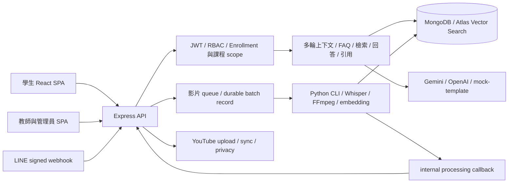

# FocusFlow 現況審查與三週開發 TODO

審查日期：2026/10/13。開發截止：2026/11/2。人力：2 人，搭配 Codex／Claude Code 等 AI coding agent。

基準：`feat/adaptive-genui`，HEAD `966f34b7cbaf446a7b6975b7e7dffc56d3af3e84`。開始審查時工作目錄乾淨。本次僅新增這份分析文件，沒有修改功能程式、安裝依賴、啟動服務、執行測試、連接資料庫或呼叫外部 provider。

**建議交付目標：先完成可驗收的 Web 教學影片問答主線。** 本專案已有大量功能；接下來三週最有價值的工作是補穩定性、安全邊界與驗收證據。完整 Adaptive GenUI、自動產片、個人化推薦及全面架構改造不宜同時排入。

## 閱讀範圍、證據與估算規則

本次包含 `README.md`、`AGENTS.md`、架構與各子系統入口文件，並對下列原始碼進行全域檔案／函式／契約掃描，詳讀核心與高風險流程。以下計數是目前 checkout 的靜態檔案計數，不是測試結果或覆蓋率。

| 範圍 | 原始碼檔案數 | 行數 | 審查重點 |
|---|---:|---:|---|
| `backend/src/` | 172 | 31,092 | routes、controllers、services、models、middleware、config、管理與診斷 scripts |
| `backend/scripts/` | 5 | 1,669 | QA／多模態評測及輔助工具 |
| `frontend/focus-flow/src/` | 53 | 13,134 | React 頁面、元件、CSS、API、session、上傳與引用操作 |
| `STT_Whisper/src/` | 32 | 9,587 | STT、正規化、切段、embedding、publication、batch、resume |
| `database/tools/` | 12 | 1,652 | 初始化、indexes、目前 uploader、legacy 與修復工具 |
| **合計** | **274** | **57,134** | 不含第三方依賴、二進位素材及生成輸出 |

另盤點 Backend 90 個、Frontend 11 個、Pipeline 16 個測試檔，檢視 harness、案例與隔離方式，以及 package／lockfile、OpenAPI、部署 workflow、Adaptive GenUI 任務狀態。這是跨模組靜態審查，**不宣稱逐行精讀了全部 57,134 行及所有歷史文件／測試內容**；未啟動專案，因此也不宣稱已重現以下問題。歷史交付圖稿、archive、影片、模型、outputs、uploads、venv、node_modules 不作目前功能可用性的證據。

證據標記：

- **程式碼可確認**：存在的邏輯、端點、欄位、預設值或未實作接點。
- **靜態風險**：從控制流程可推得的失敗／並行情境，尚未執行重現。
- **待確認**：部署設定、Atlas 真實資料／index、provider 可用性、實際延遲、模型品質、使用者需求及團隊可投入時間。
- 文件提及的部署、歷史測試通過與 live smoke，均不當成本輪已驗證結果。

工作量以**人時**估算，含 AI 產碼後的人工審查、必要測試、文件契約及整合；不是 AI 執行時間。S 約 2–5 小時，M 約 6–12 小時，L 約 13–28 小時；更大工作列出總區間。這些是審查者的規劃估算，實際吞吐量待確認。P0 代表核心缺陷／交付缺口；P1 代表重要改善；P2 代表加分功能。P0 與 Must 的差異在於**本次實際交付範圍**：功能若延期，必須明確停用或移出交付承諾，不能留下缺陷卻宣稱驗收完成。

## 第一部分：現況評估

### 專案目的與技術棧

FocusFlow 將教師的教學影片轉為可檢索教材，讓學生在 Web 或 LINE 提問，取得答案、來源片段及影片時間點。教師管理課程／修課名單／影片；管理員管理帳號、公告、回報與服務狀態。

| 區域 | 程式碼中的技術 | 主要入口與證據 |
|---|---|---|
| 前端 | React 19、Vite 8、JavaScript／JSX、Three.js、GSAP、QRCode | `frontend/focus-flow/package.json`、`src/main.jsx`、`src/App.jsx`、`src/AdminApp.jsx` |
| 後端 | Express 4、Mongoose 8、MongoDB driver、JWT、bcryptjs、Multer、Nodemailer | `backend/package.json`、`src/server.js`、`src/app.js` |
| AI pipeline | Python、Faster-Whisper、FFmpeg、yt-dlp、Google GenAI、rapidfuzz、PyMongo | `STT_Whisper/requirements.txt`、`src/main.py`、`src/batch_main.py` |
| 資料與搜尋 | MongoDB、Atlas Vector Search、3072 維 stable Gemini embedding 契約 | `backend/src/models/`、`embeddingContract.service.js`、`STT_Whisper/src/embedding_contract.py` |
| 測試／文件 | `node:test`、Python `unittest`、ESLint、OpenAPI／Redocly | 各子系統 `tests/`、`backend/docs/openapi.yaml`、各 `package.json` |
| 部署設計 | self-hosted GitHub Actions、PM2、nginx、VM 既有目錄就地更新 | `.github/workflows/deploy.yml`；目前 VM 實際版本及設定待確認 |

本地 lockfile 的 Vite `8.0.5` 宣告 Node `^20.19.0 || >=22.12.0`，MongoDB driver `7.1.1` 宣告 Node `>=20.19.0`；根 README 的「Node.js 18+」已不足以描述目前安裝需求。這是 lockfile 證據，未查外部版本或漏洞資料。

### 架構概覽

- Backend 主要依 `routes → controllers → services → models` 分層；少數統計端點直接在 route 中編排 service，但主架構可理解。
- 前端以 React state 搭配自製 URL routing，session 及上傳追蹤使用 localStorage；沒有引入大型狀態管理框架。這本身不是缺陷，問題是個別頁面的請求與錯誤生命週期不一致。
- QA 先檢查修課／課程權限與 canonical video allowlist，再走 FAQ、query embedding、Leaf／可選 Parent 檢索及回答生成；後端將模型選取的證據映射為 citations。
- Pipeline 是 Backend spawn 的 Python CLI，產出版本化 artifacts、寫入 MongoDB，再回報 processing 狀態；不是獨立佇列服務。單支與批次模式的恢復能力不同。
- 目前保留 App-owned／pipeline metadata 相容，以及 camelCase text segments／snake_case visual segments 兩套邊界。相容層有用途，不宜在截止前全面拆 collection。
- 三週內應保留目前模組化單體與 CLI 架構，集中修復邊界；沒有程式碼或負載證據支持立即改成微服務、Redis queue、全站 TypeScript 或更換資料庫。

### 已實作功能清單

「已實作」僅表示程式路徑存在。所有項目的部署可用性、真實 provider 品質及正式人工驗收均待確認。

| 功能 | 已存在的內容 | 主要檔案 |
|---|---|---|
| 登入與角色 | JWT、bcrypt、student／teacher／admin、學生自助註冊、帳號停用、登入失敗鎖定 | `backend/src/services/auth.service.js`、`loginThrottle.service.js`、`middleware/auth.middleware.js`、`role.middleware.js` |
| 個人資料 | 姓名／Email／密碼修改、需授權讀取的頭像、session restore | `backend/src/services/avatar.service.js`、`utils/publicUser.js`；`frontend/focus-flow/src/pages/Profile.jsx`、`authSession.js` |
| 忘記密碼 | Email 六位碼、hash、期限、重送間隔、錯誤次數 | `backend/src/services/passwordReset.service.js`、`mailer.service.js`；`ForgotPasswordModal.jsx` |
| 課程管理 | 建立、查詢、修改、發布／封存、刪除、管理員改派教師 | `backend/src/routes/course.routes.js`、`services/course.service.js`；`TeacherCourses.jsx`、`AdminCourses.jsx` |
| 修課名單 | Email 指派、CSV 匯入學生帳號及修課、撤銷、保留進度、Web／LINE 存取檢查 | `backend/src/services/enrollment.service.js`、`courseAccess.service.js`、`models/enrollment.model.js`；`EnrollmentManagerModal.jsx` |
| 影片管理 | 本機上傳、容器檢查、檔案 hash 去重、YouTube URL API、跨課程掛載與解除、刪除 | `backend/src/services/video.service.js`、`mediaIntegrity.service.js`、`routes/video.routes.js`；`TeacherUpload.jsx` |
| 多檔與處理追蹤 | 真正的 `/video-batches` API、持久化批次項目、部分失敗回傳、重試、前端重新整理恢復追蹤 | `backend/src/services/videoBatch.service.js`、`videoProcessingQueue.service.js`、`videoBatchProcessing.service.js`、`videoBatchReconciliation.service.js`；`frontend/focus-flow/src/services/videoUpload.js` |
| STT 與 artifacts | FFmpeg／yt-dlp、Whisper、明確字典正規化、chunk overlap、embedding retry／checkpoint、manifest／summary | `STT_Whisper/src/main.py`、`transcribe.py`、`normalize_transcript.py`、`chunking.py`、`embedding.py`、`job_manager.py`、`resume_checkpoint.py` |
| Pipeline publication | stable Leaf 契約驗證、bulk upsert、target video 防護、部分失敗 summary；Parent artifact／embedding／publication 工具 | `STT_Whisper/src/mongodb_uploader.py`、`parent_embedding.py`、`parent_mongodb_uploader.py`、`publish_parent_embeddings.py` |
| 教材問答 | course-scoped 檢索、memory／Atlas 分流、Gemini／OpenAI／template adapter、結構化證據 ID、無答案引用清空 | `backend/src/services/qa.service.js`、`queryEmbedding.service.js`、`answerGeneration.service.js`、`bridgeScope.service.js` |
| FAQ | exact／semantic cache、答案證據 provenance、scope revalidation、影片異動 invalidation、常見問題 API | `backend/src/services/faqCache.service.js`、`models/faq.model.js`、`controllers/faq.controller.js` |
| Web 多輪問答 | course-scoped conversation、訊息保存、追問改寫、失敗回答重試、歷史來源 | `backend/src/services/conversation.service.js`、`contextualQuestion.service.js`、`models/message.model.js`；`StudentCourses.jsx`、`qaConversationUtils.js` |
| 影片學習工作區 | YouTube／本機播放、引用展開、timestamp 跳轉、播放／問答分欄、觀看達門檻記錄 | `frontend/focus-flow/src/pages/StudentCourses.jsx`；`backend/src/services/course.service.js` |
| 額度與紀錄 | Web／LINE 共用字數與每日成功提問限制、個別學生 override、估算月 token quota、Question／UsageLog | `backend/src/services/askLimits.service.js`、`costControl.service.js`、`questionRecording.service.js`、`usageLog.service.js` |
| LINE | raw-body HMAC 驗簽、一次性綁定碼、切課程、多輪 history、loading animation、reply 失敗後部分 Push 退化 | `backend/src/services/line.service.js`、`controllers/line.controller.js`、`middleware/lineSignature.middleware.js`；`StudentLineBot.jsx` |
| 通知與問題回報 | 站內通知、已讀／全讀、公告、影片完成通知；分類／嚴重度／截圖附件／管理處理 | `backend/src/services/notification.service.js`、`feedback.service.js`；`Topbar.jsx`、`IssueReportLauncher.jsx`、`AdminFeedback.jsx` |
| 統計與維運 | 三角色 dashboard、使用者管理、每日額度調整、服務狀態、試用彙總 report CLI | `backend/src/services/teacherStats.service.js`、`admin.service.js`、`systemStatus.service.js`、`pilotUsageReport.service.js`；各 Dashboard／Admin 頁面 |
| YouTube 整合 | OAuth upload、有限重試／recovery、retry safety、刪除後轉 private、metadata sync | `backend/src/services/youtubeUpload.service.js`、`shortsSync.service.js` |
| 短影音 | 學生唯讀已修且已發布課程的 ShortAsset feed、cursor；選題、凍結證據、生成腳本、版本、教師審核、成品上傳與發布邏輯 | `backend/src/services/shortAsset.service.js`、`shortScript.service.js`、`shortScriptGeneration.service.js`、`shortAssetPublish.service.js`；`TeacherShortScripts.jsx`、`TeacherVideoReview.jsx`、`StudentShortsWall.jsx` |
| 開放教材推薦 | 關鍵字索引／IDF 排序、最多三筆、來源／授權文字、與課程回答分開 | `backend/src/services/openDataExtension.service.js`、`models/openEduVideo.model.js`；`frontend/focus-flow/src/utils/extendedResources.js` |
| 分層／視覺檢索 | Parent adapter、Child Expansion、rollout allowlist／readiness、Leaf fallback；visual citation 支線 | `backend/src/services/hierarchicalRetrieval.service.js`、`hierarchicalDataReadiness.service.js`、`parentSearch.service.js`、`childExpansion.service.js`、`qa.service.js` |
| 文件與評測工具 | OpenAPI route inventory 檢查、QA／retrieval runner、ground truth、隔離與唯讀角色檢查 | `backend/tests/docs.routes.test.js`、`tests/helpers/expressRouteInventory.js`、`src/scripts/phase2_2_hierarchical_e2e_runner.js`、`scripts/evaluateMultimodalRetrieval.js` |

### 不能算成完成的項目

- Adaptive GenUI：目前只有計畫／harness，`docs/30_Features/Adaptive_GenUI/tasks.json` 的 35 項任務全部 `todo`，未找到正式 Renderer／Planner／interaction service 的功能接線。
- `HIERARCHICAL_RETRIEVAL_ENABLED`、`VIDEO_BATCH_PIPELINE_ENABLED`、`SHORT_SCRIPT_AUTOMATION_ENABLED`、`OPEN_DATA_EXTENSION_ENABLED` 的程式預設均為 false；真實 runtime 值待確認。不是所有短影音讀取／審核端點都受腳本開關控制。
- 影片 visual embedding 不等於可回答畫面語意的完整多模態 QA；目前生成答案主要依 transcript，visual 路徑提供引用／片段建議。
- 未找到 FocusFlow 呼叫 ComfyUI／MiniMax 產片的程式接線。外部人工產片流程待確認，不能計為系統整合完成。
- 管理員有修改使用者角色 API，沒有直接建立教師帳號的專用 API／UI；學生註冊後由管理員升為教師是程式上可組成的替代流程，其是否為團隊正式操作規範待確認。
- 教師前端目前使用本機檔案上傳，YouTube URL API 雖存在，未在 TeacherUpload 提供同等操作入口。

### 整體評價：各三點

**成熟度**

1. **功能面達到具體 MVP／試用系統的程度。** 身分、修課、教材處理、問答、引用與維運都有可追蹤程式路徑，不是只有展示 UI。
2. **工程面仍需可靠性收斂。** 併發額度、token 撤銷、單支處理完成確認、LINE 事件重送及錯誤呈現存在可辨識風險。
3. **品質／交付面尚不能確認正式就緒。** 測試檔與評測工具豐富，但本輪沒有執行；瀏覽器、真實模型、active vectors、VM 設定及人工驗收均待確認。

**最大優勢**

1. **教材引用是架構的一部分。** `supportingEvidenceIds`、canonical video scope、FAQ provenance、無答案引用清空，比單純把檢索結果全部顯示更有教學價值。
2. **角色與營運流程已具規模。** 修課撤銷、匯入、額度 override、問題回報、通知與管理頁面能支援小規模試用，三週內不必重新建立基本 CRUD。
3. **具備可隔離的 provider／測試／feature flag 邊界。** mock／template、read-only runners、default-off 擴充及 batch artifacts，有利於兩人搭配 AI 分工與逐項驗收。

**最大問題**

1. **資料及事件成功狀態缺少一致保證。** 回呼失敗、程序中斷、重送、額度記錄失敗與多步刪除，可能造成 UI／DB／外部副本不同步。
2. **功能深度超過現有整合保障。** 大型 QA service／頁面、不同 upload client、silent catch 與以 mock 為主的測試，使功能數增加時更容易出現跨模組回歸。
3. **期限內的範圍必須收斂。** GenUI、Parent rollout、視覺 QA、短影音產線都有額外資料／人工／provider 相依；AI 產碼不能消除這些成本。

## 第二部分：功能與優化盤點

每項核取方塊代表「建議後續工作」，不是本輪已授權實作。相依中的 D 編號見第三部分決策表。

### 1. 前端

- [ ] **FE-01｜【優化】P0｜核心頁面錯誤、重試與請求競態。**
  - 證據／價值：StudentCourses 的課程／影片讀取、TeacherDashboard 及多個 Admin 頁面吞掉錯誤，網路失敗可能被顯示成「沒有資料」；`openCourse()` 未辨識過期請求，快速返回再開別課程時可能被舊結果覆寫。修復能避免學生誤認沒有修課或教材。
  - 範圍：課程、影片、上傳追蹤優先；核心 mutation 失敗應保留輸入及顯示原因。沿用 Profile 已有的 AbortController／request generation 手法。
  - 檔案：`frontend/focus-flow/src/pages/StudentCourses.jsx`、`TeacherCourses.jsx`、`TeacherUpload.jsx`、`TeacherDashboard.jsx`、`AdminUsers.jsx`、`AdminFeedback.jsx`。
  - 工作量：M，核心最小版 8–12 小時；所有管理頁完全統一另需 4–6 小時，屬 Should。相依：AI-01 錯誤碼、BE-02 session contract。方式：【適合交給 AI agent】，由人工核對互動結果。
  - 驗收：離線／401／403／5xx 分別可辨識；重試能恢復；較早請求不覆寫新課程；不把 403 當成無影片。

- [ ] **FE-02｜【新增功能】P1｜顯示有效提問額度及重置時間。**
  - 證據／價值：StudentCourses 寫死 50 字／每日 5 次，後端支援環境設定及個人 override；學生無法提前知道當日剩餘次數。應由後端提供有效限制，避免 UI 與管理員設定矛盾。
  - 檔案：`frontend/focus-flow/src/pages/StudentCourses.jsx`、`backend/src/services/askLimits.service.js`、`utils/publicUser.js`、`routes/qa.routes.js`、`backend/docs/openapi.yaml`。
  - 工作量：M，6–10 小時（含 API）。相依：BE-03、D-05；不能為此重做整個 quota。方式：【適合交給 AI agent】。驗收：一般／override／不限次數／臺灣午夜重置正確，LINE 失敗訊息同語意。

- [ ] **FE-03｜【優化】P1｜統一 API timeout、session 失效事件及頁面錯誤邊界。**
  - 證據／價值：`apiFetch()` 支援傳入 signal，但沒有預設 deadline 或全域 401 處理；session restore 只解決重新開啟時的驗證。DashboardRouter 沒有 ErrorBoundary，元件 runtime exception 可影響整個工作區。
  - 檔案：`frontend/focus-flow/src/api.js`、`authSession.js`、`components/DashboardApp.jsx`、`services/videoUpload.js`、`services/shortScript.js`。
  - 工作量：M，6–10 小時。相依：AI-01；BE-02 所需的「改密碼後重新登入」最小接線已計入 BE-02，不重複估時。方式：【適合交給 AI agent】。驗收：一般 403 保留登入；401 引導登入；5xx 不清除合法 session；上傳不誤套 QA deadline；錯誤邊界可重試。

- [ ] **FE-04｜【優化】P1｜影片播放錯誤與降級入口。**
  - 證據／價值：YouTube IFrame loader Promise 沒有 script error／timeout reject，播放器沒有完整錯誤呈現。腳本被擋、影片 private／removed 或本機串流失效時，學生可能只看到空播放器。
  - 檔案：`frontend/focus-flow/src/pages/StudentCourses.jsx` 的 `loadYouTubeIframeApi()`／`YouTubePlayer()`，`StudentShortsWall.jsx`。
  - 工作量：S，3–5 小時。相依：BE-01、D-04。方式：【適合交給 AI agent】。驗收：顯示播放失敗原因、可重新載入；僅在有有效授權／合法來源連結時提供替代入口。

- [ ] **FE-05｜【優化】P1｜縮小首次載入與動畫負擔。**
  - 證據／價值：DashboardApp 靜態 import 全部角色頁面，App 靜態 import 動畫／登入頁；Three.js／GSAP 與大型教師頁可能增加初始 bundle。實際 bundle 大小及裝置效能待確認。
  - 檔案：`frontend/focus-flow/src/components/DashboardApp.jsx`、`App.jsx`、`components/BubbleScene.jsx`、`LiquidGradientBg.jsx`、`vite.config.js`。
  - 工作量：M，6–10 小時。相依：先有本地 build／裝置量測，CO-01。方式：【適合交給 AI agent】。驗收：按角色／頁面 lazy load；保留載入與錯誤狀態；CSS 已有 reduced-motion 規則，另確認 JS 動畫是否跟隨偏好。

- [ ] **FE-06｜【優化】P1｜限縮式拆分大型頁面與共用 UI。**
  - 證據／價值：StudentCourses 1,126 行、TeacherShortScripts 1,185 行、TeacherCourses 804 行，混合資料存取、播放器、對話、modal 與樣式；`lineMessageUrl()`、API base、modal／狀態樣式存在重複。
  - 檔案：上述三頁、`frontend/focus-flow/src/pages/StudentLineBot.jsx`、`services/videoUpload.js`、`services/shortScript.js`、`hooks/useModalDialog.js`。
  - 工作量：L，14–22 小時。相依：核心 bug 已固定、CO-01；本次只抽取被修改的邏輯，全面拆分 Later。方式：【適合交給 AI agent】，人工決定責任邊界。驗收：引用／seek／重試行為不變，沒有兩人同時修改同一頁。

- [ ] **FE-07｜【優化】P1｜核心工作區鍵盤與手機檢查。**
  - 證據／價值：已有 media queries、部分 dialog hook；部分可點擊 div／span 與獨立 modal 未使用相同焦點管理，不能從 CSS 判定手機／鍵盤完整可用。
  - 檔案：`frontend/focus-flow/src/pages/StudentShortsWall.jsx`、`StudentCourses.jsx`、`AdminUsers.jsx`、`components/EnrollmentManagerModal.jsx`、`hooks/useModalDialog.js`、`index.css`。
  - 工作量：M，6–10 小時。相依：CO-02 真實頁面驗收。方式：【需人工主導】，AI 可修 semantic HTML／focus trap。驗收：Tab、Enter、Escape、焦點返回、窄螢幕的播放／提問／引用三項操作可完成。

- [ ] **FE-08｜【優化】P1｜移除未有證據的首頁效能數字。**
  - 證據／價值：App 寫死「問答準確率 98%」「平均回應時間 <3s」，QAPanel 卻提示通常 10–20 秒；程式碼沒有提供這兩個首頁數字的統計依據。避免錯誤期待與驗收爭議。
  - 檔案：`frontend/focus-flow/src/App.jsx`、`pages/StudentCourses.jsx`。
  - 工作量：S，2 小時。相依：D-01；若要展示數字，須先有 CO-02 測量。方式：【需人工主導】，AI 修改文案。驗收：改為可證明的產品敘述或附明確資料集／量測日期，不用命中率冒充答案正確率。

- [ ] **FE-09｜【新增功能】P2｜對話重新命名、封存與刪除入口。**
  - 證據／價值：已有 conversation list／restore／create／retry，沒有 rename／archive／delete route；長期使用難整理歷史。
  - 檔案：`frontend/focus-flow/src/pages/StudentCourses.jsx`、`backend/src/routes/conversation.routes.js`、`services/conversation.service.js`、`models/conversation.model.js`。
  - 工作量：M，8–12 小時。相依：BE-07 分頁、D-06 資料保留政策。方式：【適合交給 AI agent】。驗收：只能操作本人對話，撤銷修課後不得藉此讀到教材。

- [ ] **FE-10｜【新增功能】P2｜回答有幫助／來源不符回饋。**
  - 證據／價值：已有一般問題回報，缺少直接連到 message／citation 的教學品質回饋；有助找出檢索／生成／來源跳轉問題。
  - 檔案：`frontend/focus-flow/src/pages/StudentCourses.jsx`、`backend/src/models/message.model.js`、`feedback.model.js`、`services/feedback.service.js`。
  - 工作量：M，8–12 小時。相依：AI-02、D-06。方式：【需人工主導】分類與用途，AI 可實作表單／CRUD。驗收：回饋綁定訊息與證據，不把「按讚」當作答案正確性的充分證據。

### 2. 後端

- [ ] **BE-01｜【優化】P0｜教材媒體存取授權及下架後拒絕存取。**
  - 證據／價值：`app.js` 直接 `express.static(env.uploadDir)`，`video.service.js` 回傳 `/uploads/<filename>`；讀取不經 JWT／Enrollment。`deleteVideo()` 刪 DB 與索引而未在此路徑清除原始上傳檔，若副本仍在則舊 URL 可繼續提供。VM nginx 是否另封鎖此路徑待確認。
  - 檔案：`backend/src/app.js`、`services/video.service.js`、`services/courseAccess.service.js`、`routes/video.routes.js`；`frontend/focus-flow/src/pages/StudentCourses.jsx`。
  - 工作量：M，8–12 小時（限定本機教材的串流入口）；大型 object storage／DRM Later。相依：D-04、CO-01；需提供 Range 與播放器相容的授權方案，不能把整支影片抓成記憶體 Blob 當通用解法。
  - 方式：【需人工主導】存取設計，AI 實作 handler／契約／測試。驗收：匿名、未修課、撤銷、課程下架、影片刪除皆不能取得本機媒體；合法播放／seek 可用。YouTube unlisted 連結外流是另一邊界，不能用這項修復宣稱已解決。

- [ ] **BE-02｜【優化】P0｜密碼變更後撤銷 JWT、重設碼原子消耗。**
  - 證據／價值：JWT 只含 `sub`，預設 7 天；authenticate 不比對 token version／password-change time，改密碼或重設密碼只改 hash，舊 token 仍可驗證。重設 attempts／成功消耗採 read → write，並行請求可能覆寫計數或重複通過。
  - 檔案：`backend/src/services/auth.service.js`、`passwordReset.service.js`、`middleware/auth.middleware.js`、`models/user.model.js`；`frontend/focus-flow/src/pages/Profile.jsx`、`authSession.js`、`api.js`。
  - 工作量：M，8–12 小時。相依：先定舊 token 遷移與重新登入語意；CO-01 隔離 Mongo 驗證。方式：【適合交給 AI agent】，人工審查安全語意。驗收：成功改／重設後舊 token 失效、驗證碼只能消耗一次、並行錯碼不遺失計數；已有 hash／TTL／timingSafeEqual 保護要保留。

- [ ] **BE-03｜【優化】P0｜提問額度原子預留與重送去重。**
  - 證據／價值：`assertDailyAskAvailable()` 只查完成的 Questions，`assertQaQuotaAvailable()` 只查 UsageLog，再於回答後記錄；同時 Web／LINE 請求可以都通過。`recordQuestion()`／`recordUsage()` 吞掉寫入錯誤，使「紀錄＝額度帳本」更不可靠。
  - 檔案：`backend/src/services/askLimits.service.js`、`costControl.service.js`、`conversation.service.js`、`qa.service.js`、`questionRecording.service.js`、`usageLog.service.js`、`line.service.js`。
  - 工作量：L，10–16 小時（單 process 交付仍需 DB 原子條件；跨 VM 的完整 queue Later）。相依：D-05、AI-01、CO-01；新增持久化帳本／index 需先定 schema，Shared Atlas rollout 另行授權。
  - 方式：【需人工主導】預留／釋放／失敗計費政策，AI 實作。驗收：同一請求只呼叫一次模型；跨入口併發不超每日額度；成功／無答案／失敗／timeout 的計數符合政策；寫入失敗有可觀測結果。

- [ ] **BE-04｜【優化】P0｜單支 pipeline 完成確認與中斷恢復。**
  - 證據／價值：Python `notify_backend()` 回呼失敗只 warning；正常 exit 的 lifecycle 不確認 DB 最終狀態；`recoverQueuedVideoProcessing()` 只查 queued。故單支預設路徑可能「資料已寫入但仍 processing」，或重啟後卡住。Batch reconciliation 已存在，但預設開關 false，不能假設會補救單支路徑。
  - 檔案：`STT_Whisper/src/main.py`、`job_manager.py`、`resume_checkpoint.py`；`backend/src/services/sttProcessLifecycle.service.js`、`video.service.js`、`videoProcessing.service.js`、`videoBatchReconciliation.service.js`、`models/video.model.js`。
  - 工作量：L，10–16 小時。相依：D-03、CO-01；本次只選一條主要執行模式收斂。方式：【需人工主導】狀態／job identity／恢復設計，AI 補對應實作與失敗測試。
  - 驗收：回呼丟失、backend 重啟、child 正常退出／異常退出都能收斂到明確終態；同一 video 不同時被兩個 executor 接手；不要僅按超時直接判失敗而打斷仍正常跑的長影片。

- [ ] **BE-05｜【優化】P0（若交付 LINE）｜Webhook 先可靠收件，再處理與去重。**
  - 證據／價值：controller `await processWebhookEvents()` 後才回應；service 逐件等待 QA，沒有 webhook event ID 的持久化去重。長回應／平台重送可能重複模型費用、扣額度或送答案；真實重送設定及發生頻率待確認。
  - 檔案：`backend/src/controllers/line.controller.js`、`services/line.service.js`、`routes/line.routes.js`、`models/lineBindToken.model.js`、`src/server.js`。
  - 工作量：L，16–24 小時，另需 4–8 小時送達／重啟驗收。相依：BE-03、AI-01、D-02；建議 Mongo 持久收件＋有限 worker，先不引入 Redis。單純 `res.send()` 後 fire-and-forget 不能算可靠完成。
  - 方式：【需人工主導】，AI 可補 event receipt、claim、重送／restart 測試。驗收：回應不等待 AI、同 event 不重複執行、重啟可恢復、合法簽章仍必須、reply／push 失敗有狀態；綁定碼也需原子消耗。

- [ ] **BE-06｜【優化】P1｜收斂輸入型別、長度及高成本端點節流。**
  - 證據／價值：已有多項手寫驗證，但 QA controller 直接解構 body 並將 object 轉字串，Admin `isActive` 用 Boolean 轉換，部分字串缺上限；register／reset 無共用 request rate limit。登入 email Map 只在達門檻時清過期項，不是嚴格容量上限。
  - 檔案：`backend/src/controllers/qa.controller.js`、`admin.controller.js`、`services/admin.service.js`、`auth.service.js`、`loginThrottle.service.js`、`passwordReset.service.js`、`src/app.js`。
  - 工作量：M，8–12 小時。相依：D-05、代理來源信任設定待確認。方式：【適合交給 AI agent】。驗收：null／array／object／布林字串／超長欄位都回可預期 4xx；保留既有學生註冊及角色白名單，不在本次全站換 validator 框架。

- [ ] **BE-07｜【優化】P1｜真正 DB 分頁與查詢投影。**
  - 證據／價值：admin users／videos、course／conversation／messages 多處全量讀取；Feedback service 在讀全部項目後才 slice；TeacherCourses 對每門課另查 videos，課程 presentation 也逐課載入。資料成長將增加網路／記憶體與查詢數。
  - 檔案：`backend/src/services/admin.service.js`、`feedback.service.js`、`course.service.js`、`conversation.service.js`、`teacherStats.service.js`；`frontend/focus-flow/src/pages/TeacherCourses.jsx`、`AdminFeedback.jsx`。
  - 工作量：L，14–22 小時。相依：CO-01 真實隔離查詢、前後端分頁契約；先挑最常用清單。方式：【適合交給 AI agent】。驗收：在 DB 做 limit／cursor／必要 count，非全部讀完再 slice；只取需要欄位；無跨課程資料擴權。

- [ ] **BE-08｜【優化】P1｜Index／collection 契約與啟動 migration 隔離。**
  - 證據／價值：Mongoose schema、DB init tools、兩套 uploader 各維護契約；Question `sourceUsageLogId` 同時宣告 sparse／partialFilterExpression，需用隔離 Mongo 檢查 index 建立相容性；`server.js` 每次啟動都執行 `migrateVideoFields()`，connect 未明確停用 autoIndex。這些不受 memory harness 驗證。
  - 檔案：`backend/src/models/question.model.js`、`videoSegment.model.js`、`videoSegmentParent.model.js`、`src/config/database.js`、`services/videoMigration.service.js`、`src/server.js`、`database/tools/setup/init_indexes.js`、`database/tools/mongodb_uploader.py`。
  - 工作量：M，8–12 小時。相依：D-03、CO-01；正式 index 狀態待確認。方式：【需人工主導】契約及 migration rollout，AI 產出比對／隔離檢查。驗收：一份可追溯 index manifest；啟服無未批准的 schema migration；必要 index 先驗證再發布。

- [ ] **BE-09｜【優化】P1｜刪課／刪影片一致性及外部失敗補償。**
  - 證據／價值：course delete 先刪 segments／videos／enrollments 等，最後才刪 Course，只 rollback ShortAsset archive；YouTube 轉 private 失敗也可能留下副本。Parent／其他歷史參照沒有統一清理政策。途中出錯可能留下「課程存在、影片已消失」。
  - 檔案：`backend/src/services/course.service.js`、`video.service.js`、`shortAsset.service.js`、`youtubeUpload.service.js`、`models/videoSegmentParent.model.js`。
  - 工作量：L，16–24 小時。相依：BE-01、D-06；若未完成，交付前限制 destructive 操作並提供管理作業單。方式：【需人工主導】transaction／soft-delete／補償選擇，AI 實作。驗收：中途失敗可重試、可辨識半完成、外部副本失敗可追蹤，不承諾 DB transaction 能回滾 YouTube。

- [ ] **BE-10｜【新增功能】P1｜受控教師帳號建立與首次改密碼。**
  - 證據／價值：沒有專用教師建立 API；名單匯入以學號為初始密碼，沒有 first-login change flag。減少人工升權與可預測初始密碼的長期使用風險。
  - 檔案：`backend/src/routes/admin.routes.js`、`services/admin.service.js`、`enrollment.service.js`、`models/user.model.js`；`frontend/focus-flow/src/pages/AdminUsers.jsx`、`Profile.jsx`。
  - 工作量：L，14–20 小時。相依：BE-02、D-05。方式：【需人工主導】帳號發放政策，AI 補 CRUD。驗收：僅管理員可建立教師、沒有公開 teacher sign-up；一次性初始憑證／必要改密碼有明確流程。若只用現有帳號完成展示，可延期。

- [ ] **BE-11｜【優化】P1｜觀看進度的並行與統計語意。**
  - 證據／價值：markVideoWatched 讀取 Set 再 `$set`，不同影片並行可能遺失一筆；前端到 80% 播放位置就視為看過，拖曳也可能達門檻。Student stats 的平均進度以前六門 courseList 計算，課程更多時不等於全課平均。
  - 檔案：`backend/src/services/course.service.js`、`teacherStats.service.js`、`models/enrollment.model.js`；`frontend/focus-flow/src/pages/StudentCourses.jsx`、`StudentDashboard.jsx`。
  - 工作量：M，6–10 小時。相依：D-06 指標定義；先做原子 `$addToSet` 及平均分母。方式：【適合交給 AI agent】，人工決定「觀看」是否代表學習完成。驗收：兩片並行標記均保留；平均值分母一致；不把播放位置當作理解程度。

### 3. AI 功能

- [ ] **AI-01｜【優化】P0｜Provider deadline、取消、有限重試及輸出上限。**
  - 證據／價值：answerGeneration、queryEmbedding、shortScriptGeneration 的 fetch 沒有 AbortSignal／明確 deadline；生成未設定輸出 token 上限。Gemini 雖有 template fallback，必須等請求失敗才進退化；無回應時可一直等待。Python 有 embedding 重試，不等於所有 provider 都有 deadline。
  - 檔案：`backend/src/services/answerGeneration.service.js`、`queryEmbedding.service.js`、`shortScriptGeneration.service.js`、`line.service.js`；`STT_Whisper/src/embedding.py`、`extract_audio.py`。
  - 工作量：M，核心 QA 最小版 8–12 小時；短影音／全部媒體程序另 4–8 小時，Should／Later。相依：BE-03、FE-01、D-05。
  - 方式：【適合交給 AI agent】，人工核對 provider error／fallback 語意。驗收：query／answer 有個別及總 deadline、遲到結果不追加、429／5xx 只做有限重試、template 退化明確顯示；非冪等上傳不能盲目 retry。

- [ ] **AI-02｜【優化】P0｜固定教材 QA 品質與拒答驗收。**
  - 證據／價值：已驗證 ID 合法性，但沒有程式能單憑 ID 證明每個 claim 都由該片段支持；一般 Top-K 也不能證明整門課完整覆蓋。要把模型說得通順與教材答得正確分開驗收。
  - 檔案：`backend/src/services/answerGeneration.service.js`、`qa.service.js`、`contextualQuestion.service.js`、`data/studentPilotRetrievalGroundTruth.js`、`src/scripts/phase2_2_hierarchical_e2e_runner.js`、`tests/citation-contract.test.js`、`tests/contextualization-evaluation.test.js`。
  - 工作量：M/L，12–18 小時，**已包含在 CO-02 驗收包，不另外加總**。相依：D-01 教材、AI-01、D-05 模型費用／人工評者。方式：【需人工主導】，AI 做 replay／資料整理。
  - 驗收：既有基準題＋一般題、追問、分類／比較、教材不足、跨課程、注入、全課概覽各有案例；每個引用點回正確片段；重大錯答／越權零容忍。數量及品質門檻是團隊需簽核的交付標準，不沿用舊測試數字推論。

- [ ] **AI-03｜【優化】P1｜Atlas 路徑避免載入全課 embedding。**
  - 證據／價值：`askQuestion()` 啟動 `loadScopedSearchableSegments()`，該函式 `.find(...).lean()` 無 projection，連同全課 3072 維向量讀入，Atlas miss 路徑還會 await。`lean()` 減少 hydration，沒有消除全量讀取。
  - 檔案：`backend/src/services/qa.service.js`、`bridgeScope.service.js`、`leafContextSelection.service.js`、`models/videoSegment.model.js`。
  - 工作量：M，6–10 小時。相依：CO-01 回歸、AI-02；負載規模待確認。方式：【適合交給 AI agent】。驗收：Atlas 用存在性／count 或少量 metadata 查詢；只有 memory path 載入向量；保留無資料／FAQ／scope 語意，量測傳輸量與延遲。

- [ ] **AI-04｜【優化】P1｜Prompt 版本與 FAQ generation invalidation。**
  - 證據／價值：QA／腳本 prompt 內嵌 service；FAQ 保存 answer／matches／embedding，但沒有統一 prompt／model／教材 generation key。scope revalidation 可擋失效影片，不能證明片段內容更新後快取答案仍正確。
  - 檔案：`backend/src/services/answerGeneration.service.js`、`shortScriptGeneration.service.js`、`faqCache.service.js`、`qa.service.js`、`models/faq.model.js`。
  - 工作量：M，8–12 小時。相依：AI-02、AI-05。方式：【需人工主導】prompt 調整與失效政策，AI 抽出版本／fixtures。驗收：promptVersion／model／教材 generation 可追蹤；重索引／prompt 變更不永久重用舊答案；保持 supporting-evidence provenance。

- [ ] **AI-05｜【優化】P1｜Leaf publication 完整性與 stale chunks 政策。**
  - 證據／價值：目前 Leaf uploader 依 chunkId upsert，沒有在同段函式清除縮短或重切後多出的舊 chunk；常規 scope 也不按 Leaf active generation 過濾。Pipeline uploader 的 Leaf document 未寫 courseId，DB uploader 則可選填。Parent 另有更完整契約，不能視作 Leaf 已一致。
  - 檔案：`STT_Whisper/src/mongodb_uploader.py`、`rebuild_student_pilot_leaf_embeddings.py`、`parent_mongodb_uploader.py`；`database/tools/mongodb_uploader.py`；`backend/src/services/bridgeScope.service.js`、`embeddingContract.service.js`。
  - 工作量：L，14–24 小時，不含大規模重新 embedding 的等待與費用。相依：BE-08、D-03、D-06；目前 live 是否存在 stale／混版資料待確認。
  - 方式：【需人工主導】publication／rollback 契約，AI 做離線比對與測試。驗收：canonical videoId、模型／維度／instruction／generation 均一致；換版只查有效資料；Shared Atlas publication 或 cleanup 需獨立授權。未完成前凍結教材重索引或以受控重建流程處理。

- [ ] **AI-06｜【優化】P1｜真實成本／延遲／退化指標。**
  - 證據／價值：costControl 用 ASK 次數 × 固定 estimatedTokensPerAsk，未保存 provider actual usage；FAQ、template、失敗與多輪長 context 的花費不同。QA `retrievalLatencyMs` 在生成後才賦值，會混入其他階段耗時。
  - 檔案：`backend/src/services/costControl.service.js`、`qa.service.js`、`answerGeneration.service.js`、`queryEmbedding.service.js`、`pilotUsageReport.service.js`、`models/usageLog.model.js`。
  - 工作量：M，8–12 小時。相依：BE-03、AI-01、D-05。方式：【適合交給 AI agent】，人工定預算。驗收：cache／model／fallback 分開計數；actual tokens 有來源；正確量測階段／總 p50／p95；費率以當時批准設定，不自行假定。

- [ ] **AI-07｜【優化】P1｜追問歧義與全課問題政策。**
  - 證據／價值：contextualizer 為字串／正規表達式改寫；對主題漂移、複雜指代未必可靠；QA 未看到全課概覽覆蓋閘門。原問題、歷史與 snippets 仍可能包含指令性文字。
  - 檔案：`backend/src/services/contextualQuestion.service.js`、`answerGeneration.service.js`、`qa.service.js`、`conversation.service.js`、`line.service.js`。
  - 工作量：M，8–12 小時。相依：AI-02。方式：【需人工主導】問法／澄清策略與 prompt 校準，AI 補 deterministic policy／negative cases。驗收：歧義時澄清、不靠前一輪錯答作教材事實；無可靠全課摘要時明示範圍限制，FAQ hit 也遵守相同政策。

- [ ] **AI-08｜【優化】P1｜短影音選題 coverage 排序與腳本可用性。**
  - 證據／價值：`shortScriptTopic.service.js:98` 明確寫 coverage 排序尚未實作；後續 ShortScript service 已有最低證據數淘汰，但「有六片段」不等於覆蓋主題。腳本已有引用／語言／字幕／轉折驗證，仍需人工判斷教學與敘事品質。
  - 檔案：`backend/src/services/shortScriptTopic.service.js`、`shortScript.service.js`、`shortScriptGeneration.service.js`；`frontend/focus-flow/src/pages/TeacherShortScripts.jsx`。
  - 工作量：L，14–22 小時。相依：D-01 若短影音為必要交付則升為 Must，並需排除其他功能；AI-02。方式：【需人工主導】，AI 補排序及測試。驗收：coverage 是可解釋的內容覆蓋，而不是只算片段數；沿用完整短影音品質門檻。

- [ ] **AI-09｜【新增功能】P2｜有限範圍的教材摘要／學習路線／複習測驗。**
  - 證據／價值：未看到完整 per-video 教學摘要與學生測驗服務；可提升找重點與自我檢查價值，但須先解決教材覆蓋、引用與人工出題驗收。
  - 檔案：可接 `backend/src/services/qa.service.js`、`models/video.model.js`、`models/message.model.js`；`frontend/focus-flow/src/pages/StudentCourses.jsx`。新 service／model 尚未存在。
  - 工作量：L，24–40 小時，只限一種功能；整套個人化學習更大、待拆分。相依：AI-02／AI-04／AI-05。方式：【需人工主導】教學設計，AI 實作固定 schema／CRUD。驗收：每個學習主張／題目有教材支持，教師可審，不生成任意 HTML／JS。

- [ ] **AI-10｜【新增功能】P2｜Adaptive GenUI／真正視覺 QA／自動產片。**
  - 證據／價值：GenUI 是 35 項待辦；visual 支線沒有完整 caption QA；FocusFlow 未串接產片 engine。差異化潛力高，但相依最多，不能當三週內的低成本 UI 工作。
  - 檔案：`docs/30_Features/Adaptive_GenUI/Adaptive_GenUI_PLAN.md`、`tasks.json`、`HARNESS.md`；`STT_Whisper/src/video_multimodal_pipeline.py`；`backend/src/services/shortAssetPublish.service.js`。
  - 工作量：L／多個里程碑，GenUI 粗估 80–140+ 小時，視覺 QA／產片各 40–80+ 小時，需另拆任務；皆未包含外部產片算力等待。相依：既有品質門檻、資料、provider 費用、權限及人工審查。
  - 方式：【需人工主導】架構／教學／UX，AI 按既有單一 active task harness 執行。驗收：不降低原 M0–M7／holdout／人工門檻；本次建議 Later，不修改 tasks.json 狀態。

### 4. 共通

- [ ] **CO-01｜【優化】P0｜關鍵隔離整合測試與部署前 CI 閘門。**
  - 證據／價值：現有 Backend harness monkey-patch Mongoose，select／lean 為 no-op；不能驗證真實 index、原子競態及 projection。前端 11 檔為 helper／service 測試，未找到瀏覽器 E2E 套件／設定。唯一 GitHub workflow 在 push main 後直接更新部署，沒有前置 test／lint 閘門。
  - 檔案：`backend/tests/helpers/backendTestHarness.js`、`tests/auth.routes.test.js`、`ask-limits.routes.test.js`、`video-batch.routes.test.js`、`frontend/focus-flow/tests/`、`STT_Whisper/tests/`、`.github/workflows/deploy.yml`。
  - 工作量：M/L，10–14 小時，限核心 gate 與數條高價值整合案例；各修復自己的單元測試已計入該任務。相依：D-03 隔離 DB、D-07 分支／部署程序。方式：【適合交給 AI agent】，人工確認隔離。
  - 驗收：固定 Node／lockfile、PR 跑受影響測試、lint／build／docs lint；隔離 Mongo 驗證 BE-02／03，瀏覽器走登入→課程→引用→重試；不把 shared Atlas 當 CI 測試 DB，不觸發真實 YouTube／郵件／LINE。

- [ ] **CO-02｜【優化】P0｜正式交付驗收、bug 收尾及回退證據。**
  - 證據／價值：存在 acceptance／read-only runners 和 deployment health checks，但檔案存在或歷史結果不等於目前版本完成。最後一週必須保留模型、瀏覽器、角色、失敗情境及回退檢查時間。
  - 檔案：`backend/src/scripts/phase2_2_hierarchical_e2e_runner.js`、`services/runtimeDiagnostics.service.js`、`tests/mvp.acceptance.test.js`、`.github/workflows/deploy.yml`、`docs/current-status.md`、`backend/docs/current-state.md`。
  - 工作量：L，20–28 小時（含 AI-02 的案例／人工審查與限定 bug 修復），若交付 LINE 另 4–8 小時；無法從代碼確定 provider／驗收者等待時長。
  - 相依：所有 Must 修復、D-01／03／05／07。方式：【需人工主導】，AI 可執行已隔離檢查與彙整。驗收：當次 HEAD／flags／active data／model／時間／結果可追溯；本地、provider、部署、人工各有獨立結論；有可執行回退，不以新功能替代收尾。

- [ ] **CO-03｜【優化】P1｜可重現依賴與 Python 部署相容。**
  - 證據／價值：README Node 18+ 與 lockfile engine 不符；deploy 用 npm install，Python requirements 只有下界，workflow 沒有同步 Python 依賴步驟。Backend／Pipeline 改動可能與 VM 舊 venv 不相容。
  - 檔案：`README.md`、`backend/package-lock.json`、`frontend/focus-flow/package-lock.json`、`STT_Whisper/requirements.txt`、`.github/workflows/deploy.yml`。
  - 工作量：M，6–10 小時。相依：D-07；最小 Node engine／npm ci 調整可納入 CO-01，完整 Python lock 與環境重建另計。方式：【適合交給 AI agent】，人工批准 VM 變更。驗收：乾淨隔離環境可重建；不順手升全部依賴；漏洞是否存在待另外核實，不憑版本號下結論。

- [ ] **CO-04｜【優化】P1｜觀測、告警與日誌最小化。**
  - 證據／價值：已有 health／runtime snapshots，但多處 console、process-local scheduler／Map，缺統一 request／job trace 與可確認告警接線。Logs 有問題預覽／conversationId 等，保存與存取政策待確認。
  - 檔案：`backend/src/utils/logger.js`、`logPreview.js`、`services/runtimeDiagnostics.service.js`、`systemStatus.service.js`、`conversation.service.js`、`videoProcessingQueue.service.js`、`shortsSync.service.js`。
  - 工作量：M，6–10 小時。相依：AI-06、D-06／07。方式：【適合交給 AI agent】，人工定告警目的與接收者。驗收：provider 超時、卡住 job、寫入失敗／額度釋放失敗可定位；不輸出 secret／完整教材或問題到對外報告。

- [ ] **CO-05｜【優化】P1｜狀態與文件入口一致性。**
  - 證據／價值：frontend README 還有較舊的單支追蹤敘述，而目前 client 已使用 batch API；多份 current-state 含歷史數字，易被 AI agent 當成當前 runtime。相關工作應只更新主要權威文件。
  - 檔案：`frontend/focus-flow/README.md`、`README.md`、`ARCHITECTURE.md`、`docs/current-status.md`、`backend/docs/current-state.md`、`docs/30_Features/Adaptive_GenUI/tasks.json`。
  - 工作量：S，3–5 小時。相依：D-01、CO-02。方式：【適合交給 AI agent】。驗收：功能／flag／驗收標記一致；不複製舊測試數字；不把本 TODO 變成 GenUI tasks.json 的第二份狀態權威。

- [ ] **CO-06｜【優化】P1｜半成品與明確 TODO 的邊界登記。**
  - 證據／價值：程式區掃描沒有發現大量正式 `TODO/FIXME/HACK/XXX`；明確未完成注釋主要是短影音 coverage 排序。真正大缺口在未接線功能、default-off 開關、CLI／runtime 差異，不能只按 TODO 數量判斷成熟度。
  - 檔案：`backend/src/services/shortScriptTopic.service.js`、`src/config/env.js`、`STT_Whisper/src/main.py`、`docs/30_Features/Adaptive_GenUI/tasks.json`、`frontend/focus-flow/src/components/navigationConfig.js`。
  - 工作量：S，2–4 小時。相依：D-01／02。方式：【適合交給 AI agent】。驗收：每個交付入口都有可用／關閉／待驗收狀態；關掉功能時不顯示永久報錯的 CTA；不把注釋中的 placeholder 輸入提示當成半成品。

- [ ] **CO-07｜【優化】P1｜保留與清除政策、可回復資料操作。**
  - 證據／價值：Question／UsageLog 保留歷史，Conversation／Message 可持續累積，腳本 raw outputs／附件／媒體各有保存方式；刪除課後部分參照保留是設計選擇，但沒有單一保留與復原政策。
  - 檔案：`backend/src/models/question.model.js`、`usageLog.model.js`、`conversation.model.js`、`message.model.js`、`feedbackAttachment.model.js`、`services/databaseDeliverable.service.js`、`course.service.js`。
  - 工作量：M，6–10 小時，僅政策／export／隔離 restore；大量 production 清除不含在內。相依：D-06、BE-09。方式：【需人工主導】，AI 補工具／文件。驗收：欄位／保存目的／期限／刪除行為明確，restore 只先在隔離 DB 演練，不以任意 TTL 破壞教學稽核資料。

- [ ] **CO-08｜【優化】P2｜大型 service 重構與命名契約收斂。**
  - 證據／價值：QA service 1,996 行、LINE 1,022 行、YouTube upload 962 行、Pipeline main 1,041 行；一個檔承擔檢索、呈現、紀錄、外部副作用等多項責任。多套中文註解／命名／camelCase 與 snake_case 有維護成本。
  - 檔案：上述 services／main、`backend/src/services/bridgeScope.service.js`、`database/tools/legacy/`、`STT_Whisper/src/utils.py`。
  - 工作量：L，20–32 小時以上，按模組另拆。相依：CO-01、AI-02，且不與核心修復並行修改同一檔。方式：【適合交給 AI agent】，人工決定抽象邊界。驗收：route／response／FAQ／LINE／OpenAPI parity；保留 legacy adapter 的使用邊界，不借重構遷移 Shared Atlas。

## 第三部分：專案規劃

### 1. 範圍取捨

下表是建議，尚未視為團隊已接受。D-01／D-02 必須先確定 11/2 要展示與驗收什么。

| 範圍 | 任務／最小交付 | 取捨理由 |
|---|---|---|
| **Must** | FE-01 核心錯誤與競態 | 學生需能分辨沒教材與系統故障，不能靠手動重新整理維持主線 |
| **Must** | BE-01 媒體授權、BE-02 token／重設安全 | 身分與修課邊界必須適用於實際教材存取及帳號恢復 |
| **Must** | BE-03 額度預留與請求去重、AI-01 QA deadline | 模型不可無限等待或被重複請求繞過預算；優先保護現有核心體驗 |
| **Must** | BE-04 單一選定影片處理路徑可靠收斂 | 教師上傳後必須有可恢復、可信的完成／失敗狀態；只支援一條驗收過的路徑 |
| **Must** | CO-01 核心隔離整合／CI、CO-02 含 AI-02 的交付驗收／回退 | 要證明修復無回歸，且把最後一周留給收尾 |
| **條件 Must** | BE-05＋LINE 送達驗收 | 若 LINE 屬正式交付，則先收件、去重、恢復是必要可靠性，不可只做順利問答 demo |
| **Web-only 的必要縮限** | 明確停止承諾／公開引導未驗收的 LINE 問答與非必要產線 | 需 4–6 小時 UI／routing／說明與驗證，納入容量；不能只刪文件里的功能名稱 |
| **Should** | FE-08、FE-02、FE-04、AI-03，依剩餘時數選 | 低投入可改善期待、額度透明、播放問題及 QA 記憶體；總量封頂 12 小時 |
| **Should** | BE-06 最常用端點驗證、BE-11 原子觀看與統計、CO-05／06 | 解決明確但不擋核心流程的問題；只做小範圍，不全站翻修 |
| **Should／條件 Must** | BE-08 的具體 blocking index／runtime mismatch | 先於 CO-01 隔離驗證；若會阻止本輪啟動／額度新 schema，就升 Must 並重新估時，不能以「P1」忽略實際失敗 |
| **Later** | FE-05／06 全面性能／拆分、BE-07 全清單分頁、BE-09 全刪除一致性 | 改動面大，適合已有核心回歸保障後做；驗收前可限制危險刪除入口 |
| **Later** | BE-10 專用教師建立、FE-09 對話管理、FE-10 品質反饋 | 現有帳號／一般回報可支持限定試用，新增營運流程不應擠壓核心驗收 |
| **Later** | AI-04／05 全量 generation／重索引、AI-08 短影音擴充 | 本次凍結教材集與已批准設定；新資料版本與多模式發布需要額外 DB／provider 驗收 |
| **Later** | AI-09／10、Parent 正式 rollout、個人化推薦、全自動產片 | 缺人工品質／資料／算力驗收，耗時並非只寫元件；保持各自原計畫與門檻 |
| **Later** | 新資料庫／微服務／Redis、全站 TS／新狀態框架、CO-08 全面重構 | 沒有負載／開發效率證據支持在本期限更換基礎架構 |

- [ ] **SCOPE-01**：在 10/14 前簽核交付範圍、教材與驗收情境；未決前用 Web 主線進行獨立修復規劃。
- [ ] **SCOPE-02**：Should 合計上限 12 小時；若 Must upper estimate 超過 132 小時或關鍵驗收者未就緒，Should 全部暫停。
- [ ] **SCOPE-03**：未收斂的 destructive delete、LINE 或 AI 產線必須明確限制入口／權限／對外說明；不能拿僅成功情境的展示當作完整交付。

### 2. 人力與容量可行性

計算假設：10/13–11/2 有 15 個週一至週五日期，2 人共 30 個人日；**未扣國定假日、請假、課務及其他工作，實際可用時間待確認**。每人日以 6 小時可投入任務計，總容量 180 人時。保留 20%（36 小時）給不可預見阻塞，承諾容量以 **144 人時** 為上限。

AI 效率的規劃假設：清楚契約的 CRUD／helper／測試初稿，撰寫階段可節省約 30–50%；架構決策、review、真實模型／教師驗收及跨服務查錯沒有同比例節省。下列區間已經考慮 AI 幫助，不再乘第二次折扣；Agent 數量增加也不增加兩人的 review 容量。

| Must 工作包 | AI 實作／測試初稿後的開發人時 | 人工審查／整合／驗收人時 | 合計 |
|---|---:|---:|---:|
| FE-01 核心頁面 | 5–7 | 3–5 | 8–12 |
| BE-01 媒體授權 | 5–7 | 3–5 | 8–12 |
| BE-02 session／reset | 5–7 | 3–5 | 8–12 |
| BE-03 原子額度／去重 | 6–10 | 4–6 | 10–16 |
| BE-04 pipeline 狀態 | 6–10 | 4–6 | 10–16 |
| AI-01 QA deadline | 5–7 | 3–5 | 8–12 |
| CO-01 關鍵隔離驗證／CI | 6–8 | 4–6 | 10–14 |
| CO-02＋AI-02 收尾／品質／回退 | 4–6 | 16–22 | 20–28 |
| **Web 基本包** | **42–62** | **40–60** | **82–122** |
| Web-only 選擇所需入口縮限 | 2–3 | 2–3 | 4–6 |
| **建議 Web-only 承諾** | **44–65** | **42–63** | **86–128** |
| 若需交付 LINE：BE-05 加送達驗收 | 10–14 | 10–18 | 20–32 |
| **Web＋LINE 完整核心** | **52–76** | **50–78** | **102–154** |

**判斷：Web-only 在假設容量內可行，含最多 12 小時 Should 的高估為 140 小時，接近 144 小時承諾上限。Web＋LINE 的高估 154 小時超過承諾容量 10 小時，且外部驗收等待未計入，因此不宜無條件承諾。** 這不是說 LINE 無法完成，而是須選範圍或取得明確可用時間。

刪減順序：

1. Should 全移出，不降低 P0 的測試／人工審查。
2. 交付 Web-only；LINE 保留計畫但限制未驗收入口與承諾，總估 86–128 小時。
3. 若 LINE 必做，改交付**已凍結教材的學生 Web＋LINE 問答**，本期不開放教師新影片處理；BE-04 的 10–16 小時移出，入口縮限再花 2–4 小時。新總估 **94–142 小時**，教師上傳不算本期已驗收能力。
4. 若兩人平均每天只能投入 4 小時，gross 僅 120 小時、保留 20% 後 96 小時：上述 Web-only 高估仍超出，必須再縮為已備教材＋學生 Web 核心，或調整期限／人力。AI 不足以合理保證填補所有差額。

新增 blocking DB/index 修復、公開教材不允許 YouTube、改 provider／大規模重新 embedding，均需重新估算；不得吸收進「AI 會比較快」。

### 3. 每週里程碑

#### 第 1 週：10/13–10/19 — 鎖範圍、修安全與可靠性骨架

目標：10/14 前做關鍵決策，10/19 前讓最小修復在隔離環境可驗證。建議安排約 34–48 人時；剩餘容量用於 review、相依解除與提早暴露阻塞。

- [ ] **W1-01**：完成 D-01／02／03／04／05，凍結教材、provider、主要處理模式與 API 契約；記錄相關外部操作需另授權。
- [ ] **W1-02**：完成 BE-02；前端重新登入語意到位；建立隔離 Mongo 的 token／重設並行案例。
- [ ] **W1-03**：完成 BE-01 媒體授權最小串流與合法 seek；確認下架／撤銷權限限制。
- [ ] **W1-04**：完成 FE-01 核心讀取錯誤／請求競態，AI-01 deadline 骨架及錯誤碼契約。
- [ ] **W1-05**：建立 BE-03 預留／去重與 BE-04 job identity／終態方案；先補會失敗的回歸案例，不等到第二週再決定狀態模型。
- [ ] **W1-06**：CO-01 的 CI／隔離 harness 先到位；選定 AI-02 教材與人工評者；若 LINE Must，完成持久收件契約並啟動 BE-05。

完成標準：

- [ ] W1-GATE：雙人 review 過密碼／媒體邊界；權限正反例通過隔離驗證；核心 UI 錯誤不偽裝零資料；所有契約可供另一個人直接接入。
- [ ] W1-GATE：沒有未授權的 Atlas/index／provider／部署行為；D-03 缺隔離環境時當天升級阻塞，不假設 tests 可連 shared DB。
- [ ] W1-GATE：10/19 重新估算剩餘 Must；若超 132 小時總估，啟動縮限而非提前佔用第三週新功能時間。

#### 第 2 週：10/20–10/26 — 接通核心、驗證失敗恢復、凍結功能

目標：完成所有 Must 工程與整合，模型／資料問題在 10/23 前暴露，**10/26 結束後不加入新功能**。建議安排約 32–46 人時；Should 只能使用已確認餘量。

- [ ] **W2-01**：完成 BE-03／AI-01；Web／LINE／retry 共用額度政策；timeout／late response／寫入失敗不造成重複扣額。
- [ ] **W2-02**：完成 BE-04；斷回呼、重啟、中途失敗、恢復／重試均有結果；若選擇已備教材交付則落實上傳縮限。
- [ ] **W2-03**：完成 CO-01 隔離 Mongo 及瀏覽器核心流程；檢查 FE-01 mutation 錯誤與授權串流接線。
- [ ] **W2-04**：執行已授權的 AI-02 基準與人工 review 第一輪；資料／模型 mismatch 單獨列為 blocking，不用 mock 成功替代。
- [ ] **W2-05**：若 LINE Must，完成 BE-05 重送去重／重啟恢復／reply-push 送達驗收；否則完成明確停用／說明。
- [ ] **W2-06**：餘量只選 FE-08、FE-02、FE-04、AI-03 之中最有證據的項目，合計 ≤12 小時；最後兩項依實測判斷。
- [ ] **W2-07**：10/23 前決定發布目標與回退步驟；10/26 凍結 release candidate、flags、依賴／教材版本及未交付列表。

完成標準：

- [ ] W2-GATE：完整走完登入→已修課程→影片→提問／追問→引用跳轉→失敗重試；撤銷／未修／未發布／已下架都拒絕。
- [ ] W2-GATE：所有 P0 對應回歸通過；沒有未分派的 blocker；品質缺陷定位到資料／檢索／生成／引用／UI，並明確是否阻擋交付。
- [ ] W2-GATE：每個開啟的交付入口都有驗收計畫及 owner；大型 GenUI／Parent／產片維持原計畫，不在凍結時偷加。

#### 第 3 週：10/27–11/2 — 收尾、bug、整合與驗收

目標：只修 bug、做驗收、整理交接與回退。建議預留約 20–28 人時 CO-02；其他未使用容量用於失敗後的修復與必要重驗。沒有新功能排程。

- [ ] **W3-01**：跑受影響子系統完整檢查：Backend tests／OpenAPI lint；Frontend tests／lint／build；Pipeline unittest；新增改動只重跑受影響項目。
- [ ] **W3-02**：完成 AI-02 最終教材／模型品質 review、Web 瀏覽器／手機／鍵盤核心流程；若 LINE 屬範圍則補本輪 delivery 與 redelivery 證據。
- [ ] **W3-03**：在已明確授權的目標環境執行發布與 live smoke；核對當次 health、provider、flags、active vectors／index 與播放授權。未取得部署授權就只交付已驗證 release candidate 與作業單。
- [ ] **W3-04**：演練回退與資料／job 恢復；若有新 DB schema，確認舊程式與新 schema 的回退相容，不只回退前端。
- [ ] **W3-05**：修復發現的 P0／阻擋型 P1；10/30 前形成候選驗收紀錄，11/2 只處理最後必要確認與交接。
- [ ] **W3-06**：更新主要狀態文件，分列本地通過、provider 通過、部署、人工簽核及未執行原因；列出延期任務 owner 與下一步。

完成標準：

- [ ] RELEASE-GATE：範圍內沒有開放的 P0；本地／真實模型／瀏覽器／目標環境證據都對到同一 release candidate。
- [ ] RELEASE-GATE：教師與學生可獨立完成約定核心任務；重大錯誤來源／越權為零；效能目標須按 D-05 指定設備與樣本判斷。
- [ ] RELEASE-GATE：資料不足與 provider 降級可理解，未驗收功能關閉或明確不屬本次交付；完成回退／操作／責任人交接。
- [ ] RELEASE-GATE：未拿到真實環境或人工驗收時明確標記「待確認／未驗收」，不能僅憑 CI 或文件對外稱正式上線。

### 4. 兩人與 AI agent 分工

用**功能責任＋檔案 owner**分工，而不是讓一人只做前端、另一人承擔所有 Backend／AI／pipeline。建議：

| 人員 | 主要責任與檔案所有權 | AI 適合處理 | 人工負責 |
|---|---|---|---|
| A：使用者與帳號流程 owner | FE-01；BE-02 auth／passwordReset／user／auth middleware；BE-03 askLimits／costControl；Frontend API／StudentCourses；約 48–73 人時含縮限與分攤收尾 | CRUD／helper、驗證、quota 帳本、unit test、錯誤碼、UI 狀態修復 | 登入與額額度 UX、reset／token 政策、安全 review、跨入口語意 |
| B：教材與答案流程 owner | BE-01 Backend media／video routes；BE-04 Pipeline／processing；AI-01 provider／QA orchestration；約 38–55 人時 | 串流 handler、deadline adapter、狀態 reconciliation、checkpoint fixtures、failure tests | 資料契約、恢復／publication、prompt、引用與教材品質 |
| 共同 | CO-01 各負責自己子系統；CO-02 雙人交叉 review；D 決策與 release | 自動檢查／報告初稿／diff 整理 | scope、實際模型評測、教師驗收、外部操作授權／回退 |

衝突規則與交接：

- [ ] **TEAM-01**：`StudentCourses.jsx` 只有 A 修改；B 先交媒體／QA response fixtures，再由 A 接播放器、timeout 與錯誤顯示。
- [ ] **TEAM-02**：`qa.service.js`、`conversation.service.js`、`line.service.js` 的核心接線由 B 統一整合；A 提交額度 service API／測試 fixture。若 BE-05 納入，先重新分配 B 負荷，不多開 agent 同時改這三檔。
- [ ] **TEAM-03**：`env.js`、OpenAPI、`server.js`、workflow、共享 harness 每日指定單一整合 owner；另一人提供具體改動說明，避免兩份 AIpatch 互相覆蓋。
- [ ] **TEAM-04**：一天兩次短交接，更新已合入契約／剩餘 blocker；任務包含可改路徑、不可改路徑、驗證方式及 done 條件。Agent 必須保留其他人的異動。
- [ ] **TEAM-05**：兩人各以一個正在 review 的 AI 變更為上限，新增 agent 只處理互不相交且有清楚輸入／產物的任務；每日先審查／整合，再繼續派任務。
- [ ] **TEAM-06**：臨近發布的改動由另一人 review；AI 不能自己對自己的 prompt 品質、架構或安全邊界簽核。

可平行／需串行：

| 任務組合 | 是否可平行 | 整合前置 |
|---|---|---|
| A 的 BE-02 與 B 的 BE-04 | **可平行** | auth／processing 不共用主要檔案 |
| A 的 FE-01 讀取狀態與 B 的 AI-01 adapter | **可平行** | 先凍結 timeout／錯誤碼 fixture |
| A 的 BE-03 帳本與 B 的 BE-01 media handler | **可平行** | 分開 models／routes；env 與 workflow 由整合 owner 處理 |
| QA／LINE quota 接線、provider deadline 接線 | **按順序整合** | B 合入一次；不能同時分支改 QA 大檔 |
| AI-02 資料標註與隔離 unit test 補寫 | **可平行** | 同一教材版本與預期來源 |
| 真實 provider 品質／授權環境驗收 | **工程完成後串行 gate** | 資料、模型、費用與人工評者就緒；並行 mock 測試不能取代此 gate |

### 5. 時程主要風險與因應

| 風險 | 程式碼證據／待確認 | 時程影響 | 因應與停止條件 |
|---|---|---|---|
| AI 答錯但引用 ID 合法 | validator 驗證 ID，不驗證 claim 語義 | 改 prompt／檢索可能反覆回歸 | 10/16 準備凍結教材與基準；人工定位五層原因；有重大錯答就縮題域，別開新 GenUI |
| Atlas 向量／索引／模型契約不一致 | readiness 大量基於配置聲明；真實 active 資料待確認 | 無法僅靠本地解決 | 10/16 確認唯讀驗證目標與 owner；凍結既有資料；禁止未經授權 re-embed／index 更新 |
| Pipeline 回呼／重啟卡狀態 | warning 後繼續、正常 exit 不補確認、queued-only 恢復 | 教師無法確認教材可用 | BE-04 先做失敗 fixture；只驗收一種模式；10/23 不穩就用已備教材縮限 |
| LINE 重送與慢回應 | controller 等完整 QA；無持久去重 | 重複費用／答案／排程擴大 | 10/14 決定是否 Must；需要則 BE-05 最早排，不需要則限制入口並停宣稱 |
| AI 產碼超過人工 review 容量 | 大檔與 mock harness 邊界多 | 看似進度快、整合回歸晚 | 一人一個待 review 變更；文件 owner；每日契約交接；重構與 provider 調校不可並行碰 QA 主檔 |
| 部署環境漂移／發布不可回退 | 就地 git pull／npm install；Python 未同步 | CI 過但 VM 起不來或舊 job 仍在 | 10/23 定 Node／Python 版本與發布目標；先隔離演練；release 記 artifact/HEAD、job 與 schema 回退條件 |
| 實際可用工時低於 30 人日 | 假日／課務／請假未知 | Must 高估可能超容量 | 10/14 確認每天可投入；每周重估；先刪 Should，再縮渠道／upload 範圍 |
| 動畫／iframe／手機環境不穩 | 依賴外部腳本；無完整 browser test | 演示時卡播放／操作 | 核心設備 10/20 前指定；故障與備用入口驗收；裝飾性能改善後置 |
| 多步刪除留下半完成 | course cascade 無全面 rollback | 驗收資料損壞、重建耗時 | 驗收教材凍結；未完成 BE-09 時限制硬刪；備份／隔離 restore 先演練 |
| 外部服務或評者直到第三周才可用 | keys、SMTP、YouTube、LINE、教師日程待確認 | 最後周變成首次整合 | 10/16 確認資源，10/23 做第一輪真實驗收；不把未執行結果標通過 |

### 6. 必須盡快決策的地方

以下都是決策待辦，建議項不等於現有團隊決定或使用者授權。

| ID／核取 | 決策 | 建議 | 最晚日期 | 未決影響 |
|---|---|---|---|---|
| D-01 | 11/2 交付目標與功能範圍 | 以 Web 核心問答驗收為主；明確短影音／GenUI／Parent 是否在承諾內 | **10/14** | 無法合理計算 Must；全部功能並做會超載 |
| D-02 | LINE 是否必要、實際 webhook 目標／送達驗收 | 若必要，BE-05 先排；否則 Web-only 明確縮限 | **10/14** | 額外 20–32 小時及外部 delivery 相依 |
| D-03 | 隔離 DB、真實 Atlas 唯讀目標、資料 owner 與主要 pipeline 模式 | 本地隔離測原子性；Shared Atlas 唯讀驗證；先驗收一種模式 | **10/16** | index／data readiness／恢復驗收被阻擋 |
| D-04 | 教材隱私與播放策略 | 本機媒體授權；是否接受 YouTube unlisted 鏈接可轉發需人工決定 | **10/15** | 若要求所有教材絕不外流，現有 YouTube 方案需要大改並重估 |
| D-05 | 模型／預算／deadline／額度／失敗政策與效能門檻 | 凍結既有 provider；確定失敗釋放／degraded 計數；按實測 p95 定門檻 | **10/16** | timeout／quota／品質結果無共同標準 |
| D-06 | 保留／刪除／觀看進度／QA log 政策 | 歷史保留與教材下架分開；觀看不等於理解；發布前限制危險硬刪 | **10/19** | schema／回退／統計與新 feedback 不一致 |
| D-07 | release 分支／自動部署／目標環境／回退與驗收者 | PR 先 CI；明確本輪發布目標；固定 Node／Python；預約教師學生驗收 | **10/23**（環境資源 10/16 先確認） | 第三周首次部署／找評者將失去收尾緩沖 |

- [ ] D-01 簽核交付範圍。
- [ ] D-02 簽核 LINE 取舍與目標。
- [ ] D-03 確認隔離／唯讀環境與 pipeline 模式。
- [ ] D-04 確認教材播放與分享邊界。
- [ ] D-05 確認模型、費用、額度與驗收指標。
- [ ] D-06 確認保留／刪除／觀看語意。
- [ ] D-07 確認 release 與人工驗收安排。

### 7. 如果只能做五件事

1. [ ] **把教材問答真正驗收完：AI-02＋CO-02，並補 FE-01 核心失敗呈現。** 學生價值是答對、找得到來源、故障可理解；這比新 UI 樣式更接近項目目的。
2. [ ] **修帳號與教材存取邊界：BE-01＋BE-02。** 修課權限須覆蓋媒體實際讀取，恢復密碼須讓舊憑證失效；已有保護應貫穿完整流程。
3. [ ] **讓模型請求與額度可控：AI-01＋BE-03。** deadline、取消、原子預留及去重能同時降低等待、成本與重複執行風險。
4. [ ] **讓教材處理狀態可信且可恢復：BE-04。** 處理完仍顯示進行中會直接堵住教師→學生主線；先固定一種模式，沒餘量時明確用預備教材交付。
5. [ ] **建立核心隔離整合與發布閘門：CO-01。** 防止兩人與 AI 的並行改動直到部署才互相衝突；最後周維持只修 bug。若 LINE 明確 Must，將 BE-05 納入這一可靠性工作包並按容量刪減上傳／其他渠道範圍，不額外免費加塞。

## 後續完成紀錄格式

每個任務完成後，記錄 owner、實際工時、涉及 HEAD／diff、驗證環境／命令、結果與證據路徑。只有滿足該項驗收才能勾選；「AI 寫完」「單元測試通過」「已部署」「人工簽核」是不同狀態。

本輪已執行：Git status／HEAD／檔案與原始碼靜態查讀；TODO 文件的路徑、日期、任務編號、工時加總與空白檢查。未執行：功能測試、build／lint、伺服器、Mongo／Atlas、provider、YouTube／LINE／SMTP、VM 部署與人工試用；遵循本輪僅分析的範圍。因此本文件中的所有開發與驗收任務保持未勾選。
