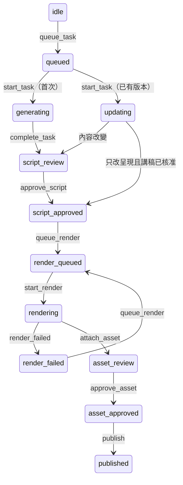

# recut 資料、狀態機與背景工作

這份文件說明 RC1 的儲存格式與程式介面，供 RC2、RC3、RC8 接手。生成步驟由後續工單註冊，RC1 不提供正式假生成或呼叫外部工具。功能狀態與驗收結果看[目前狀態](../../docs/current-status.md)，規則依[產製決策](../../docs/04_Features/Short_Video/recut-design-decisions.md)與[體驗決策](../../docs/04_Features/Short_Video/decisions.md)。

## 集合與欄位

名稱採 Mongoose 預設小寫複數；以下是程式定義，未查證或建立共用 Atlas 集合／索引。新集合都有 `createdAt`、`updatedAt`。

| 集合／Model | 主要欄位與用途 |
|---|---|
| `shortscripts`／`ShortScript` | 新增 `productionMode: avatar\|recut`；缺欄位讀為 avatar、不遷移。`recut` 只放 `state/revision/currentVersionId/currentAssetId/currentAssetGenerationVersion/activeTaskId/lastCompletedTaskId/pendingEditId`。既有 `courseId + topicKey` unique 與 avatar `versions` 不變 |
| `recutsources`／`RecutSource` | `scriptId/videoId/startSec/endSec/frozenAt/hitChunkIds/sentences`；`sourceCheck.{passed,results,checkedAt}`；`audio.{integratedLufs,truePeakDbtp,fixedGainDb,targetLufs,peakLimitDbtp}`。RC2 完成檢查／辨識後建立凍結來源 |
| `recutversions`／`RecutVersion` | `scriptId/taskId/sourceId/parentVersionId/selection/fullScript/plan/modelId/assetVersions/shortRenderVersion/theme`；每次只新增，不改舊版。主題與施工單分開存 |
| `recuttasks`／`RecutTask` | `scriptId/courseId/requestedBy/type/status`；固定 `callLimit` 與 `callsUsed`；`stepIds/input/baseSnapshot/resultVersionId/queuedAt/readyAt/startedAt/finishedAt/error/notifiedAt` |
| `recutattempts`／`RecutAttempt` | 每次嘗試一份：`taskId/stepId/stage/status/input/output/validation/modelId/usageMetadata/consumesCall/startedAt/finishedAt/durationMs/error`。預留 `workerId/assetId/generationVersion` 給 RC7；渲染量測存 `output/validation` |
| `recutapprovals`／`RecutApproval` | `scriptId/versionId/type/approvedBy/approvedAt`；成品另記 `assetId/generationVersion`，純呈現新版沿用講稿核准時記 `inheritedFromApprovalId` |
| `recutreviewevents`／`RecutReviewEvent` | 共用 `scriptId/versionId/kind/actorId/taskId/occurredAt`。建議：`suggestionType/content/adopted/adoptedAt`；修改：`sentenceId/originalLabel/action/reasonLabel/draftId/revertedAt`；操作時間：`phase/startedAt/endedAt/durationMs` |
| `shortassets`／`ShortAsset` | 新增 `recutVersionId`；搭配既有 `sourceScriptId/generationVersion` 識別這一版 MP4。替換 MP4 必須使用新的 generation 或 assetId |

`selection` 固定使用以下形狀，理由標籤取自 `constants/recut.js`：

```js
{
  answerable: true, unanswerableReason: null,
  ranges: [{ from: 's1', to: 's2', startAt: 'OpenCV', endAt: '模型' }],
  sentenceLabels: [{ sentenceId: 's1', label: '結論或定義' }, { sentenceId: 's2', label: '例子' }],
  openingSentenceId: 's1', lockedSentenceIds: []
}
```

`plan.schemaVersion` 為 `recut-v1`；完整施工單驗證與標籤／範圍一致性由 RC3／RC4／RC5 實作。RC1 只檢查基本來源歸屬與格式版本，測試的假 plan 不能拿去渲染。`answerable: false` 時存原因與跳過標籤、`plan: null`，結束任務而不跑後續配圖，也不允許核准製作。

三段時間的 `phase` 是 `script_review`、`asset_review`、`production_wait`；RC8 開始／結束一次操作時新增事件，實際畫面計時不在 RC1。

## RC2 → RC3 的句子清單

完整合成樣本見 [recut-sentences.json](../tests/fixtures/recut-sentences.json)；只有兩句，供格式測試，不代表已通過 30～65 秒選段驗證。

```js
{
  id: 's1', startSec: 41.2, endSec: 44.8, text: 'OpenCV 是工具箱。',
  words: [{ text: 'OpenCV', startSec: 41.2, endSec: 42.5 },
          { text: '是工具箱', startSec: 42.5, endSec: 44.8 }],
  retrievalHit: true, chunkIds: ['chunk_0002']
}
```

編號從 `s1` 依序增加；句子與逐字時間均為**原片絕對秒數**，不是視窗起點為零。每句有文字、非空逐字時間、布林 `retrievalHit`（★ 的依據）；`chunkIds` 是溯源片段。`createRecutSource(input)` 檢查順序、有限數字、時間範圍、文字與逐字時間；RC2 負責切句、命中對應、媒體檢查與增益計算。

來源的 `videoId` 參照 `Video._id`，`plan.source.videoId` 使用它的字串值；`chunkIds` 保留原片段 ID。RC2 把既有選題證據當定位線索，另凍結連續來源，不把 avatar 的分散證據直接當成 recut 完整視窗。

## 狀態與核准



取消／失敗用 `restore_task` 恢復開始前快照，保留 `pendingEditId`。`revise` 可從可審閱狀態切到新版，依內容比較回 `script_review` 或 `script_approved`；不從渲染途中切版。

集中入口在 [recutState.service.js](../src/services/recutState.service.js)：

```js
await transitionRecut({ scriptId, event: 'approve_script', versionId, actorId });
await transitionRecut({ scriptId, event: 'queue_render', versionId });
await transitionRecut({ scriptId, event: 'attach_asset', versionId, assetId, generationVersion });
await transitionRecut({ scriptId, event: 'approve_asset', versionId, assetId, generationVersion, actorId });
await transitionRecut({ scriptId, event: 'publish', versionId, assetId, generationVersion });
```

RC8 的 route 先驗課程權限，再呼叫入口；可帶 `expectedRevision` 拒絕過時請求。講稿核准必須傳目前 `versionId`；有未套用修改、任何生成／修改工作，或無可回答的講稿／施工單時都拒絕。渲染與上架重新查核准紀錄，不能只把 state 設成已核准就通過。

RC8 以 `set_pending_edits` 指向同版的 `edit` 事件；全部復原時傳 `pendingEditId: null`。每句修改各留事件，用 `draftId` 分組；成功套用或復原不刪歷史。修改任務的 `input` 固定本次選段、鎖定句與採納建議，避免任務讀到後來的編輯；RC1 不代為套用選段或建構完整講稿。

內容比較 `narrationKey` 看 `sourceId`、依序排列的選段範圍與句內微調、開場句、完整講稿、plan 原片與實際剪點。字幕、圖卡、顏色、動畫未改變這些資料時，為新版本建立可追溯的講稿核准沿用紀錄；不沿用成品核准。原音內容或順序改變就重審講稿。既有兩個成品發布入口在同一腳本鎖內呼叫 `assertRecutAssetPublishable` 並完成寫入，避免檢查後又被切版；舊 avatar 上傳入口拒絕直接上傳 recut 成品。RC8 仍要經 `publish` 更新 recut 狀態，講稿核准不能當成發布。

`RECUT_STAGES` 位於 [constants/recut.js](../src/constants/recut.js)，每個階段都有 `location/checks/failureTarget`。其他程式引用 `RECUT_STAGES.selection` 等物件，不另複製階段表；檢查實作、重試分類與 worker 租約由對應工單接上。

## RC2／RC3／RC4 的背景步驟介面

```js
const { registerRecutSteps } = require('./recutQueue.service');
registerRecutSteps('generate', [
  { id: 'source-v1', stage: 'sourceCheck', run: async ({ task, data, checkCancelled }) => {
    // RC2 用注入的檢查／辨識實作，透過 createRecutSource 新增凍結來源。
    return { sourceId }; // 回傳值合併到後續步驟的 data
  } },
  { id: 'selection-v1', stage: 'selection', run: async ({ task, data, runAttempt }) => {
    const selected = await runAttempt({ input, modelId, consumesCall: true,
      execute: async () => ({ output, validation: { valid: true }, usageMetadata }) });
    return { selection: selected };
  } },
  // RC4 註冊 cards、wholeCheck；最後一步 return { version: 完整的RecutVersion輸入 }。
]);
```

這是介面示意，變數由實際步驟提供，不能直接當成生成程式。三種任務 `generate/apply_selection/apply_suggestions` 各註冊有序步驟。registry 不預設真實或假步驟；未註冊時啟動回 `503 RECUT_STEPS_NOT_CONFIGURED`。RC8 完成權限／草稿處理後，用 `recutQueue.enqueue({ script, requestedBy, type, input })` 建立修改任務。

每個註冊步驟自動記一筆非模型嘗試；其中每次模型呼叫與重試都經 `runAttempt`，設 `consumesCall: true`。回傳 `output/validation/modelId/usageMetadata`；`validation.valid: false` 會保存結果並拋錯，RC3／RC4 可接住錯誤後依 `RECUT_STAGES` 重試。外部失敗如有用量，可在 error 上帶 `output/validation/usageMetadata`，同樣保存。輸入輸出須可儲存，不存 SDK 物件或憑證。

初次生成讀 `recut.initialCallLimit`，兩種修改讀 `recut.modificationCallLimit`。S1 接上前，集中轉接函式回預設 5；測試用 `createRecutQueue({ getSetting, notify })` 注入設定與通知。S1 接手只替換這個讀取點；初次至少 3、修改至少 2，不接受教師指定額度或取樣參數。

任務**建立時**固定上限，所有步驟、重試與建議共用 `callsUsed`。每次呼叫前原子保留額度，超限不執行；失敗或取消不退回已保留次數。沒有新增每日／每月總預算。

## 排隊、恢復與取捨

1. 先建立有 `baseSnapshot` 的排隊工作，再以 script revision 做條件更新；附加成功並設定 `readyAt` 才可執行。
2. 依 DB 的 `queuedAt + _id` 排序，單一 backend 程序一次跑一件。每步前後查取消；同一腳本的取消與版本提交以程序內鎖排序，CAS（條件相符才更新）防止過時覆寫。
3. 成功先切換目前版與 `lastCompletedTaskId`，再標 task 成功。失敗／取消只恢復自己仍持有的腳本，不刪來源、候選版、嘗試或修改紀錄。
4. `server.js` 連線後、短影片功能啟用時呼叫 `recoverQueuedRecutTasks()`。排隊工作恢復；running 標 `RECUT_TASK_INTERRUPTED`、恢復原版，不重送可能已計費的呼叫。要求取消則標 `cancelled`。若目前版已提交但 task 未收尾，依完成指標補成功，不回滾。
5. 成功／失敗通知課程教師，以 taskId 去重；通知失敗不回滾，下次啟動補送。`cancelled` 是獨立終態，與失敗分開統計。版本已提交但 task 尚未收尾時，取消回報成功結果，不推翻新版。

選 DB 工作而非只用記憶體陣列，是為了重啟恢復與稽核；不重跑 running，是避免重複付費與不確定的外部副作用。採逐次寫入、script CAS 與完成指標，不綁定 replica set transaction；代價是可能留下未採用的來源／候選版本，依決策保留供稽核。

限制：只供**單一 backend 程序**，不是跨程序租約；不要同時啟動多個 queue instance 或 PM2 cluster。RC7 的 worker 佇列另實作租約。`recover()` 只在啟動時呼叫，不能用來中斷現有 runner。步驟 ID 隨不相容變更更新；重啟對不上時明確失敗，不猜測續跑。

## 驗證方式

`recut-state.service.test.js` 驗核准、修改回審與格式；`recut-queue.service.test.js` 驗假步驟排隊、恢復、取消、額度、紀錄與通知；`recut.routes.test.js` 驗權限、輸入、202、查詢與取消。皆用既有記憶體 harness，8 拍生成程式與測試不改。

另有 [recut.mongo.js](../integration/recut.mongo.js)，只接受明確 port 的 loopback URI，使用隨機 `focusflow_recut_test_*` DB、關閉 autoIndex／autoCreate，結束清除該次 DB。從 backend 執行：

```powershell
$env:RECUT_TEST_MONGODB_URI = 'mongodb://127.0.0.1:27131'
node --test integration/recut.mongo.js
```

這只驗資料與狀態機，不證明 ASR、模型品質、FFmpeg、渲染、前端或正式部署已驗收；執行結果以狀態正本為準。
