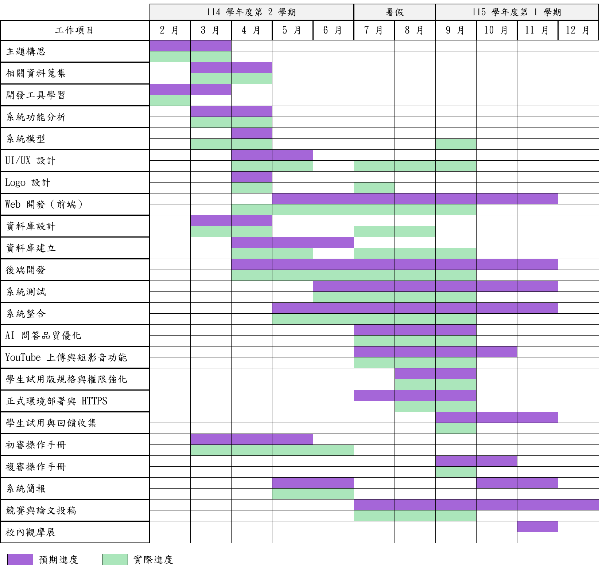
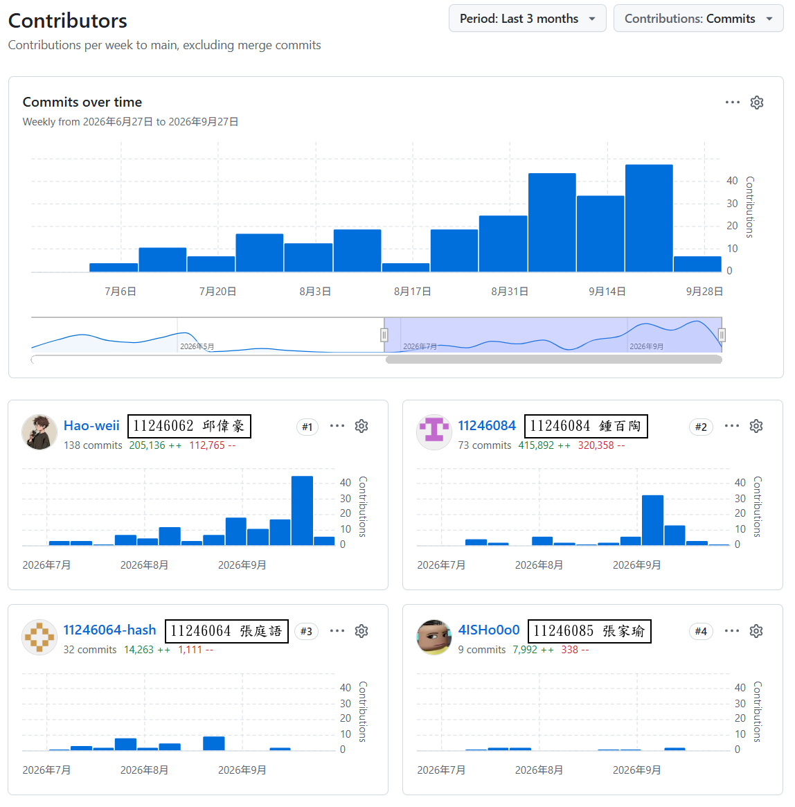
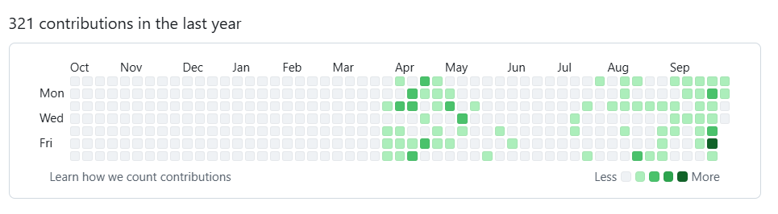
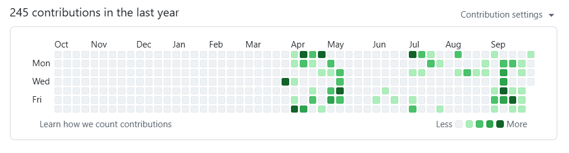
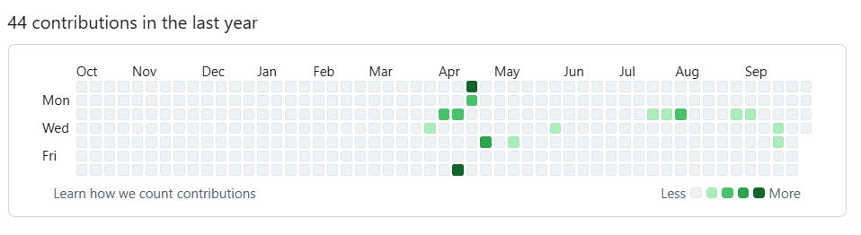
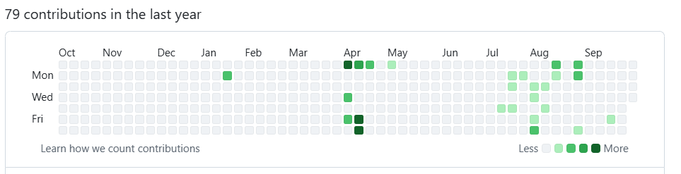

# 第4章 專案時程與組織分工

## 4-1 專案時程

本專題自2026 年2 月開始，橫跨114 學年度第2 學期與115 學年度第1 學期。根據專案工作流程，我們將整體開發過程分成多個工作項目，並彙整成圖4-1-1 的甘特圖。2026 年6 月的專題審查後，團隊依評審意見與教授會議決議進入第二階段開發，新增「AI 問答品質優化」、「YouTube 上傳與短影音功能」、「學生試用版規格與權限強化」、「正式環境部署與HTTPS」、「學生試用與回饋收集」、「競賽與論文投稿」及「校內觀摩展」等項目。系統自2026 年9 月21 日起透過https://focusflow.ntub.edu.tw開放學生試用，這項進度也已反映在圖中。[^3]

圖4-1-1 專案時程甘特圖

## 4-2 專案組織與分工

表4-2-1 專業組織與分工表

●：主要負責人、○：次要負責人

| 項目/組員 |  | 111246062邱偉豪 | 111246064張庭語 | 111246084鍾百陶 | 111246085張家瑜 |
| --- | --- | --- | --- | --- | --- |
| 系統規劃 | MVP 範圍與系統架構規劃 |  |  | ● |  |
|  | 使用者需求分析 |  |  | ○ | ● |
|  | 功能樹與流程設計 | ● |  |  | ○ |
|  | 影片處理與AI 問答流程 |  | ○ | ● |  |
| 前端開發 | 學生試用版後端規格與施工單 | ● |  | ○ |  |
|  | 階層式檢索資料契約 | ○ | ● |  |  |
|  | 短影音製作規格與腳本架構 |  |  | ● | ○ |
|  | 首頁入口頁面 |  |  |  | ● |
|  | 使用者登入頁面 |  |  |  | ● |
|  | 角色切換與登入後導向 |  |  |  | ● |
|  | 側邊導覽列 |  |  |  | ● |
|  | 頂部資訊列 |  |  |  | ● |
|  | 學生儀表板頁面 |  |  |  | ● |
|  | 學生課程列表頁面 |  |  |  | ● |
|  | 學生課程詳細頁面 |  |  |  | ● |
|  | 學生影片播放功能 |  |  |  | ● |
|  | 學生AI 問答面板 |  | ○ |  | ● |
|  | 學生LINE Bot 綁定頁面 |  |  | ● | ○ |
|  | 教師儀表板頁面 |  |  |  | ● |
|  | 教師課程管理頁面 |  |  |  | ● |
|  | 教師新增課程功能 |  |  | ● | ○ |
|  | 教師影片上傳頁面 |  | ○ | ● | ○ |
|  | 教師影片處理狀態顯示 |  | ○ | ● | ○ |
|  | 管理員總覽頁面 |  |  |  | ● |
|  | 管理員使用者管理頁面 |  |  | ● | ○ |
|  | 管理員課程管理頁面 |  |  | ● | ○ |
|  | 管理員影片管理頁面 |  |  | ● | ○ |
|  | 管理員統計頁面 |  |  |  | ● |
|  | 整體UI 視覺設計（首頁／登入／Dashboard／側邊列／圖示） |  |  |  | ● |
|  | 視覺互動效果（3D Button／Bubble Scene 動態背景） |  |  |  | ● |
|  | 學生教學短片牆頁面 | ○ |  |  | ● |
|  | Topbar 通知與使用者選單個人資料頁面（頭貼／姓名／密碼） |  |  |  | ●● |
|  | 全站RWD 響應式排版 |  |  |  | ● |
|  | 管理員獨立登入入口 |  |  |  | ● |
|  | 教師短影片審核頁面 |  |  | ○ | ● |
|  | 教師短影音腳本與成品上傳頁面 |  |  | ● | ○ |
|  | 多輪對話問答介面與引用片段顯示 | ○ | ● |  | ○ |
| 後端開發 | 多影片批次上傳介面 |  | ● |  | ○ |
|  | 問題回報與意見回饋入口 | ○ |  |  | ● |
|  | 全系統中文化與學生端體驗修正 |  |  | ● | ○ |
|  | API 架構與基礎中介層 | ● |  |  |  |
|  | 登入驗證與JWT 權限控管 | ● |  |  |  |
|  | 課程CRUD API | ● |  |  | ○ |
|  | 影片管理API（上傳／列表／詳細／刪除） | ● |  | ○ |  |
|  | 影片處理控制API（狀態查詢／重試／內部回報） | ● | ○ | ○ |  |
|  | AI 問答API | ● | ○ | ○ |  |
|  | LINE Webhook 與簽章驗證 | ● |  | ○ |  |
|  | LINE 綁定Token API | ● |  | ○ |  |
|  | 統計API（學生／教師／管理員） | ○ |  | ● |  |
|  | 管理員後台API（使用者／影片／事件紀錄） | ○ |  | ● |  |
|  | 問題紀錄API | ○ |  | ● |  |
|  | 角色登入、站內通知與頭貼API | ● |  | ○ |  |
|  | 修課授權與學生名單管理（含CSV 匯入） | ● |  | ○ |  |
|  | YouTube 自動上傳、重試與刪除轉私人 |  | ○ | ● |  |
|  | FAQ 快取機制 |  | ● | ○ |  |
|  | 多影片批次處理與續跑 |  | ● |  |  |
|  | 多輪對話API 與對話紀錄 |  | ● |  |  |
|  | LINE 多輪追問與跨課程隔離 | ● | ○ |  |  |
|  | 短影音腳本生成、審核與上架API |  |  | ● |  |
|  | 忘記密碼、登入鎖定與每日提問上限 |  |  | ● |  |
| 資料庫設計 | 系統服務狀態API 與安全標頭 |  |  | ● |  |
|  | OpenAPI 補齊與route 覆蓋測試 | ● |  |  |  |
|  | MongoDB 資料模型設計 | ○ |  | ● |  |
|  | 影片片段與處理狀態結構 |  | ○ | ● |  |
| AI自動化 | Embedding 與向量資料結構 |  | ● | ○ |  |
|  | 問答匹配片段紀錄結構 | ○ | ○ | ● |  |
|  | MongoDB 索引設計（含Atlas Vector Search） |  | ○ | ● |  |
|  | 資料匯入與Demo Seed 工具 | ● |  | ○ |  |
|  | Parent 階層片段結構與索引 |  | ● | ○ |  |
|  | 對話與訊息集合（conversations／messages） |  | ● |  |  |
|  | 通知、頭貼與修課集合 | ● |  | ○ |  |
|  | Stable Embedding 遷移與試用版向量重建 | ○ | ● |  |  |
|  | RAG 檢索流程 | ○ | ● |  |  |
|  | 問題向量化、向量搜尋、答案生成 | ○ |  | ● |  |
|  | 回答附帶影片片段與時間戳 |  |  | ● |  |
|  | 問題與回答紀錄保存 | ○ |  | ● |  |
|  | 影片檔案掃描與音訊抽取 |  | ● |  |  |
|  | Whisper 語音轉文字 |  | ● |  |  |
|  | 逐字稿快取、正規化與術語校正 |  | ● |  |  |

表4-2-2 組員工作內容與貢獻度

| 序號 | 姓名 | 工作內容 | 貢獻度 |
| --- | --- | --- | --- |
| 1 | 組長11246084鍾百陶 | 系統規劃與AI 問答流程；向量搜尋、答案生成、FAQ 快取與統計後台API；YouTube 自動上傳；短影片腳本自動化、上架與審核；通知、忘記密碼與個人資料；教師與管理員頁面；手冊第1～3、12 章與全冊整合 | 25% |
| 2 | 組員11246062邱偉豪 | 後端API 架構、JWT 與課程、影片、問答、LINE API；修課名單與CSV 匯入；VM、Nginx、PM2、CI/CD 與HTTPS 部署；自動化測試與試用驗收；影像檢索與問答評測；手冊第3～11 章與附錄 | 25% |
| 3 | 組員11246064張庭語 | AI 模組：音訊抽取、Whisper 語音轉文字、逐字稿切段與Gemini Embedding；可續跑Pipeline 與批次處理；階層式檢索；多輪問答前後端；RAG 檢索流程；手冊第1、2、5 章與論文統整 | 25% |
| 4 | 組員11246085張家瑜 | 前端首頁、登入、儀表板與學生課程、影片、問答頁；教學短片牆；管理員獨立登入入口；短影片審核頁；整體UI 視覺與3D Button、Bubble Scene 動態效果；Logo、名牌設計與簡報製作 | 25% |
| 總計 |  |  | 100% |

## 4-3 上傳GitHub 紀錄

圖4-3-1 上傳GitHub 紀錄

圖4-3-2 11246062 邱偉豪 上傳GitHub 紀錄

圖4-3-3 11246084 鍾百陶 上傳GitHub 紀錄

圖4-3-4 11246085 張家瑜 上傳GitHub 紀錄

圖4-3-5 11246064 張庭語上傳GitHub 紀錄

[^3]: AI 輔助紀錄索引：AI-ORIG-02、AI-DOC-20260913、AI-DOC-20260914、AI-DOC-UML-20260930、AI-INTEGRATE-20260930、AI-DOC-20261001（說明見第14 章表14-4-1）。
