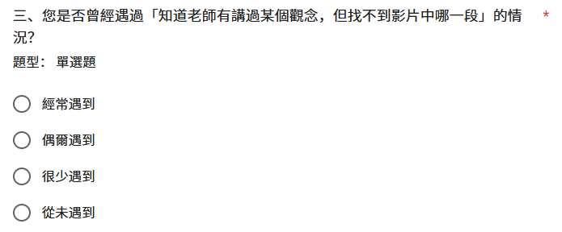
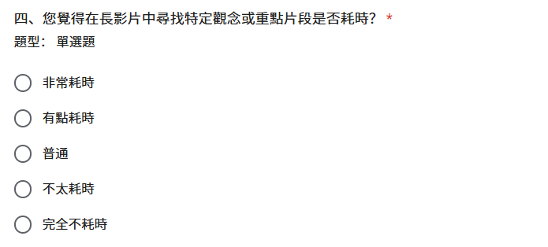
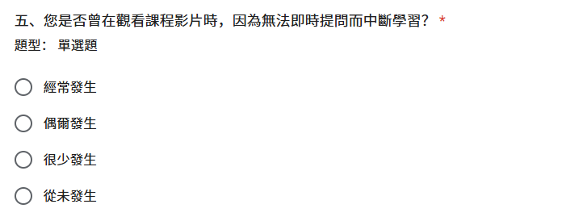
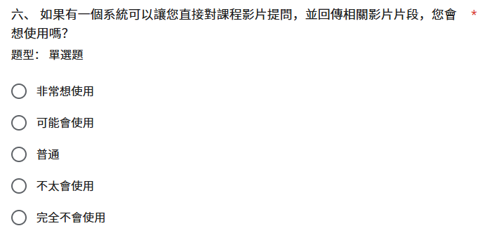
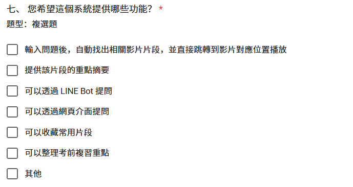
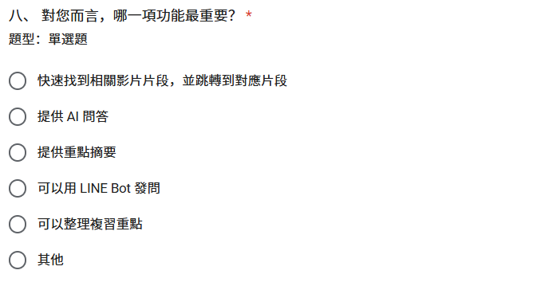
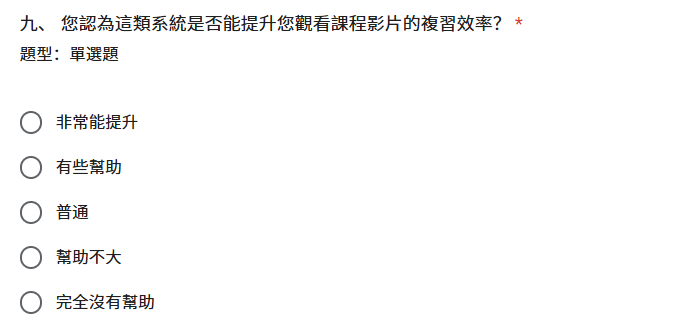
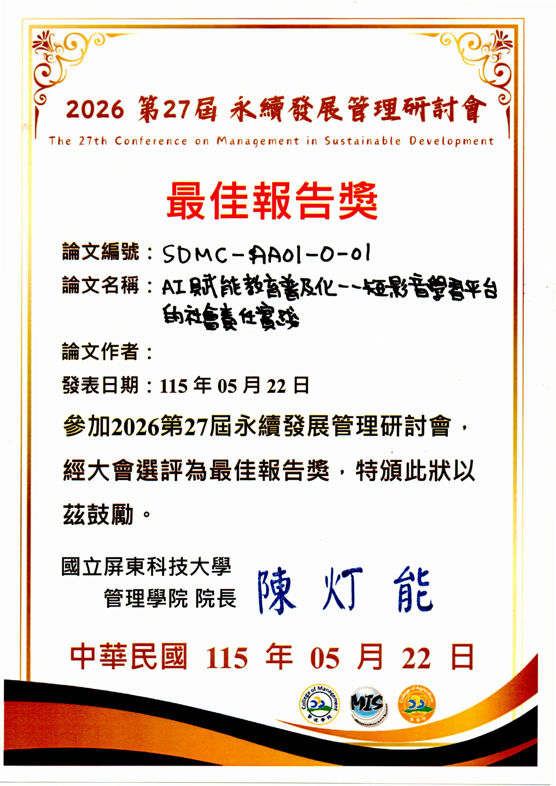

# 附錄

## 附錄一 會議紀錄

國立臺北商業大學　資訊管理系

附表1-1 第1 次專題討論會議紀錄

會議日期：中華民國115 年01 月22 日

會議地點：線上

會議主席：蒯思齊

會議記錄：邱偉豪

開會時間：10:00

散會時間：12：00

會議議題：讀書彙報(寒假_1th

開會人員：指導老師 蒯思齊組員 邱偉豪、張庭語、張家瑜、鍾百陶

#### 一、討論內容

本次會議主要說明神經網路與監督式學習的基本概念。教授指出，神經網路具有黑盒子特性，無法像傳統程式一樣手動寫出完整判斷規則，而是由模型從資料中自行學習特徵。硬體方面，深度學習高度依賴NVIDIA GPU，主要原因是GPU 適合處理張量與矩陣運算，效率高於一般CPU。模型設計方面，以MNIST 為例，輸出層需設為10 個神經元，對應0 到9 共10 種分類結果。教授也強調Label 的重要性。Label 即標準答案，若資料沒有標籤，模型就無法計算Loss，也無法透過反向傳播修正參數。因此專題選題時不能只看是否有資料，還要確認資料是否有對應標準答案，否則可能變成非監督式學習或需要大量人工標註。

#### 二、決議事項

名詞統一使用台灣說法：啟動函數。GPU 對矩陣運算與張量處理非常重要。監督式學習必須具備Label，否則模型無法修正學習。專題選題時需確認資料是否具備標準答案。若資料無Label，將增加人工標註成本與專題難度。本次未完成報告內容，於下次會議繼續。

下次開會時間：中華民國115 年01 月27 日

下次會議內容：簡報製作

國立臺北商業大學　資訊管理系

附表1-2 第2 次專題討論會議紀錄

會議日期：中華民國115 年01 月27 日

會議地點：線上

會議主席：蒯思齊

會議記錄：邱偉豪

開會時間：14:00

散會時間：16:00

會議議題：讀書彙報(寒假_2th

開會人員：指導老師 蒯思齊組員 邱偉豪、張庭語、張家瑜、鍾百陶

缺席人員：無

#### 一、討論內容

本次會議討論NLP 與CNN 的模型選擇策略。CNN 不只可用於影像，也能處理文字中的關鍵特徵，例如倒裝句、意圖判斷等，因此不一定所有NLP 問題都需使用LSTM。CNN 架構方面，現代主流多採連續小卷積核堆疊，再搭配Pooling，相較傳統大卷積可減少參數、增加非線性，並支援更深層網路。教授也說明AI 的核心挑戰是泛化性。模型容易因規則改變而失效，可透過Dropout 與資料增強降低Overfitting。實務部署上，模型訓練完成後需透過Flask API 架設服務，才能整合成Line Bot 等實際產品。

#### 二、決議事項

期末專題選題應避免純計算或死記硬背型題目。專題方向可朝泛化性高或具創意應用的主題發展。技術學習需釐清CNN 原理，如Padding 與Pooling。題目確定後，可參考老師提供的範例與AI 跨域班資料。後續可使用本地端顯卡資源協助模型訓練。

下次開會時間：中華民國115 年02 月03 日

下次會議內容：簡報製作

國立臺北商業大學　資訊管理系

附表1-3 第3 次專題討論會議紀錄

會議日期：中華民國115 年02 月03 日

會議地點：線上

會議主席：蒯思齊

會議記錄：邱偉豪

開會時間：14:00

散會時間：16:00

會議議題：讀書彙報(寒假_3th

開會人員：指導老師 蒯思齊組員 邱偉豪、張庭語、張家瑜、鍾百陶

缺席人員：無

#### 一、討論內容

進行簡報報告。

#### 二、決議事項

下次開會時間02 月10 日

下次開會時間：中華民國115 年02 月10 日

下次會議內容：簡報製作

國立臺北商業大學　資訊管理系

附表1-4 第4 次專題討論會議紀錄

會議日期：中華民國115 年02 月10 日

會議地點：線上

會議主席：蒯思齊

會議記錄：邱偉豪

開會時間：14:00

散會時間：16:00

會議議題：讀書彙報(寒假_4th

開會人員：指導老師 蒯思齊組員 邱偉豪、張庭語、張家瑜、鍾百陶

缺席人員：無

#### 一、討論內容

本次會議介紹生成式模型核心技術，包含DeepDream、神經風格遷移、VAE 與GAN 的運作原理與差異，並討論自編碼器的壓縮概念，以及Temperature 參數如何影響生成結果的隨機性。模型訓練方面，說明超參數優化、模型集成、混合精度與遷移學習等加速方法。遷移學習可重用預訓練模型已學到的通用特徵，縮短訓練時間。CNN 特徵提取則由淺層辨識線條、邊緣等基本元素，深層辨識較完整的物體特徵。另有同學反映API Key 出現429 Error，老師說明免費版API 有頻率與總量限制，付費版或教育版額度較高。

#### 二、決議事項

下週因過年暫停會議一次。Temperature 相關內容可觀看老師錄製影片。後續可透過實作調整Temperature，觀察生成結果差異。

下次開會時間：中華民國115 年02 月24 日

國立臺北商業大學　資訊管理系

附表1-5 第5 次專題討論會議紀錄

會議日期：中華民國115 年02 月24 日

會議地點：線上

會議主席：蒯思齊

會議記錄：邱偉豪

開會時間：14:00

散會時間：16:00

會議議題：讀書彙報(過年後_1th

開會人員：指導老師 蒯思齊組員 邱偉豪、張庭語、張家瑜、鍾百陶

缺席人員：無

#### 一、討論內容

本次會議討論專題可能會使用AI 與n8n，組員需先熟悉n8n 基本操作。因系統規模較大、token 消耗可能偏高，老師預計在本機端部署Ollama，提供API 使用，校外連線需透過學校VPN。老師示範以Ollama 運行本地端大語言模型，並說明本地部署對企業資料保密的重要性。高效能模型對硬體需求高，例如大型模型可能需要約70GB 記憶體，一般單張RTX 4090或5090 不一定足夠。商業模式方面，教授強調系統必須具備創造收益或降低成本的價值，可從訂閱制、廣告引流、企業降本等方向思考，例如長者陪伴AI、會計報帳AI、ERP 或CRM 等應用。

#### 二、決議事項

開學沒意外會要交企畫書，每人下周二前想一個主題出來開學準備： 需申請學校VPN 帳號以便在校外呼叫校內伺服器資源（如Ollama API）。會議時間協調：開學後週二下午的定期專題指導時間（下午5:30 - 6:30 ）

下次開會時間：中華民國115 年03 月03 日

下次會議內容：看跨域班影片GitHub 研究想專題主題借討論室

國立臺北商業大學　資訊管理系

附表1-6 第6 次專題討論會議紀錄

會議日期：中華民國115 年03 月03 日

會議地點：圖書館討論室

會議主席：蒯思齊

會議記錄：邱偉豪

開會時間：17:30

散會時間：19:30

會議議題：開學後_1th

開會人員：指導老師 蒯思齊組員 邱偉豪、張庭語、張家瑜、鍾百陶

缺席人員：無

#### 一、討論內容

大家分享查到的專題主題並討論

#### 二、決議事項

最終確定從兩個題目中2 選1：AI x 智慧衣櫥：穿搭推薦與服裝管理短影音成癮x 自我管理：FocusFlow

下次開會時間：中華民國115 年03 月10 日

下次會議內容：想專題主題

國立臺北商業大學　資訊管理系

附表1-7 第7 次專題討論會議紀錄

會議日期：中華民國115 年03 月10 日

會議地點：圖書館討論室

會議主席：蒯思齊

會議記錄：邱偉豪

開會時間：17:30

散會時間：19:00

會議議題：確定題目_2th

開會人員：指導老師 蒯思齊組員 邱偉豪、張庭語、張家瑜、鍾百陶

缺席人員：無

#### 一、討論內容

回報確定的題目短影音

#### 二、決議事項

最終確定短影音，並決定使用教授自己就已經錄製了一些上課錄影的VOD。並制定接下來行動方針為調查一下現在市面上的短影音生成服務 (如最有名的Sora2 或是Seedance 2 之類的)，了解一下他們可以做什麼。

下次開會時間：中華民國115 年03 月24 日

下次會議內容：決定專題題目收集短影音製作的服務與模型的資料(邱偉豪、鍾百陶)收集語音轉文字技術的資料(張庭語)收集如BLIP 等畫面描述技術的資料(張家瑜)

國立臺北商業大學　資訊管理系

附表1-8 第8 次專題討論會議紀錄

會議日期：中華民國115 年03 月24 日

會議地點：圖書館討論室

會議主席：蒯思齊

會議記錄：張家瑜

開會時間：17:30

散會時間：19:30

會議議題：確認ChatGPT 規劃、Codex 實作的AI 分工流程，並建立GitHub 留痕與AI使用紀錄方式。

開會人員：指導老師 蒯思齊組員 邱偉豪、張庭語、張家瑜、鍾百陶

缺席人員：無

#### 一、討論內容

本次會議確認專題開發採ChatGPT 規劃、Codex 實作的AI 分工流程。先由ChatGPT 進行產品規劃、功能流程與架構設計，再整理成結構化prompt 交給Codex 產生程式實作，以降低token 浪費並提高生成品質。教授提醒，AI 產出最多只能完成約80%，剩餘20% 仍需由團隊補齊、修正與客製化。專題報告中也要清楚區分AI 產出與團隊自行判斷、修改、取捨的部分。6/2 文件撰寫方向以目前最具體可行的工具、系統設計、技術規劃與開發流程為主，後續成果可依工具迭代調整。GitHub 需從現在開始持續更新，保留會議紀錄、實作、簡報、文件版本與修改歷程。

#### 二、決議事項

採用ChatGPT 規劃、Codex 實作的AI 分工方式。將規劃內容整理成結構化prompt，供後續開發與報告使用。AI 產出需由團隊修正與客製化，並說明人為貢獻。專題以高標願景為方向，以可用核心成果為落地目標。6/2 文件先寫最具體可行方案，保留後續調整彈性。GitHub 需持續上傳會議紀錄、實作、簡報、文件與版本紀錄。

下次開會時間：中華民國115 年03 月31 日

下次會議內容：三月底前完成需繳交資料。建立AI 使用紀錄模板，固定記錄目標、模型工具、prompt、AI 原始輸出、團隊修改內容、修改原因與最終版本。

國立臺北商業大學　資訊管理系

附表1-9 第9 次專題討論會議紀錄

會議日期：中華民國115 年03 月31 日

會議地點：圖書館討論室

會議主席：蒯思齊

會議記錄：邱偉豪

開會時間：17:30

散會時間：19:30

會議議題：確認系統由遊戲化轉向數位學習證明，並規劃以Whisper、RAG、MongoDB、網頁前端與LINE Bot 完成影片問答MVP。

開會人員：指導老師 蒯思齊組員 邱偉豪、張庭語、張家瑜、鍾百陶

#### 一、討論內容

本次會議討論系統價值與技術架構。遊戲化機制原先考慮加入養寵物功能，但教授建議專題應從趣味性轉向實質價值，改以學習歷程證明與數位證書作為核心。系統也可記錄學生技術偏好、提問紀錄與觀看熱點，作為面試或升學輔助資料。技術架構方面，專案採GitHub branch 管理版本，對話紀錄以JSON 格式儲存，前端包含登入頁、課程選擇與LINE Bot QR Code。資料庫優先使用MongoDB，以利彈性調整。MVP 第一階段聚焦影片問答功能，流程為Whisper 語音轉文字、建立索引，再由LLM生成答案。未來可擴充短影音生成答案與跨課程學習路徑規劃。

#### 二、決議事項

放棄寵物機制，改開發數位學習證明系統。核心價值改為學習歷程紀錄、數位證書與學習數據分析。語音轉文字使用Whisper。問答架構採RAG。資料庫優先使用MongoDB。互動介面採網頁前端加LINE Bot。5 月初完成MVP 串接，6 月2 日進行第一階段成果驗收。

下次開會時間：中華民國115 年04 月07 日

國立臺北商業大學　資訊管理系

附表1-10 第10 次專題討論會議紀錄

會議日期：中華民國115 年04 月07 日

會議地點：圖書館討論室

會議主席：蒯思齊

會議記錄：鍾百陶

開會時間：15:00

散會時間：16:30

會議議題：系統實作進度匯報與技術架構優化

開會人員：指導老師 蒯思齊組員 邱偉豪、張家瑜、張庭語、鍾百陶

缺席人員：無

#### 一、討論內容

本次會議確認系統由文字檢索改為Gemini Embedding 2 多模態檢索，直接整合影片畫面、聲音與文字，避免影像資訊流失與向量空間不一致。影片處理採15 至30 秒規則式切段，每段建立多模態向量。video_segments 需新增embedding、startSec、endSec 欄位，以支援精準跳轉與後續剪片。Whisper 保留為字幕顯示與術語校正輔助，不再作為主要檢索依據；query_embedding.service.js 改串Google Vertex AI Gemini Embedding 模型。系統採地端運算加雲端播放架構。地端負責FFmpeg、影片切片、embedding 與逐字稿；雲端負責影片或短片播放，前端與LINE Bot 透過video_url 或clip 連結存取。LINE Webhook 驗證失敗主因為express.json() 改寫raw body，後續需改用express.raw({ type: 'application/json' }) 驗簽，並將secrets 全面移至 .env 管理。

#### 二、決議事項

改採Gemini Embedding 2 作為多模態檢索核心。影片統一切為15 至30 秒片段建立向量。video_segments 新增多模態embedding 與startSec、endSec 欄位。Whisper 改為字幕與術語校正輔助。採用「地端運算 + 雲端播放」架構。建立queued、processing、completed、failed 四種處理狀態。/videos/:videoId/processing 作為正式進度查詢API。LINE webhook 改用raw body 驗簽，secrets 全面移至 .env。LINE 綁定維持QR Code 搭配一次性token。

下次開會時間：中華民國115 年04 月21 日

國立臺北商業大學　資訊管理系

附表1-11 第11 次專題討論會議紀錄

會議日期：中華民國115 年04 月21 日

會議地點：資研討室

會議主席：蒯思齊

會議記錄：張家瑜

開會時間：15:00

散會時間：16:30

會議議題：第一階段進度匯報與展示規劃

開會人員：指導老師 蒯思齊組員 邱偉豪、張家瑜、張庭語、鍾百陶

缺席人員：無

#### 一、討論內容

本次會議確認專題進度與展示方向。資料庫資料與索引已完成，Embedding 現階段以文字搜尋為主，圖片搜尋後續再擴充。LINE Bot 目前採一次性token 驗證，重點是完成網頁、LINE Bot、影片問答與時間戳回覆的完整流程。6 月2 日報告以核心流程展示為主。Backend 已完成JWT、課程API、影片處理、問答API、LINE 整合與Swagger 文件，後續需確認資料庫與LINE 對話紀錄完整性。學生影片上傳因版權疑慮，傾向不開放，影片改採YouTube 不公開連結託管。教授提醒需理解AI 生成程式碼，特別是Embedding、向量比對與Cosine Similarity 原理。

#### 二、決議事項

現階段以文字搜尋與核心展示流程為主，圖片搜尋後續再擴充。LINE Bot 維持一次性token 驗證，並串接網頁選課、QR Code、影片問答與時間戳回覆流程。影片採YouTube 不公開連結託管，不開放學生直接上傳影片。前端UI 可先用AI 生成初版，再手動微調。Backend 須確保資料庫與LINE 對話紀錄完整性。團隊需能說明AI 程式碼、Embedding、向量比對與Cosine Similarity 原理。可評估報名全國技專院校專題競賽。

下次開會時間：中華民國115 年05 月05 日

下次會議內容：於2026/04/24 前完成論文線上報名及繳費。完成LINE Bot 與網頁整合，確保影片觀看與問答順暢。完成GitHub 技術架構文件與專題手冊。製作Canva 專題簡報，供05/22 論文研討會與06/02 校內報告使用。深入理解AI 生成程式碼，能說明功能、流程與底層邏輯。

國立臺北商業大學　資訊管理系

附表1-12 第12 次專題討論會議紀錄

會議日期：中華民國115 年05 月05 日

會議地點：資研討室

會議主席：蒯思齊

會議記錄：張庭語

開會時間：15:00

散會時間：16:30

會議議題：計畫書優化與系統架構討論

開會人員：指導老師 蒯思齊組員 邱偉豪、張庭語、鍾百陶、張家瑜

缺席人員：無

#### 一、討論內容

本次會議確認LINE Bot 與YouTube 為主要展示流程。初期採手動上傳YouTube，後端儲存youtubeVideoId，LINE Bot 回覆含時間戳的YouTube 連結，讓使用者可跳轉至對應片段。自動上傳YouTube 因涉及API、OAuth 與審核流程，列為後續優化。計畫書需改為工程化描述，補上Gemini Embedding、Cosine Similarity、Line Messaging API 等技術內容，並加入課外線上學習相關數據。目標客群收斂為大專院校學生。文件與圖表部分，需重繪系統架構圖、資料庫Schema 圖，並補上7–12 月甘特圖。展示環境確定使用Linux 虛擬機。

#### 二、決議事項

LINE Bot 作為主要展示入口，影片互動採YouTube timestamp 連結跳轉。計畫書補強工程化技術內容、市場需求數據，TA 鎖定大專院校學生。系統架構圖、資料庫Schema 圖與7–12 月甘特圖需重繪或補齊。展示環境確定使用Linux。下次會議前完成文件擴充、圖表重繪與準確度評估資料。

下次開會時間：中華民國115 年05 月12 日

下次會議內容：張庭語：補強技術可行性章節，加入Gemini Embedding、Cosine Similarity、Line Messaging API。補充課外線上學習數據，並將TA 改為大專院校學生。邱偉豪：重繪系統架構與流程圖。重繪資料庫Schema 圖。製作7–12 月甘特圖。開發團隊：完成系統準確度評估報告。

國立臺北商業大學　資訊管理系

附表1-13 第13 次專題討論會議紀錄

會議日期：中華民國115 年05 月12 日

會議地點：資研討室

會議主席：蒯思齊

會議記錄：邱偉豪

開會時間：15:00

散會時間：15:48

會議議題：計畫書各章節修訂與簡報優化

開會人員：指導老師 蒯思齊組員 邱偉豪、張庭語、鍾百陶、張家瑜

#### 一、討論內容

本次會議主要檢討專題文件、簡報與系統設計。前言需補強研究背景，加入台灣線上教育市場成長趨勢圖，並完整標示資料來源；若引用非公開資料，需註明授權方式與使用限制。文件排版原則採先文字後圖。使用者案例圖需取消LINE Bot 獨立節點，並新增權限控管區塊，限定管理員可修改權限。系統架構圖、元件圖與資料庫關聯圖需調整版面，並確認黑白列印後仍清楚。簡報需大幅精簡文字，改以流程圖、架構圖與趨勢圖呈現，並使用淺色背景與較大字體。系統功能方面，影片Embedding 改採影片切段方式實作，問答系統後續可加入快取與離峰摘要機制。

#### 二、決議事項

前言需加入線上教育市場趨勢圖，並標示資料來源。問卷調查聚焦於影片片段查找效率與學習成效。簡報需精簡文字，增加流程圖、架構圖與視覺化內容。簡報改用淺色背景並加大字體。使用者案例圖取消LINE Bot 獨立節點。新增「權限控管」區塊，僅管理員可修改權限。系統架構圖、元件圖與資料庫關聯圖需重新調整版面。影片Embedding 採影片切段方式實作。問答系統後續規劃快取與離峰摘要機制。

下次開會時間：中華民國115 年05 月19 日

下次會議內容：張庭語：修改前言，加入台灣線上教育市場成長趨勢圖。張庭語：完善問卷問項，聚焦效率提升與學習成效，於本週五前完成。張庭語：調整使用者案例圖，取消LINE Bot 節點並新增權限控管區塊。全體組員：優化簡報格式，將文字轉為流程圖、架構圖等視覺化內容。邱偉豪：優化系統架構圖，改用淺色色塊並參考範例重新製作。

國立臺北商業大學　資訊管理系

附表1-14 第14 次專題討論會議紀錄

會議日期：中華民國115 年05 月19 日

會議地點：資研討室

會議主席：蒯思齊

會議記錄：邱偉豪

開會時間：15:00

散會時間：15:48

會議議題：簡報架構、系統設計與競賽規劃

開會人員：指導老師 蒯思齊組員 邱偉豪、張庭語、鍾百陶、張家瑜

#### 一、討論內容

本次會議確認專題簡報架構，簡報需從學生觀看教學影片的痛點切入，包含影片過長、重點難定位、複習效率低等問題，凸顯FocusFlow 可將教學影片轉為可問答的知識庫。系統設計以三種角色呈現：學生可透過Web 或LINE Bot 提問並跳轉重點片段；老師可上傳MP4 或YouTube 教材，由後端自動完成音訊提取、轉錄、切段與向量化；管理者負責平台管理、帳號停權與資料審核。市場需求以問卷數據佐證，並以圖表呈現。推廣規劃採校內測試、他校推廣、SaaS 授權三階段。技術呈現需聚焦核心，減少程式碼細節，並補強AI 生成正確性的檢核機制。另需加入約3 分鐘系統操作示範影片，協助評審理解功能。

#### 二、決議事項

簡報以痛點、應用場景與核心價值為主。補上系統操作示範影片。強化AI 生成正確性檢核說明。架構圖精簡呈現MongoDB、影片切段、向量檢索與LINE Bot 流程。市場需求以問卷圖表呈現。推廣規劃採校內測試、他校推廣、SaaS 授權三階段。至少參與三項專題競賽。

下次開會時間：中華民國115 年06 月02 日

下次會議內容：全體組員：5/22 前往屏東科大參與ESG 論文研討會。張庭語、鍾百陶：補齊技術說明，包括AI 正確性檢核、相似度比較方式與影片切段方法。張家瑜：修改專題簡報，移除不必要技術細節，加入實際應用場景。邱偉豪：更新系統架構流程圖，使流程更直觀。並製作專題情境展示影片。全體組員：準備2026 第31 屆大專校院資訊應用服務創新競賽所需文件與行銷素材。

國立臺北商業大學　資訊管理系

附表1-15 第15 次專題討論會議紀錄

會議日期：中華民國115 年06 月02 日

會議地點：—

會議主席：蒯思齊

會議記錄：—

開會時間：—

散會時間：—

會議議題：第一階段簡報、SWOT 與商業模式修正

開會人員：指導老師 蒯思齊組員 邱偉豪、張庭語、鍾百陶、張家瑜

#### 一、討論內容

本次會議檢視第一階段簡報。簡報頁面順序需重新調整，教師端說明需能回應評審提到的NotebookLM 競品問題，排練時間以約13 分鐘為目標。SWOT 的劣勢應改寫為與競品相比的弱點，例如算力限制、知名度、用戶量與資料量不足；MVP 現況、Embedding 切段與依賴影片品質不宜列為劣勢。商業模式需補上不同階段的學生數、影片量、收費與成本估算，推廣對象可分為學校與補習班。簡報需說清楚介面、功能規劃、切段策略與系統流程中哪些是團隊的設計與判斷，降低AI 生成感。另需預先準備評審可能的提問，可用TronClass 無法搜尋影片、不能即時提問等痛點作為對照，並事先開好展示環境。

#### 二、決議事項

簡報頁面順序與教師端內容需再調整，回應NotebookLM 競品問題。SWOT 劣勢改寫為與競品相比的弱點。商業模式補上使用量、影片量、收費與成本估算。簡報需凸顯團隊實際貢獻，降低AI 生成感。評審問答從商業模式與系統實作兩個方向預先準備。現場展示前先開好程式與系統環境。

下次開會時間：中華民國115 年06 月09 日

下次會議內容：全體組員：調整簡報頁面順序與教師端說明，補強商業模式數據與成本估算，整理團隊貢獻與AI 協作邊界說明，產出評審可能問答清單。張庭語、張家瑜：重寫SWOT 劣勢段落。邱偉豪：預先開好Demo 系統與展示環境。

國立臺北商業大學　資訊管理系

附表1-16 第16 次專題討論會議紀錄

會議日期：中華民國115 年06 月09 日

會議地點：—

會議主席：蒯思齊

會議記錄：—

開會時間：—

散會時間：—

會議議題：第一階段簡報練習

開會人員：指導老師 蒯思齊組員 邱偉豪、張庭語、鍾百陶、張家瑜

#### 一、討論內容

本次會議進行第一階段簡報的完整排練。老師建議開頭介紹要更有力，總時間控制在15分鐘內，目前排練約12 至14 分鐘，每位成員口說時間控制在2.5 分鐘以內。與NotebookLM、TronClass 等競品的比較講得太久，只需用一兩句話點出最大差異；操作畫面與Whisper 設定等技術細節不需口頭展開，口說重心放在問題、解法、展示效果與價值。現場展示需突顯AI 回答與片段定位的即時性，並測試轉接頭、網路、平板瀏覽器電腦模式與前端介面呈現效果，建議準備兩台電腦。簡報另需補強規模化潛力與教師端管理後台的應用價值，並確認上台站位與服裝。

#### 二、決議事項

各成員修改講稿，每人控制在2.5 分鐘以內。競品比較只保留最大差異，不逐頁細講操作畫面。技術細節不口頭展開，投影片有帶到即可。正式展示準備兩台電腦，一台播投影片，一台開好系統待命。測試平板以瀏覽器電腦模式呈現前端介面。報告當天採正裝，並先確認上台站位順序。

下次開會時間：中華民國115 年06 月16 日

下次會議內容：全體組員：將最新版簡報傳給老師確認，修改講稿並再進行一次完整計時排練，確認上台站位順序。邱偉豪：準備兩台電腦作為簡報與系統展示設備，測試平板瀏覽器電腦模式與前端介面。

國立臺北商業大學　資訊管理系

附表1-17 第17 次專題討論會議紀錄

會議日期：中華民國115 年06 月16 日

會議地點：—

會議主席：蒯思齊

會議記錄：—

開會時間：—

散會時間：—

會議議題：評審意見檢討

開會人員：指導老師 蒯思齊組員 邱偉豪、張庭語、鍾百陶、張家瑜

#### 一、討論內容

本次會議檢討評審的提問，包含影片問答範圍、合作對象、影片存放與權限、成本收益、STP 市場區隔與產品定位，以及特徵值與相似度演算法、分析類別圖與設計類別圖的差異、程序圖流程、課程選擇設計、伺服器承載與LMS 整合等。影片處理流程改為老師直接上傳到系統，由伺服器自動轉傳到綁定的YouTube 頻道，再切分後送入RAG，並移除原本貼YouTube 連結的介面。系統核心需說明完整流程：Whisper 轉錄、切段、Embedding、相似度比對、門檻判斷到回傳片段；資料不足時回覆「目前資料不足以回答」，回覆需能直接跳轉到影片片段。商業面需依使用量區間估算伺服器、儲存、API、轉錄與維護成本，並可將系統包裝成API 或模組掛接LMS。評審建議的知識圖譜列為未來發展方向。上次評審現場因使用評審電腦，出現影片播不出來、文件開啟很卡、無法即時翻到指定頁數等問題，下次評審需自備電腦並安排專人記錄評審提問。

#### 二、決議事項

影片改由老師直接上傳，移除貼YouTube 連結介面。上傳流程統一為老師上傳、伺服器自動轉傳綁定的YouTube、切分後送入RAG。知識圖譜列為未來方向，暫不實作。暑假先專心期末考，系統暫不大改。後續會議改為週二上午10 點，以Google Meet 遠端進行。下次評審需補強特徵值與相似度演算法、分析與設計類別圖差異、成本收益估算、LMS整合與伺服器承載說明。

下次開會時間：中華民國115 年07 月07 日

下次會議內容：邱偉豪、張庭語：準備Gemini Embedding 2 運作原理說明。邱偉豪、鍾百陶：補強特徵值與相似度演算法的完整流程。張庭語：準備分析類別圖與設計類別圖差異說明，補充STP 市場區隔變數。邱偉豪：修正程序圖並補上影片上傳流程，將影片上傳流程改為自動化，為查詢結果片段加入可直接跳轉播放的連結，評估自架伺服器承載能力與成本。全體組員：估算成本、收益與擴展可行性，重新檢視課程選擇設計，收斂產品定位，規劃LMS 掛接與授權模式，準備評審設備並安排專人記錄評審問題。

國立臺北商業大學　資訊管理系

附表1-18 第18 次專題討論會議紀錄

會議日期：中華民國115 年07 月07 日

會議地點：—

會議主席：蒯思齊

會議記錄：—

開會時間：—

散會時間：—

會議議題：Phase 2 規劃與上線部署討論

開會人員：指導老師 蒯思齊組員 邱偉豪、張庭語、鍾百陶、張家瑜

#### 一、討論內容

老師提醒系統開發完成只是起點，上線後的持續運作、狀態監控與迭代才是重點，需要真實使用者持續使用，才能暴露穩定性、效能與體驗問題。部署上建議先使用系上虛擬機測試，效能不足再遷移至公有雲，並詢問系上技師能否申請固定DNS。成本方面，務必在雲端平台設定每月API 費率上限，系統需限制每位使用者的token 用量並定期重置。影片分段方面，固定時間切段可能把完整語意截斷，建議加入Chunk Overlap，後續建立短期、中期、長期多層向量索引，以提升範圍較大問題的召回率。各成員的Phase 2 規劃包含：老師上傳本地影片後自動推送至YouTube、批次處理多支影片與提升回答品質、統一後端資料結構與找不到答案時的回覆邏輯、前端整合YouTube Shorts 頁面並修正手機版顯示。另討論將高頻問題轉成短影片並建立常見問題資料庫，以及競賽報名類別與文件時程。

#### 二、決議事項

系統先部署至系上虛擬機測試，效能不足再評估遷移至公有雲。設定雲端API 每月費率上限，並實作每位使用者token 上限與定期重置機制。新增系統狀態監控功能。影片分段加入Chunk Overlap，並規劃多層向量索引。短影片統一上傳YouTube Shorts，系統以iframe 引用。建立常見問題資料庫，避免相同問題重複生成。7/10 前完成比賽報名，8/7 前繳交出賽文件，計畫書需補入相關學術參考文獻。

下次開會時間：中華民國115 年07 月14 日

下次會議內容：邱偉豪：新增系統狀態監控功能，將系統部署至系上虛擬機，設定雲端API 費率上限，詢問系上能否申請固定DNS，申請YouTube API。後端負責人：實作使用者token 上限與重置機制，統一資料結構格式。AI Pipeline 負責人：影片分段加入Chunk Overlap，規劃多層向量索引。前端負責人：整合YouTube Shorts 頁面，修正課程進度顯示問題。全體組員：完成比賽報名與出賽文件，補充學術參考文獻。

國立臺北商業大學　資訊管理系

附表1-19 第19 次專題討論會議紀錄

會議日期：中華民國115 年07 月14 日

會議地點：—

會議主席：蒯思齊

會議記錄：—

開會時間：10:49

散會時間：—

會議議題：營運效益分析與各組進度報告

開會人員：指導老師 蒯思齊組員 邱偉豪、張庭語、鍾百陶、張家瑜

#### 一、討論內容

競賽計畫書需撰寫營運計畫與效益分析，教授提醒需以可查證的假設精算成本與收益：先設定每月使用人數、課程數、影片處理量與提問次數，再估算公有雲VM、LLM API、Embedding API、儲存與流量成本；收益除訂閱或授權費外，可將替代助教回覆問題所節省的工時列為可量化效益，並計算損益平衡點。教授另建立專題專用的API 專案，可用其獨立用量提高成本估算準確度。問答成本方面，後端已有FAQ 快取基礎，下一步是完善與驗證：字面相同的問題直接回傳既有答案，語意相近的問題命中後沿用先前結果，且答案必須綁定課程。AI Pipeline已完成流程狀態管理、執行批次與輸出版本管理、中斷續跑與checkpoint 恢復，接著強化MongoDB 上傳並進行加入Chunk Overlap 的分段優化；檢索候選數量由Top 5 擴至Top 20 的做法延後，待有評估數據再決定。Shorts 需先釐清生成方式，課程過濾由後端比對學生修課清單。本地影片上傳至YouTube的單一管道已整合，上傳後的Embedding 失敗疑為API 額度耗盡，改用教授新建專案的API 重測。

#### 二、決議事項

設定每月使用情境，估算VM、LLM、Embedding、儲存與流量成本，計算損益平衡點。詢問學校技師能否提供校外存取所需的網域。使用教授新建的專題API 專案執行後續測試並估算成本。完善並驗證依課程區分的FAQ 快取。Phase 2 先完成MongoDB 上傳強化與影片分段優化，Top 20 與Reranker 延後。「一部影片上傳至多個課程」暫緩處理。取消7/21 會議，下一次教授會議改為7/28。

下次開會時間：中華民國115 年07 月28 日

下次會議內容：全體組員：建立營運成本與效益試算表，產出競賽計畫書初版並確認參賽組別，準備兩週進度報告。邱偉豪：整理公有雲VM 規格與費用資料，完善並驗證依課程區分的FAQ 快取。鍾百陶：詢問學校技師能否開放校外存取的網域，以新API 重測影片上傳與Embedding流程並整理用量。張庭語：依最新順序推進Phase 2，盤點MongoDB 上傳與現有影片分段邏輯。張家瑜：研究Shorts 生成方式及修課過濾機制。

國立臺北商業大學　資訊管理系

附表1-20 第20 次專題討論會議紀錄

會議日期：中華民國115 年07 月28 日

會議地點：—

會議主席：蒯思齊

會議記錄：—

開會時間：10:58

散會時間：—

會議議題：各組進度報告與競賽組別討論

開會人員：指導老師 蒯思齊組員 邱偉豪、張庭語、鍾百陶、張家瑜

#### 一、討論內容

系統已能由手機及外網透過IP 存取，伺服器使用Nginx 串接前後端，focusflow.ntub.edu.tw 已申請但尚未連通；YouTube OAuth 已申請，自動上傳仍處理失敗。教授建議刪除影片時不直接永久刪除YouTube 教材，改研究未公開影片與分享權限管理。前端已完成通知欄、個人頁、頭像、手機版與品牌視覺調整，管理員入口待確認後改由指定網址進入。Pipeline 已能同時上傳兩部影片並完成處理；圖片Embedding 的切分策略需針對教學影片設計，多輪問答本版暫緩。後端將檢索候選數由3 筆提高至15 筆，加入課程外問題的拒答提示，並完成FAQ 快取與通知功能。成本估算以Azure 每月約新臺幣5,500 元、50 人每人每週20 題、18 週為假設，Embedding 成本尚待實測；教授建議效益分析加入「隨處學習」與「助教不足」兩項價值。競賽方面NIICC 已完成報名，教授建議選擇教育AI 專門組。短影片生成方式尚未定案，本週先蒐集工具資料。

#### 二、決議事項

YouTube 影片刪除優先研究未公開影片與分享權限管理，先確認API 是否可自動化。圖片Embedding 依教學影片特性設計切分策略。損益平衡分析加入「隨處學習」與「助教不足」的效益佐證，並標示尚待實測的成本。競賽選擇教育AI 專門組，7/29 參加訓練營，8/7 前完成企劃書與需求書。短影片生成本週只做方案調研。多輪問答本版暫緩。

下次開會時間：中華民國115 年08 月04 日

下次會議內容：鍾百陶：驗證YouTube 未公開影片與撤銷權限能否由API 自動化，排查YouTube 自動上傳失敗並追蹤DNS 連線。張家瑜：修正前端測試問題、移除管理員入口並處理手機版重複標題。張庭語：提出教學影片圖片Embedding 的切分策略，推進多層級切段與檢索。邱偉豪：修正後端問題並持續驗證FAQ 快取、通知與頭貼，補強雲端成本與損益平衡資料，參加NIICC 臺北訓練營。全體組員：完成競賽企劃書與需求書，蒐集短影片製作工具資料。

國立臺北商業大學　資訊管理系

附表1-21 第21 次專題討論會議紀錄

會議日期：中華民國115 年08 月04 日

會議地點：—

會議主席：蒯思齊

會議記錄：—

開會時間：—

散會時間：—

會議議題：多層檢索進度與短影片生成方向調整

開會人員：指導老師 蒯思齊組員 邱偉豪、張庭語、鍾百陶、張家瑜

#### 一、討論內容

鍾百陶已完成使用者需求清單與範例文件；競賽期間須避免一稿多投，報名文件需在8/7前提交。多層級檢索方面，張庭語已建立副分段並完成向量化，由副分段尋找大方向、子分段提供精確逐字稿與時間戳，向量化使用Gemini 文字向量模型產生3072 維向量，並加入版本指紋與續跑機制。邱偉豪已完成Parent Search 與問答串接，併入主線時保留安全回退，下一步整合MongoDB 資料並進行端到端測試。教授建議把多層級檢索的設計邏輯放入簡報，並以A/B 測試比較新舊檢索的回答效果。權限方面，課程由教師或管理員指派，下架影片應採停用或封存而非永久刪除。短影片原規劃由長影片挑選片段剪輯，教授認為純剪輯仍可能語意不完整，方向改為研究生成式AI 直接生成影片；生成內容只可使用影片資料庫內的資料，教師審核不通過時先選擇畫面、字幕或聲音等原因分類，再進入對應的重新生成流程。

#### 二、決議事項

短影片方向改為研究生成式AI 直接生成影片，內容來源只限影片資料庫內的資料。蒐集理想短影片範例，以成品風格反推設計方向。教師審核未通過時先選擇原因分類再填寫描述，系統依類別重新生成。多層級檢索的設計邏輯與實作截圖放入簡報；通過端到端及A/B 測試後再進行圖片Embedding。移除前端管理員入口，修改環境變數以排查YouTube 上傳問題。使用開源或外部工具前需評估資料隱私。下次會議暫定週二晚上8 點後。

下次開會時間：中華民國115 年08 月11 日

下次會議內容：全體組員：提交競賽報名文件，研究生成式AI 短影片方案並整合成共同文件，蒐集理想短影片範例。張庭語：將副分段向量資料存入MongoDB，完成端到端與A/B 測試，修改環境變數並排查YouTube 上傳問題。邱偉豪：整合MongoDB 多層資料與Parent Search，補齊權限邊界測試並留存實作截圖。張家瑜：移除前端一般介面的管理員入口。

國立臺北商業大學　資訊管理系

附表1-22 第22 次專題討論會議紀錄

會議日期：中華民國115 年08 月11 日

會議地點：—

會議主席：蒯思齊

會議記錄：—

開會時間：19:57

散會時間：—

會議議題：QA 評測策略與短影片生成規劃

開會人員：指導老師 蒯思齊組員 邱偉豪、張庭語、鍾百陶、張家瑜

#### 一、討論內容

評審可能追問如何證明系統回答正確。教授示範由Agent 自動設計題目、撰寫標準答案，讓系統完成問答後交由AI 評分，再依分數與題型分析系統擅長與不擅長之處，作為簡報與短影片的選題依據。教授展示比較R-CNN 與YOLO 的教學短影片，影片引用上課畫面，讓觀眾看出回答根據課程內容；影片以影片生成模型在本地設備執行，生成一分鐘影片約需76 分鐘。張庭語已將Parent Embedding 統一切換至gemini-embedding-2 並重新處理47 筆資料；目前測試範圍仍只有1 支影片，不足以全面啟用，推出方式保留關閉、部分開啟與全面開啟三種模式。另發現同一問題在LINE 與網頁版得到不同回答，需確認根因後修復。短影片初步流程為審題、取得QA 答案、填入腳本、產生提示詞、生成畫面、合成語音、教師審核到發布；先以VEO API 驗證效果與成本，並研究成功短影片的腳本公式，預計設計約10 支劇本交由教授在本地設備產生樣本。

#### 二、決議事項

建立QA 自動出題、標準答案與AI 評分流程，分析系統擅長與不擅長的題型。短影片需呈現可辨識的課程內容，發布前保留教師審核。先嘗試VEO API 並評估效果與成本，不合適則改由教授以本地設備產生樣本。全體研究短影片腳本公式，設計約10 支劇本。多層檢索先採限制性推出。確認並修復LINE 與網頁版回答不一致的問題。競賽參加資訊應用組，文件於9/3 前提交學校。

下次開會時間：中華民國115 年08 月18 日

下次會議內容：鍾百陶：建立10 個QA 評測問題，執行AI 評分並整理擅長與不擅長的題型。張庭語：修復LINE 聊天機器人回答異常，完成後協助競賽文件。邱偉豪：嘗試VEO API 進行影片生成測試並保留實作紀錄。全體組員：研究短影片腳本公式，依QA 內容設計約10 支短影片劇本，確認競賽文件格式與分工，確認課表並決定下次會議時間。

國立臺北商業大學　資訊管理系

附表1-23 第23 次專題討論會議紀錄

會議日期：中華民國115 年08 月18 日

會議地點：—

會議主席：蒯思齊

會議記錄：—

開會時間：20:44

散會時間：21:27

會議議題：系統上線、競賽文件與短影片審核規劃

開會人員：指導老師 蒯思齊組員 鍾百陶、張庭語、張家瑜

缺席人員：邱偉豪（請假）

#### 一、討論內容

QA 評測不宜只把RAG 找出的片段交給另一個AI 評分，應將原始教材、逐字稿整理成完整資料集，讓獨立的AI 從中查找依據並比較系統回答。LINE Bot 與網頁版行為不一致的問題已修正。服務已可透過focusflow.ntub.edu.tw 及HTTPS 連線，但瀏覽器仍顯示憑證不受信任，80 port 實際仍無法連入；教授認為現階段LINE webhook 能透過HTTPS 正常連線即可先沿用現有設定。競賽文件初稿已完成，送件前先交教授審閱。短影片方面，鍾百陶已整理多份腳本，邱偉豪分析短影片結構並進行Veo 生成測試；測試可生成講師形象與簡單背景，但技術圖、文字與精確教學內容仍不足。教授將提供範例影片供流程測試，團隊需整併腳本後儘早交付。系統其餘進度包含修課權限與學生名單管理、多影片處理與中斷後續跑、YouTube 上傳失敗後的復原流程；LINE 提問尚未存入MongoDB，仍需補齊。教授離席後，組內討論將多輪問答排在圖片Embedding 之前，並提出建立教師端短影片審核頁面，提供通過、不通過與回饋欄位；此為組內提案，尚待確認正式規格。

#### 二、決議事項

QA 評測改以完整原始教材為獨立對照來源。現有HTTPS 暫時沿用，80 port、憑證信任與正式展示安全性仍需驗證。競賽文件先交教授審閱，依回饋調整後再送件。合併現有短影片腳本與腳本公式，儘早交給教授安排生成樣本。Veo 測試結果保留為技術比較資料，目前品質不足以直接上架。LINE 提問寫入MongoDB 等缺口另列待辦。下週會議照常，8/31 當週停會。

下次開會時間：中華民國115 年08 月25 日

下次會議內容：鍾百陶：重新設計QA 評測流程，整理完整原始教材並建立獨立答案比對機制。鍾百陶、邱偉豪：合併短影片腳本與腳本公式，整理成單一版本交給教授。張庭語：將競賽文件交教授審閱，依回饋調整後完成送件。全體組員：確認80 port、HTTPS 憑證與正式展示環境，補上LINE 提問寫入MongoDB的流程，規劃教師端短影片審核頁面與回饋欄位，確認開學後固定會議時段。

國立臺北商業大學　資訊管理系

附表1-24 第24 次專題討論會議紀錄

會議日期：中華民國115 年08 月25 日

會議地點：—

會議主席：蒯思齊

會議記錄：—

開會時間：19:57

散會時間：—

會議議題：系統整合方向與競賽文件圖表化

開會人員：指導老師 蒯思齊組員 邱偉豪、張庭語、鍾百陶、張家瑜

缺席人員：—

#### 一、討論內容

各組員進度：鍾百陶展示以AI 製作的QA 評分表（含拒絕回答判定與0 至5 分給分標準），AI 評分約4.85 分（會議口頭報告，未另行驗證）；張庭語完成多輪問答，系統先把依賴前文的問題改寫成可獨立理解的查詢再檢索，前端新增對話串管理、重開舊對話與失敗重試，引用來源由五個減為三個；張家瑜完成短影片審核頁前端（選擇是否通過、填寫六類不通過理由、確認送出），後端尚待串接；邱偉豪負責後端，並撰寫學生試用版系統規格書，目標9 月開放學生試用。教授建議把評估機制放入計畫書；系統定位維持只回答老師課程影片內容，不補充AI 通用知識。文件原則：文字偏多、圖表不足，應以架構圖與表格為主、文字為輔；架構圖須是技術流程圖，不是程式或介面截圖。短影片生成：教授說明架構採用ComfyUI 搭配MiniMax，每段可生成15 秒影片；建議以線上工具（如VEO）的低品質結果與自製影片對比，VEO 的已知問題是跨時間連續動作不穩定、無法生成中文旁白。系統整合：目標是使用者登入後能完整執行各項功能且不崩潰；試玩範圍先以一至兩堂課為例；專題本質是概念驗證（POC），執行效率暫不列第一優先。會議排程：開學後暫定每週四13:30 開會，下週教授出國，暫停一次。教授離席後的組內討論（非教授核准的正式規格）：9 月完成專題手冊，競賽文件優先；張家瑜負責深層腳本並合併GitHub 上既有的10 支腳本；鍾百陶研究從資料庫自動產出腳本的可行性；影片目前已上傳到個人頻道，本地影片有跨電腦無法播放的問題，需研究處理；10 月中旬可能複評，9 月底前目標開放使用者測試。

#### 二、決議事項

評分機制與評分標準納入計畫書，作為系統表現的佐證。QA 系統維持只回答課程影片內容，不補充額外AI 通用知識。文件以架構圖與表格為主、文字為輔，競賽文件優先於專題文件。專題定位為POC，以系統穩定跑完完整流程為首要目標。試玩範圍先以一至兩堂課為例，並將測試過的問答範例整理成表格供評審參考。短影片以線上工具成果與自製影片對比呈現技術價值；影片先上架，待後端完成後再重跑審核流程。開學後每週四13:30 開會，下週教授出國，暫停一次。

下次開會時間：中華民國115 年09 月10 日

下次會議內容：邱偉豪：完成短影片審核頁的後端串接，整合零散功能，並研究影片儲存方式與跨電腦播放問題。張庭語：以學生與教師角色測試系統，修改競賽文件（減少文字、加入架構圖）後傳給教授確認。張家瑜：製作深層腳本，並將GitHub 上現有的10 個腳本依回饋修改、合併。鍾百陶：研究腳本自動化的可行性，並針對一至兩堂課整理問答範例表格。全體組員：9 月底前完成專題手冊，依評分回饋逐項修改。

國立臺北商業大學　資訊管理系

附表1-25 第25 次專題討論會議紀錄

會議日期：中華民國115 年09 月10 日

會議地點：—

會議主席：蒯思齊

會議記錄：—

開會時間：—

散會時間：—

會議議題：功能凍結與班級使用者測試啟動

開會人員：指導老師 蒯思齊組員 邱偉豪、張庭語、鍾百陶、張家瑜

缺席人員：—

#### 一、討論內容

系統進度：已整合常見問題聚類，依相似度合併不同問法的同質題目並產出對應腳本；RAG 改為寬鬆檢索再收斂、補回前後文片段並強制綁定引用出處，資料不足時主動提示，14 題測試表現良好；短影音審核流程初步完成，系統產出腳本後離線生成影音，上架時以不公開模式上傳YouTube，教師審核通過後才開放學生觀看。影音生成算力：雲端API 限制多（時間短、指令遵循度差），本地端生成30 秒影音約需6 小時（會議口頭報告，未另行驗證），因此影像生成採離線的ComfyUI 搭配MiniMax等模型，尚未整合進線上自動化流程。部署：本地環境正常；學校虛擬機的Port 443 與SSL 憑證尚未通過，網頁仍跳出安全性警告。教授回饋：核心功能已足夠，不再增加新功能，重心轉向除錯與穩定；盡快開放班上同學測試並埋入統計計數器；計畫書與簡報要註明問題聚類與語意相似度合併，並說明影音離線生成的原因；先前投件雖未入選但評分偏高，建議轉投智服競賽（教育AI 組）與FinTech、數位理財類競賽。教授離席後的組內討論（非教授核准的正式規格）：由後端批次匯入全班名單作為測試帳號並清理開發測試資料；製作Google 表單收集回饋；預錄完整系統操作影片作為展示備援；以Markdown 共同撰寫專題文件並納入版控。

#### 二、決議事項

凍結新功能開發，專注於Bug 修復、上雲部署與文件撰寫。啟動班級使用者測試：匯入全班預設帳號，並以表單與計數器收集回饋與使用數據。本週優先完成智服競賽（教育AI 組）報名與文件繳交，並將問答與影音架構包裝為理財問答助手，投FinTech 相關創意競賽。VM 憑證洽系辦技士處理；若仍未通過，先以跳過警告的方式維持系統可訪問。分工：系統與VM 由鍾百陶、前端與簡報由張家瑜、系統手冊由邱偉豪、FinTech 文件由張庭語負責。

下次開會時間：中華民國115 年09 月17 日

下次會議內容：鍾百陶：批次匯入全班測試帳號、清理測試資料，完成系統與VM 完善，並聯繫系辦技士處理VM 憑證。張家瑜：完成前端完善與簡報，並製作預錄的Demo 影片。邱偉豪：以Markdown 撰寫專題文件與系統手冊，預計10 月中旬繳交完整文件。

張庭語：製作FinTech 競賽文件並完成智服競賽投件。未指定負責人：建立Google 表單，並在系統埋入使用計數器（班級測試開放前）。

國立臺北商業大學　資訊管理系

附表1-26 第26 次專題討論會議紀錄

會議日期：中華民國115 年09 月17 日

會議地點：—

會議主席：蒯思齊

會議記錄：—

開會時間：—

散會時間：—

會議議題：簡報方向建議與商業模式強化

開會人員：指導老師 蒯思齊組員 邱偉豪、張庭語、鍾百陶、張家瑜

缺席人員：—

#### 一、討論內容

評審重點：評審預設每組都用了AI，想看的是學生學到什麼、做了什麼；簡報應多寫開發過程與踩到的坑（例如早期以BERT 轉詞向量效果差，改用多模態Gemini Embedding才改善），並以GitHub 提交紀錄佐證學習歷程。文件與簡報格式：每個章節開頭必須先有文字說明，之後才放圖，再放表，不可一開始就出現表格或圖片；架構圖不可用AI 直接生成，建議用PlantUML 程式碼生成，可修改、可複現，程式碼存GitHub。「當全新系統介紹、不提FocusFlow」是指FinTech 競賽文件與簡報，該提案包裝為理財問答助手，系統名稱為FinFlow。商業模式強化：與金融機構合作協助使用者風險評級並收取服務費；開放財經KOL 上架課程並由平台抽成；平台自有課程採訂閱制；並以韓國要求新散戶買槓桿ETF 前須完成模擬交易與線上課程的案例說明市場需求（以上為會議口頭內容，未另行查證）。複評準備：開場播放約1 分半的情境短片，比賽用的三分鐘影片不加長；功能展示由一人說明、一人操作，也可現場隨機輸入問題；教師端以URL 帶隱藏參數與學生端區分。其他：個人開發用途申請免費個人SSL 憑證即可；副評文件以Claude skill 輔助撰寫，第一版已上傳GitHub。

#### 二、決議事項

投影片與計畫書格式改為文字、圖、表的順序，章節開頭不放圖表。FinTech 文件與簡報當全新系統介紹，不提FocusFlow（系統名稱為FinFlow）。簡報加入個人觀點與技術瓶頸的解法，搭配GitHub 紀錄佐證。架構圖改用PlantUML 生成，程式碼存GitHub。商業模式重新規劃，加入銀行風險評級、KOL 分成與訂閱制。複評開場放1 分半短片，功能展示一人說明、一人操作。教師端用URL 隱藏參數與學生端區分；副評文件以Claude skill 輔助撰寫，後續依教授回饋修改。

下次開會時間：中華民國115 年09 月24 日

下次會議內容：全體組員（會議未指定個別負責人）：查詢韓國最新槓桿ETF 管制規定，作為商業背景素材。重新規劃商業模式，納入KOL 分成、訂閱制與銀行風險評級流程。修正投影片與計畫書格式，並在投影片加入開發過程的個人觀點、技術瓶頸與解法。

製作約1 分半的情境短片，所有架構圖改用PlantUML 生成，並設計教師端URL 隱藏參數機制。

國立臺北商業大學　資訊管理系

附表1-27 第27 次專題討論會議紀錄

會議日期：中華民國115 年09 月24 日

會議地點：—

會議主席：蒯思齊

會議記錄：—

開會時間：—

散會時間：—

會議議題：簡報呈現方式與架構圖視覺化

開會人員：指導老師 蒯思齊組員 邱偉豪、張庭語、鍾百陶、張家瑜

缺席人員：—

#### 一、討論內容

簡報呈現原則：教授核心訴求是內容要能一眼看懂、文字為輔、圖為主；開發與功能流程盡量轉成流程圖；講到某功能時，同一頁就放該功能的截圖或短片；出現量化數據要先用一兩句說明代表什麼，再註明詳細內容在哪一章；初評講過的SWOT 與商業模式快速帶過，SWOT 壓成一頁四格。個人貢獻與開發歷程：內容很多、時間不夠，建議放在結尾影片之後當備用頁，報告中只帶一句每個人如何用AI 把功能做出來，評審提問時再展開，並提供幾張關鍵開發紀錄截圖給教授。架構圖與流程圖：現行「前端、後端、外部服務」架構圖偏靜態結構，教授以論文架構圖為例，要求每一步都看得出輸入、輸出與處理；參數、網路架構等細節講到該段時再展開；有寫程式的成員各自請Agent 把負責功能畫成流程圖，貼進系統分析設計章節。文件進度（第5 章需求模型）：功能性需求已做成表格並對應使用個案圖，使用個案描述需圖與文並存；系辦只要求50 頁以上、無頁數上限；各自撰寫的內容貼進Word 會跑版，需提早整合並檢查版面。時程：複評在10 月中，最晚10/8 要交出完整版簡報與文件給教授審閱並練習一次。

#### 二、決議事項

功能頁補上截圖或短片畫面；量化數據先給結論，再指向章節。SWOT 壓成一頁四格，初評舊內容快速帶過。開發歷程與AI 使用頁移到結尾當備用頁，報告中帶引導句。架構圖維持現版，文件完成後有餘裕再改成可看出輸入與輸出的論文級圖。各自負責的功能產出流程圖，納入分析設計章節；使用個案描述保留文字並補上活動圖。提早把各章節整進Word 並檢查跑版，不留到最後。最晚10/8 交出完整版簡報與文件並練習一次。

下次開會時間：中華民國115 年10 月01 日

下次會議內容：全體組員：2026-10-08 前完成完整版簡報與文件，並與教授練習一次。有寫程式的組員：各自請Agent 產出負責功能的流程圖，納入系統分析設計章節。未指定負責人（截止2026-10-08）：簡報每個功能頁補上截圖或短片、量化數據補上結論說明、SWOT 壓成一頁四格、開發歷程頁移到結尾、使用個案描述補上活動圖、各章節整進Word 並檢查跑版。

邱偉豪：架構圖優化，改成每一步都看得出輸入與輸出的論文級圖（Notion 任務已標示完成）。

國立臺北商業大學　資訊管理系

附表1-28 第28 次專題討論會議紀錄

會議日期：中華民國115 年10 月01 日

會議地點：—

會議主席：蒯思齊

會議記錄：—

開會時間：—

散會時間：—

會議議題：複評簡報節奏與現場演示安排

開會人員：指導老師 蒯思齊組員 邱偉豪、張庭語、鍾百陶、張家瑜

缺席人員：—

#### 一、討論內容

簡報結構：講功能截圖前先放整體架構或流程圖，用色框標出目前講的區塊（淺色底用紅框、深色底用黃框）；開場加一張總流程圖，標出初評完成與複評新增的範圍。時間分配：正式報告15 分鐘，開場影片約1.5 分鐘，商業模式2 至3 分鐘，系統介紹約8 分鐘；練習以13 分鐘為準，上台通常會膨脹到15 分鐘。現場演示：以事先錄好的學生提問流程影片（約3 分鐘）播放，旁邊同學同步口述，影片須有滑鼠與畫面的實際變化；教師與管理者只口頭說明介面與功能差異；Demo 影片改用有配音的版本並調小音量。報告策略：技術選型、拒答機制、回答品質評測、資料表欄位等先給結論並秀出數據，10 秒帶過，細節留備用頁；避免寫「測試中」「規劃中」，改說功能已完成、目前尚未完全穩定；成果頁刪掉未投的項目，只留1 篇研討會發表與2 件投稿中競賽。評審試用：演示影片後放QR code 與測試帳號test01 至test03（僅學生角色），因LINE Bot 需綁定、流程較複雜，改讓評審使用網頁問答介面。競賽：教授推薦期末文件完成後，於11/8 前投稿AI 數位信任相關專題獎（正式名稱需再確認，獎金與收件日為會議口頭資訊，未另行查證）。

#### 二、決議事項

功能區塊前加架構圖與色框導引頁，並新增初評與複評範圍對照圖。以13 分鐘完成一次完整練習。錄製學生提問流程影片，現場播放，不做即時操作；Demo 影片改用配音版並調整音量。細節頁壓縮至10 秒帶過，其餘留備用頁。移除「測試中」與「規劃中」字樣，成果頁併入照片與發表證明。建立test01 至test03 測試帳號與網頁版QR code。期末文件完成後，於11/8 前投稿競賽。

下次開會時間：—

下次會議內容：全體組員：依建議時間重排節奏，並以13 分鐘完成一次完整練習（複評前）。未指定負責人：功能區塊前加架構圖與色框導引頁、製作初評與複評範圍對照圖、錄製學生提問操作影片並安排同步口述、技術選型與評測等頁改為10 秒結論式講法、移除「測試中」「規劃中」字樣並重整成果頁。未指定負責人：建立test01 至test03 學生測試帳號與網頁版QR code（複評前）。未指定負責人：確認競賽投稿資格與期限並送出（2026-11-08）。

## 附錄二 問卷題目

為了瞭解使用者需求，本研究將問卷區分為三個題組，分別為基本資料、課程影片使用痛點、AI 影片問答需求。問卷之主要題目如下：[^12]

第一題詢問受訪者的身分（附圖2-1），為單選題，選項包含大學生、研究生、高中職學生、社會人士／自學者與其他。

附圖2-1 問卷受訪者身分

第二題詢問受訪者觀看課程影片的主要目的（附圖2-2），為複選題，選項有課後複習／考前準備、補看缺席課程、自主學習新知識與完成作業或專題。

附圖2-2 觀看課程影片目的

第三題詢問受訪者是否曾遇過「知道老師有講過某個觀念，但找不到影片中哪一段」的情況（附圖2-3），為單選題，頻率由經常遇到到從未遇到。

附圖2-3 找不到課程片段經驗

第四題詢問在長影片中尋找特定觀念或重點片段是否耗時（附圖2-4），為單選題，程度由非常耗時到完全不耗時。

附圖2-4 搜尋課程片段耗時

第五題詢問觀看課程影片時，是否曾因為無法即時提問而中斷學習（附圖2-5），為單選題，頻率由經常發生到從未發生。

附圖2-5 無法即時提問造成學習中斷

第六題進入系統需求題組，詢問若有系統能直接對課程影片提問並回傳相關影片片段，受訪者是否想使用（附圖2-6），為單選題，意願由非常想使用到完全不會使用。

附圖2-6 課程問答系統使用意願

第七題詢問受訪者希望系統提供哪些功能（附圖2-7），為複選題，選項包含自動找出並跳轉到相關片段、重點摘要、LINE Bot 與網頁介面提問、收藏常用片段與整理考前複習重點。

附圖2-7 課程問答系統期望功能

第八題請受訪者在上述功能中選出最重要的一項（附圖2-8），為單選題。

附圖2-8 課程問答系統重要功能

第九題詢問這類系統是否能提升受訪者觀看課程影片的複習效率（附圖2-9），為單選題，程度由非常能提升到完全沒有幫助。

附圖2-9 課程問答系統預期成效

## 附錄三 發表證明

附圖3-1 為團隊以論文〈AI賦能教育普及化——短影音學習平台的社會責任實踐〉，於 2026 年 5 月 22 日在「2026 第 27 屆永續發展管理研討會」發表後取得的最佳報告獎獎狀。

附圖3-1 專題發表證明

## 附錄四 評審意見修正追蹤

附表4-1 逐項列出評審提出的意見、修正情形與對應的章節或證據，評審意見以

委員編號識別。

附表4-1 評審意見修正追蹤

| 評審建議事項 | 修正情形 |
| --- | --- |
| 委員1-1說明影片到可被檢索與提問的向量化過程，與中間調整的步驟 | 已修正：新增向量化與檢索流程圖、各階段說明、程式預設／正式環境／現有資料三套參數對照與Atlas 實查結果，以及8 項有出處的參數調整紀錄對應章節或證據：第7 章7-2「向量化流程與參數調整」（圖7-2-6、表7-2-2～表7-2-5） |
| 委員1-2展示如何以「複雜」的提問進行精準的回答，並能跳轉至特定的影片片段 | 於簡報與現場展示處理；書面已補一組同時包含兩個子問題的實際檢索排序（僅檢索，未含回答生成）對應章節或證據：第7 章表7-2-6；跳轉機制見圖6-1-8 步驟7～11 |
| 委員2-1評分項目包含個人簡報儀態，除簡報內容外，也可適度由每位成員分別回覆評審問答 | 於簡報與現場展示處理對應章節或證據：簡報與現場問答 |
| 委員2-2為防範數位資產外流，可考慮介接Vimeo 等專業串流平台並啟用網域層級隱私限制 | 已修正（書面規劃）：TOWS 的WT 策略新增「正式商轉時改用具網域層級嵌入限制的串流平台（如Vimeo）」，並說明目前YouTube不公開影片的連結外流風險；列為未來規劃，試用期不實作，平台費用待評估對應章節或證據：第2 章表2-4-2 WT 策略第4 點；2-1 四 |
| 委員2-3建議切入補習班線上函授與數位學習市場，規劃教育業者商務合作方案 | 已修正（書面規劃）：市場區隔新增「補習班線上函授與數位學習業者」並說明適合原因；新增依課程授權、依學生數計價、白牌導入三種合作方案；尚未與業者接洽，商業模式九宮格（表2-2-1、圖2-2-1）未改對應章節或證據：第2 章2-3 市場區隔、表2-2-3 |
| 委員3-1商業模式的成本及收益請量化評估，以支持系統實踐的可行性 | 已修正：表2-1-3 補上MongoDB Atlas（目前M0 免費方案，NT$0）；表2-1-4 依官方公告價估算Flex 與M10 付費方案；表2-1-5 依例行維運清單估算一學期維運人力約NT$9,300；表2-1-6 合併上述成本，推導學校授權與補習班授權的每位學生損益平衡價格，並以三個假設價格試算所需學生數（價格為假設值，非報價）對應章節或證據：第2 章表2-1-3～表2-1-6 |
| 委員3-2影片存放YouTube 以節省空間，沒有授權帳密要如何存取未公開的影片，請再評估 | 已修正：逐步說明以專題頻道OAuth 授權上傳、預設不公開、學生以iframe 嵌入播放不需帳密、不用私人影片的原因、刪除時轉私人，並指出連結外流風險與後續對策對應章節或證據：第2 章2-1 四；上傳觸發與狀態見圖6-1-6、圖7-4-9 |
| 委員3-3餘弦相似度計算，影片的這些特徵值如何產生？請補強說明 | 已修正：說明特徵值是逐字稿片段經gemini-embedding-2 產生的3072 維語意向量（非人工特徵、非畫面特徵），補上公式、Atlas與程式兩處計算位置、一組實際相似度排序，以及影像與音訊向量的實作現況對應章節或證據：第7 章7-2「餘弦相似度如何計算」「影像與音訊向量的現況」（表7-2-6、表7-2-7）；第9 章表9-1-34；第1 章1-3 目標3、第3 章表3-2-1 文字向量嵌入列 |
| 委員3-4圖6-1-2 未見系統提及的YouTube 部分，請修正 | 已修正：先前版本的圖6-1-2「教師上傳影片與系統處理」已拆分為現行的圖6-1-5、圖6-1-6；YouTube 自動上傳畫在圖6-1-6 的opt已設定YouTube 自動上傳 區塊，圖6-1-5 另以灰框註明其觸發時機（處理完成後），上傳狀態見圖7-4-9對應章節或證據：第6 章6-1 節「影片加入與處理追蹤」（圖6-1-5 v1-1、圖6-1-6）；第7 章圖7-4-9 |
| 委員3-5設計類別圖為何完全沒有method，請重新分析 | 已修正：服務視圖（a 圖）列出實際函式；資料視圖（b 圖）的Video 補上程式中實際存在的兩個static；6-2 補充「行為集中在服務層」的設計決策與理由，並以表格列出每個實體由哪些服務方法操作；第5 章補充分析類別列責任、不列方法的原因對應章節或證據：第6 章6-2（圖6-2-2 v1-1、表6-2-5、表6-2-9、表6-2-13）；第5 章表5-4-3 |

[^12]: AI 輔助紀錄索引：AI-ORIG-04、AI-DOC-20260913、AI-DOC-20260914、AI-DOC-UML-20260929、AI-INTEGRATE-20260930、AI-DOC-20261001（說明見第14 章表14-4-1）。
