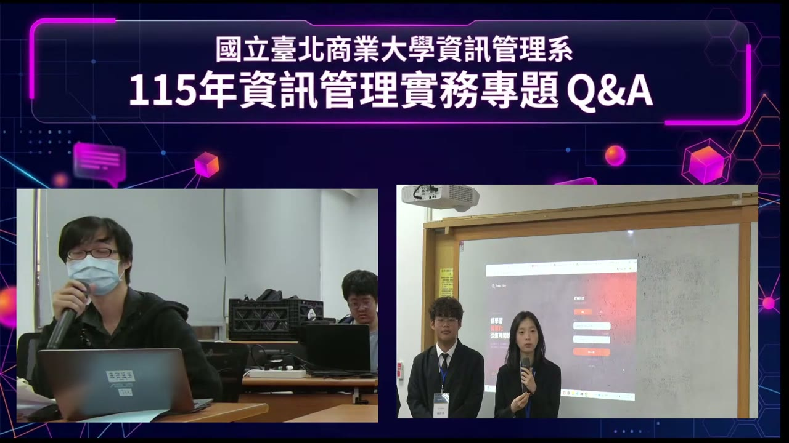
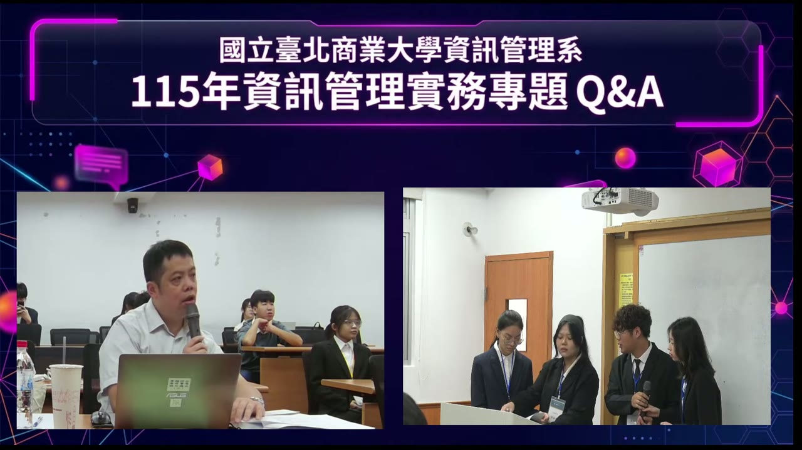
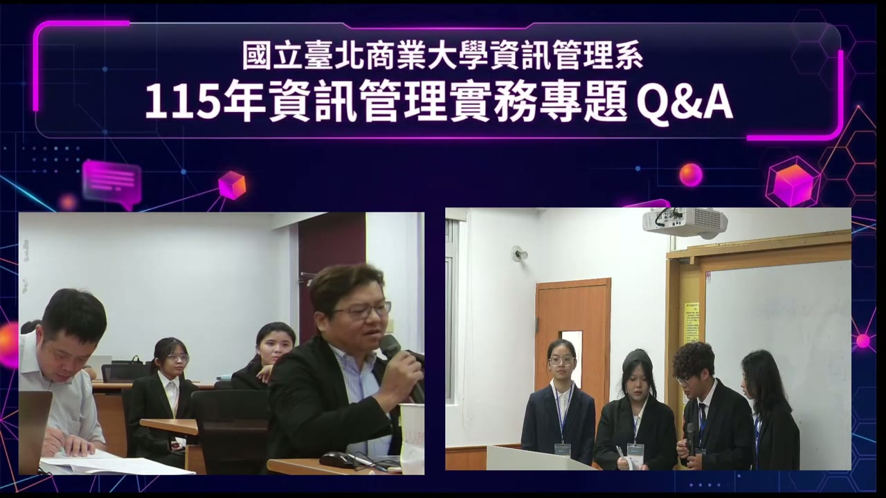

# 複評複盤與 QA 整理｜2026-10-22

| 評審 | 題目／回放 | 問題核心 | 我們當下的回應 |
|---|---|---|---|
| 1 | [1-1 帳號如何取得](https://youtu.be/FoF6-8YnPWw?t=958) | 是否須先註冊 | 百陶：Excel 匯入名單建立帳號，密碼為學號，登入後更新 |
| 1 | [1-2 YouTube 每日上傳上限](https://youtu.be/FoF6-8YnPWw?t=994) | 學期初集中上傳時，YouTube 當日額度用完怎麼辦 | 偉豪：談擴充伺服器；未直接說明額度滿額處理 |
| 1 | [1-3 服務或系統授權](https://youtu.be/FoF6-8YnPWw?t=1048) | 只授權系統，還是連硬體、AI 一起提供 | 偉豪：談系統授權，部署成本尚未考慮 |
| 1 | [1-4 組織分層管理](https://youtu.be/FoF6-8YnPWw?t=1088) | 後台缺少組織概念，如何分層管理師生 | 偉豪：致謝，後續優化 |
| 2 | [2-1 LLM、資料庫與 RAG](https://youtu.be/FoF6-8YnPWw?t=1126) | 檢索、生成與快取如何分工；報告書沒寫 RAG | 百陶：首次檢索生成，重複問題沿用快取 |
| 2 | [2-2 模型部署位置與隱私](https://youtu.be/FoF6-8YnPWw?t=1187) | LLM 在雲端或地端、個資與主權 AI | 偉豪：問答用雲端 API，短片在地端生成；地端部分報告書未寫 |
| 2 | [2-3 自有模型與演算法](https://youtu.be/FoF6-8YnPWw?t=1311) | 是否自行設計或修改模型、演算法 | 偉豪：以雲端 API 為主，未設計演算法 |
| 2 | [2-4 每週進度與指導](https://youtu.be/FoF6-8YnPWw?t=1402) | 是否每週確實和老師討論 | 偉豪：每週討論、進度上傳 GitHub；會議紀錄見第 302 頁 |
| 3 | [3-1 短片生成、驗證與修改](https://youtu.be/FoF6-8YnPWw?t=1484) | 怎麼驗證、花多少時間、能否在平台上調整 | 偉豪：教授給建議，AI 重跑流程；未給耗時 |
| 3 | [3-2 精華選段與修正資料學習](https://youtu.be/FoF6-8YnPWw?t=1601) | 參考賽事精華 AI 剪輯，以人工修正資料學習 | 偉豪：已規劃、實作一半，尚未完成 |
| 3 | [3-3 LINE 提問是否納入統計](https://youtu.be/FoF6-8YnPWw?t=1670) | LINE 問題是否計入統計 | 百陶：共用資料表，與網頁提問同步 |
| 3 | [3-4 聲音向量是否接入問答](https://youtu.be/FoF6-8YnPWw?t=1700) | 聲音向量是否能正式問答 | 偉豪：已有向量，尚未接入正式問答 |

三位評審依發言順序編號，搭配各段現場畫面。原文先以直播回放與現場錄音（Whisper medium）辨識比對，**2026-10-24 再由團隊人工逐字聽校「評審原文摘錄」與「我們當下的回應」**；評審與團隊的對話依發言順序交錯呈現，引用區塊是評審發言。回答者依錄音音高與現場畫面判斷並經聽校確認：女聲為百陶、男聲為偉豪。各題的後續處理、要和教授確認的問題與待研究清單見 [Notion 任務頁](https://app.notion.com/p/4024fe40c8bb81eaacf7ec5983235869)；2026-10-25 逐題檢查後的處理方式與理由見[後續處理總表](後續處理總表.md)。

## 評審一｜校外業師（戴口罩、黑色外套）

15:58–18:37｜現場畫面 16:50

### 1-1 帳號如何取得

[回到 15:58](https://youtu.be/FoF6-8YnPWw?t=958)

**評審原文摘錄**

> 問一下，如果學生跟老師要用，他們是要先做註冊嗎？

**問題核心**：師生要自行註冊，還是由管理端建立帳號。

**我們當下的回應（百陶）**：學生部份我們有建立了一個匯入的功能，可以把學生名單整份 Excel 匯入，系統直接建立帳號與密碼；目前帳號是用學生的 Gmail，密碼是學號，登入後再更新。老師也用同樣方式建立。

### 1-2 YouTube 每日上傳上限

[回到 16:34](https://youtu.be/FoF6-8YnPWw?t=994)

**評審原文摘錄**

> 因為我看你們把老師的影片上傳，會透過你們的 YouTube 帳號去做上傳？然後你們有思考過學期初可能比較多老師會同時上傳，那你們有考慮過當日上傳的上限？如果萬一滿了，然後系統後續會怎麼處理？

**問題核心**：多位教師共用一個 YouTube 頻道上傳，學期初集中上傳時，當日額度用完怎麼辦。

**我們當下的回應（偉豪）**：這部份的話有在持續的和教授討論規劃，老師大量上傳時設一個部署端擴充伺服器，尚未實作。答成伺服器容量，沒有回答額度滿了的處理。

### 1-3 服務或系統授權

[回到 17:28](https://youtu.be/FoF6-8YnPWw?t=1048)

**評審原文摘錄**

> 你們商業模式是跟學校去談雲端服務，還是說你們是談系統的授權？就裡面包含你們的一些硬體設備、AI 那些啊都包含，還是說只跟學校談你們的系統，但是他們要提供對應的 YouTube 帳號、相關的 AI 的帳號？

**問題核心**：合作方買到什麼：硬體、AI 由我們包辦，還是只授權系統、由學校提供 YouTube 與 AI 帳號？部署成本由誰負擔？

**我們當下的回應（偉豪）**：主要談系統面的授權服務；那如果是系統的部署成本還沒考慮到，要和學校討論。

### 1-4 組織分層管理

[回到 18:08](https://youtu.be/FoF6-8YnPWw?t=1088)

**評審原文摘錄**

> 我覺得可以建議你們，像以北商為例，其實北商學生很多，那負責對應的承辦老師可能也不一樣。那你們，因為看起來是你們後台比較沒有組織的概念，或許未來可以考慮增加不同的組織，然後分給不同的教務同仁去做管理，管理學生跟老師這方面。

**問題核心**：學生多、各單位承辦老師不同時，後台如何依組織分層，讓不同教務同仁各自管理學生與老師。

**我們當下的回應（偉豪）**：感謝建議，後續會再優化。

## 評審二｜北科大電子系教授（淺色襯衫）

18:37–24:24｜現場畫面 20:50

### 2-1 LLM、資料庫與 RAG

[回到 18:46](https://youtu.be/FoF6-8YnPWw?t=1126)

**評審原文摘錄**

> 我還是不太知道你們什麼時候用 LLM，什麼時候用資料庫？是在什麼時候會取決於要用資料庫，什麼時候用 LLM？這部分我有點好奇。

**我們當下的回應（百陶）**：比方說學生第一次提問，我們會先從系統裡面抓相關的知識，他是一個 RAG 的概念，然後我們把 RAG 的 Output 送進 LLM 生成回答；那如果以前已經問過同樣問題，那再問第二次的時候，會直接沿用我剛剛說的快取資料表的部份，會直接延用他裡面的回答，降低成本。

> 所以你們是用到所謂 RAG 的概念嗎？

**我們當下的回應（百陶）**：對我們有用 RAG。

> 可是我好像報告書沒有看到。在哪裡？

> 就是其實我剛剛原本要講其實你們可以使用 RAG 的概念。

**問題核心**：一次提問中，資料庫檢索、LLM 生成與快取如何分工；報告書沒有把 RAG 寫清楚，評審本來也想建議使用 RAG。

### 2-2 模型部署位置與隱私

[回到 19:47](https://youtu.be/FoF6-8YnPWw?t=1187)

**評審原文摘錄**

> 那第二個，你們的 LLM 到底是雲端還是地端？

**我們當下的回應（偉豪）**：那我們目前的話，整個問答是採用 Gemini API，所以他的資料可能存在雲端上面；然後向量資料主要存在 MongoDB。但是短影音生成的話，因為會牽涉教授的臉部，所以用指導教授的 GPU 在地端跑 ComfyUI 與 MiniMax H3 去進行短影片的生成。所以目前是有雲端跟地端的部份。

> 因為這部分我好像沒有在報告書中有看到，這部份你們好像也沒寫到對不對？你們剛剛講到那個有關影片會用到地端，會有寫到。

**我們當下的回應（百陶）**：我們可能要找一下。

> 好那沒關係，因為其實我們現在在做很多研究，來自於實際上做校務分析，我們都很擔心有所謂叫做個資法或隱私的東西。所以現在整個教育部，甚至於國科會都在推主權 AI。不過主權 AI 的問題在於說，可能要足夠有好的 GPU server，可能用到 H100 或 H200，那都非常的貴。那再來是說會有說要預防這樣的一個資安問題，會有做一個叫資料清洗的動作。
>
> 我必須要講其實因為就評分表來看的話，你們真的是完全按照評分表來去設計，對真的是可以拿到蠻高分的，真的是蠻不錯的。

**我們當下的回應**：並未回應，評審直接接到 2-3 的問題。

**問題核心**：LLM 在雲端還是地端、資料送到哪裡、有沒有個資外送；報告書沒寫到地端的部分；學校重視個資與主權 AI。

### 2-3 自有模型與演算法

[回到 21:51](https://youtu.be/FoF6-8YnPWw?t=1311)

**評審原文摘錄**

> 那最後一個問題，當然我是電資工程系出身，那我通常都會問：你們有自己的 model 或演算法嗎，還是都是用別人的？每一組都會問這個問題。
>
> 當然，這個問題不會影響到這邊的評分，因為這邊的評分不會影響到這個選項，但是我通常都會問這個問題啦。你們有沒有嘗試自己去更改 model 或演算法，還是說你們主要是去使用它？

**我們當下的回應（偉豪）**：我們在設計的時候，就是跟學生進行問答主要採用雲端 API，沒有設計演算法；後續討論，看看能否實作。當場沒有提到自己設計的檢索與評測方法。

> 你們四位會要繼續升學嗎？如果要繼續升學的話，就會建議這邊可能還是要做，因為到碩士班的時候，就會需要做到這部分的東西。
>
> 不過整體的話我覺得你們這組還是蠻不錯的，真的就是整個系統包含完成度。

**我們當下的回應（百陶）**：有機會的話。

**問題核心**：有沒有自己設計或修改模型、演算法（評審每組都問，不影響評分）；若要升學，研究深度需要加強。

### 2-4 每週進度與指導

[回到 23:22](https://youtu.be/FoF6-8YnPWw?t=1402)

**評審原文摘錄**

> 因為有一個評分叫做每週進度文件要上傳，這個你們每週都有跟老師 meeting 嗎？所以我這邊想要問的是說其實你們每周都有跟老師 meeting 對嗎？這部分我比較在乎，因為從文件可以看到你們有沒有上傳，但看不出是不是每週？這邊有五分可能在意說，你們有沒有每週都確實有在跟老師討論專題的部分。

**問題核心**：「每週進度文件上傳」這 5 分看的是每週都確實和指導老師討論；文件看得出有上傳，看不出是不是每週。

**我們當下的回應（偉豪）**：每週和教授討論，討論前把當週進度上傳到 GitHub；不方便上傳的大檔放 Google 雲端硬碟。收尾補充報告書第 302 頁有每週會議紀錄（[29:06](https://youtu.be/FoF6-8YnPWw?t=1746)）。

## 評審三｜本校老師（眼鏡、深色西裝外套）

24:30–28:59｜現場畫面 24:30

評審三先肯定「提問後直接跳到講解位置」的功能很順，再開始提問。

### 3-1 短片生成、驗證與修改

[回到 24:44](https://youtu.be/FoF6-8YnPWw?t=1484)

**評審原文摘錄**

> 那我有幾個想要了解的地方啦，那在你們剛剛報告的過程中，蠻想要知道那個短影音背後的生成方式，那看起來就是給予一些提示詞，那我也在思考一件事情齁。如果我們給一些提示詞，那生成的短影片，那個驗證怎麼樣去驗證？是人工的驗證嗎？然後會不會要花很多時間？

**我們當下的回應（偉豪）**：在短影片的部份的話，我們目前腳本以文字產生施工單，他不只包含我們要的內容，還有包含一些影片要如何呈現規格，一併交給 AI 模型；那我們現在還有在設計一套機制是說，透過程式去控制畫面的機制，但這一套機制目前的效果還不夠好，尚未接入，目前以生成式模型為主。那程式方面我們這邊也有在考量，因為我們有考量就是說他可能影片生成出來我們沒辦法控制，教授可能就要生成很多次。

> OK，那有去了解一下他後面驗證機制，因為可能他生成出來的短影音，可能離我們想像的還有一段落差，然後要去做調整，那這個過程的調整會很複雜嗎？還是可以在平台上直接調整？

**我們當下的回應（偉豪）**：調整方式是教授給 AI 建議，AI 重跑一次流程。目前是這樣子，但這部份後面我們可能會再持續進行優化。

**問題核心**：短片怎麼生成、是否人工驗證、驗證要花多少時間；結果不如預期時，能不能直接在平台上調整。

### 3-2 精華選段與修正資料學習

[回到 26:41](https://youtu.be/FoF6-8YnPWw?t=1601)

**評審原文摘錄**

> 那這個可能可以再研究一下，因為就像剛剛老師提到的演算法這部份阿，因為其實有研究在做這一塊，我甚至可以給你一個方向，有些人在研究說，各位知道有一些職業賽事會有現場直播嘛，阿現場直播可能就錄下整場比賽的影片，然後通常最後會有一個賽事的精華剪輯，以往是人工，現在有 AI 在做。

**我們當下的回應（偉豪）**：對，就是其是向現在 Claude 新推出的模型，我們有考慮讓他進行控制流程部份。

> 那還有一個方式，我也不知道可不可以嘗試看看，比方說，你們現在可能是透過 AI 幫你們去剪輯短影音，那可能還要做一些人工的修正，那人工修正出來的影片是我們想要的影片，對不對？也許這個資料累積久了，你們也可以丟給 AI 說，這是我的剪輯邏輯，讓它去學習一下。

**我們當下的回應（偉豪）**：有，目前我們背後已規劃、應該說目前已經實作一半，但尚未完整的實作出來，這部分我們會在持續討論。

> 好好，那就期待一下。

**問題核心**：評審提供研究方向：參考賽事精華的 AI 剪輯，並累積人工修正後的成品，讓 AI 學習老師的剪輯邏輯。

### 3-3 LINE 提問是否納入統計

[回到 27:50](https://youtu.be/FoF6-8YnPWw?t=1670)

**評審原文摘錄**

> 那你們有一個功能算是叫做 LINE 提問，我剛剛看到一閃即逝，有一個學生學習的成效，包含提問的次數，那 LINE 上面的提問會影響到那邊嗎？

**問題核心**：跨入口的提問是否一起統計。

**我們當下的回應（百陶）**：網頁和 LINE 共用同一個資料表，不管在哪裡問都一樣，數據同步變動。

### 3-4 聲音向量是否接入問答

[回到 28:20](https://youtu.be/FoF6-8YnPWw?t=1700)

**評審原文摘錄**

> 你剛剛也有提到一個你們有關聲音的部分，我剛剛好像聽你說那個部分是還沒有完成？

**問題核心**：聲音功能做到哪裡。

**我們當下的回應（偉豪）**：聲音已產生向量，但還沒接入正式問答，因為目前三種向量怎麼整合還沒討論出來；目前以文字問答為主，需要畫面或答不出來時用畫面向量來去進行回答。

[Notion 任務頁](https://app.notion.com/p/4024fe40c8bb81eaacf7ec5983235869)｜[來源與處理紀錄](來源與處理紀錄.json)｜[未校對辨識原稿](機器辨識原稿.json)
