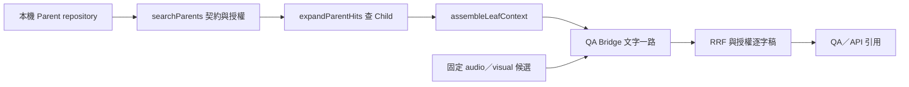

# 多模態離線驗收

這套工具驗證 Parent 到引用的程式路徑，以及固定題庫的排名驗算。執行時只讀本機 JSON，使用合成 fixture 或已保存向量，不連 Atlas、不呼叫模型。實際完成範圍與當次結果見[目前狀態](../../current-status.md)。

## Parent 路徑

`backend/tests/helpers/multimodalParentFixture.js` 明列 synthetic 來源。合成 Parent 用二維單位向量內積排序，正式 `searchParents` 複核契約與授權，再由 `expandParentHits` 查 Child、`assembleLeafContext` 組教師逐字稿，最後接 Bridge 與既有 RRF。



Flat 只回 child-0，Parent 命中則回 child-1、child-2。Parent 的 0–90 秒不取代 child-1 的 22–24 秒。兩種模式共用 media 候選；六組 × 兩模式 × 兩種權重維持每題 24 筆。缺 Parent、缺 Child、跨課影片會回退；部分 Child 缺少仍可保留有效候選，重複命中會去重。正式 QA 的新增測試另外使用 Fake Parent adapter 驗證 serve rollout，沒有宣稱 Atlas Parent 效果。

## 題庫與評分規則

正本為 [question-bank.json](../QA_Evaluation/datasets/question-bank.json)，檔案有 50 題，其中 43 題可回答、7 題應拒答。`--inspect-bank` 只檢查格式與缺漏，不計算品質分數。宣告的影片缺時間標註時拒絕評分，由題庫維護者確認，不自動補 gold。

沿用決議第 7 項，chunk 一半以上落在標註時間範圍才相關；同影片區間先取聯集，避免重複計秒。專題的 Recall@5 沿用題級命中定義，前五筆至少一筆相關為 1，否則 0；MRR 為保存前 20 名中第一筆相關結果的倒數排名。43 題做平均，拒答題排除並另記第一名 score，缺分數時回報 missingRefusalScores，不憑空填分數。

`offlineRetrievalAudit.service.js` 用區間合併評分；`verifyMultimodalAudit.js` 獨立以端點切割及中點覆蓋重算，不共用相關性與指標計算函式。兩者共用題庫 parser，parser 的多影片、逗號區間與缺漏由獨立案例驗證。任一逐題／平均結果不符即拒絕驗算。

## 輸入與命令

從根目錄使用支援版本的 Node。

```powershell
node backend/scripts/auditMultimodalOffline.js --inspect-bank docs/04_Features/QA_Evaluation/datasets/question-bank.json
node backend/scripts/auditMultimodalOffline.js bank.json manifest.json per-question.json config.json
```

輸出只有機器可讀 JSON。BLOCKED 結束碼 2，格式／校驗錯誤結束碼 1；成功為 0。檔案與輸出保存在忽略目錄，不將向量、逐字稿或備份提交 Git。

- bank 沿用上述題庫格式。manifest 為 `{ provenance, chunks }`，每個 chunk 必須有 courseId、videoId、chunkId、startSec、endSec，且在題庫課程與影片範圍內。禁止重複身份或無效時間，不需要向量與逐字稿。
- per-question 沿用現有輸出，每筆包含 questionId、mode、group、weighting、ranked。每題完整 24 組，ranked 上限 20，rank 從 1 連續；身份、影片與秒數必須和 manifest 一致。重複 chunk、未知題號、跨課、缺組或時間錯位會拒絕。
- config 需有 bankHash、manifestHash（`fingerprint` 對載入 JSON 的 SHA-256）、questionCount（含拒答題）、k=60、perChannelLimit=20、modes=`[flat,hierarchical]`、weights=`[equal,text_weighted]`、groups=`[text,audio,visual,text_audio,text_visual,all]`。順序固定。provenance 明列 synthetic、saved-gemini-fake-atlas 或 atlas，formalEvaluation 必須 false。
- 舊三題／72 筆 config 沒有完整題庫與 manifest 綁定，會回報 BLOCKED。不能把它補標成完整 43 題結果。工具回傳 bank／manifest／ranking／config hash 供獨立驗算與追溯，qualityClaim 固定 false。

離線單元測試用合成 43 題及合成 gold 驗算算式，所有數字僅代表測試預期值。正式品質報告、真實完整排名、gold 補標與驗收另行進行，本工具不授權正式品質宣稱。

## 引用元件瀏覽器 smoke

`multimodal-qa.integration.test.js` 可將本機 API 結果的身份、原始時間及來源輸出到 MULTIMODAL_BROWSER_FIXTURE 指定位置；不輸出逐字稿或向量。先設定 MULTIMODAL_OFFLINE_BUNDLE 指向保存的小樣本 bundle，再執行該測試。

`frontend/focus-flow/tests/browser/citationSmoke.mjs` 用 React 實際標籤元件渲染最小本機頁面，再以 Playwright 驗證 aria-label、舊資料無標籤、身份／排名／秒數及鍵盤跳轉。PLAYWRIGHT_MODULE_PATH 可指向現有 Playwright 模組，PLAYWRIGHT_CHROMIUM_EXECUTABLE 可指向已安裝的 Edge／Chromium。

```powershell
node frontend/focus-flow/tests/browser/citationSmoke.mjs .local-tools/phase2-validation/phase9-browser-fixture.json .local-tools/phase2-validation/phase9-browser
```

這是實際引用元件的本機 smoke，範圍不含整個 StudentCourses 頁面、正式播放器或正式站人工驗收。若缺瀏覽器，明列未執行，不自動安裝或宣稱通過。

## 第十階段固定口徑

`evaluationProtocol(bank)` 產生明確的 43 題計分清單與 7 題診斷清單，依據 decisions 基線表、第 6／7／8 項與 MA，沒有另選子集。Recall@5 為前五筆命中題數／43，Recall@10 同理；MRR 為保存前 20 名的首個相關名次倒數加總／43。7 題拒答不納入這三個平均，另列 top-score；人工拒答評分仍屬回答品質評測。

主比較為 Flat／Hierarchical × text／all 共四格，等權及文字 2:1:1 各留一版，形成八組輸出。text 單路的權重不改排序，不重複計為新實驗。完整六組模態 × 兩模式 × 兩權重共 24 組診斷輸出，包含主比較而非額外再加；每組分母維持 43，不能把重複條件加大樣本數。若含拒答診斷，全 50 題輸出為 1200 筆，其中 1032 筆計分、168 筆拒答診斷；這是列數，獨立計分題數仍為 43。

config 現在還必須包含 `protocolHash=fingerprint(evaluationProtocol(bank))`。protocol 與 annotation issue 都帶 `goldVersion=bank-sha256:<bankHash>`，獨立 checker 會核對 protocolHash；題庫／標註改動後不能沿用舊 config 或成績。[annotation-issues.json](../QA_Evaluation/datasets/annotation-issues.json)記錄 X01 原值、主評分表儲存格／SHA、最初提交、兩次歷史結果與核定流程，沒有修改人工標註。

## 完整本機學生頁驗收

沿用 `multimodal-qa.integration.test.js` 的隔離 Express／stub models，設定以下測試參數後執行該檔。`runStudentBrowserFixture.mjs` 在同一測試生命週期建立本機 Vite，瀏覽器真的操作登入、我的課程、輸入提問、API 對話、引用卡片與 HTML video；外部網路請求在瀏覽器端攔阻，Node 端 Gemini HTTP 由既有 fixture 攔截。

- MULTIMODAL_OFFLINE_BUNDLE 指向保存 bundle。
- MULTIMODAL_FULL_BROWSER_OUTPUT 指向忽略目錄的結果／截圖資料夾。
- MULTIMODAL_SYNTHETIC_MEDIA 指向本機合成影片，長度須涵蓋 fixture 原始引用秒數。
- PLAYWRIGHT_MODULE_PATH、PLAYWRIGHT_CHROMIUM_EXECUTABLE 沿用已安裝的 Playwright 與 Edge／Chromium。

例如使用既有 imageio_ffmpeg 的 ffmpeg 將 `color=c=black:s=160x90:r=1` 編成 1800 秒 H.264／yuv420p MP4，放入 `.local-tools/phase2-validation/`。這是合成黑畫面，不對應教學內容。測試將它複製到 harness 私有 uploads，僅在 test env 開啟 local playback，結束時關閉 browser／Vite、恢復記憶體設定與 fixture，清除該份測試媒體副本，不啟動正式 server 或 queue。

```powershell
node --test backend/tests/multimodal-qa.integration.test.js
```

瀏覽器驗證六情境為 flag off、flat、hierarchical、missing-index、all-failed、invalid-time。檢查引用 video／chunk／channelRanks／原始起訖、API status、回退診斷、跨課 403 及播放器 currentTime；Flat 另重新整理並從最近對話恢復，再點引用跳轉。保存 checkpoint 是真實向量，Atlas／embedding HTTP／Parent 是假介面或合成關係，回答為 template，媒體為 synthetic。結果只證明本機整合與播放跳轉，不代表真實 Atlas、生成品質或正式站已驗收。
