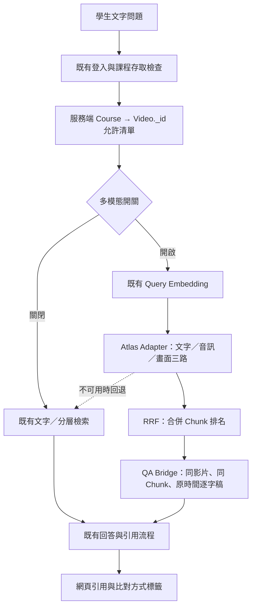

# FocusFlow 多模態：團隊進度總覽

這是 2026-11-11 的團隊溝通快照，讓組員先理解架構、證據及剩餘工作。**程式已接線，三筆真實 Atlas 技術驗證與回復已完成；全量正式驗收尚未完成。** 最新狀態仍只以 [current-status](../../current-status.md) 為正本，本頁不是另一份持續更新的狀態帳本。

## 先看這五點

1. 多模態是替既有 QA 增加文字、聲音、畫面三路「找片段」能力；回答證據仍取授權影片的逐字稿，不把聲音／畫面向量當成答案。
2. 正式目標是原本的 `focusflow.video_segments_text` 與 `text_embedding_index`。B 方案保留舊 embedding，只在指定 Chunk 另存 stable 文字／音訊／畫面向量；沒有新增集合或索引。
3. 三筆九向量曾實際寫入 Atlas、建立同名索引三路 path 並查詢；實測後已回復，694 筆指定範圍完整文件與備份相同，原文字搜尋正常。**這不代表目前 Atlas 已持續保留多模態資料。**
4. 前輪偽造 scope 的「跨課失敗」經契約審查改列測試前置不成立，不能直接宣稱正式 QA 漏洞。正式 QA 的課程授權與影片關係才是可信邊界；新契約矩陣仍待核准與執行。
5. 沒有完成 694 筆全量影音向量、正式 43 題評測或正式網站多模態 E2E，也沒有因此開啟旗標或部署。

## 技術架構：沿用原系統加檢索分支

下圖是已實作的程式路徑，不代表正式 runtime 已開啟。程式預設 `QA_MULTIMODAL_FUSION_ENABLED=false`；本輪文件整理未查正式環境旗標，也未部署。

- **影音準備**：[segment_media_embedding.py](../../../STT_Whisper/src/segment_media_embedding.py) 切逐 Chunk 音訊／無聲畫面；[Gemini Adapter](../../../STT_Whisper/src/gemini_multimodal_adapter.py) 管模型契約、checkpoint 與費用保護。保存向量可供小樣本重用，正式 QA 仍沿用原本 embedQuery 路徑；模型新增呼叫須另授權。
- **檢索與融合**：[Atlas Adapter](../../../backend/src/services/atlasMultimodalAdapter.service.js) 查三路；[RRF](../../../backend/src/services/rankFusion.service.js) 固定 k=60，等權或文字 2:1:1；[Bridge](../../../backend/src/services/multimodalQaBridge.service.js) 取得可信逐字稿，保留 retrievedBy、排名與原始秒數。
- **正式接線**：[qa.service.js](../../../backend/src/services/qa.service.js) 已接開關、回退、FAQ 證據版本與引用。Parent／Hierarchical 沿用既有模組，分層只改文字一路；LINE 沿用既有流程，不加網頁標籤。
- **安全工具**：[control.js](../../../backend/scripts/atlas-multimodal/control.js) 提供三筆 allowlist／CAS／資料回復；[index-control.js](../../../backend/scripts/atlas-multimodal/index-control.js) 處理索引前像、三節點、磁碟 receipt 與未知結果停止，不自動重送或回復。

例：聲音向量找回 A 片段 → RRF 排第一 → Bridge 載入 A 同一時段教師逐字稿 → 回答引用原 1752.15–1754.55 秒；即使影音切片延伸到 8 秒，引用秒數也不改。

## 完成度必須分四層讀

| 範圍 | 程式成果 | 已有證據 | 不能推論的完成事項 |
|---|---|---|---|
| 切片與 Gemini Adapter | 既有逐 Chunk、保存與重用流程 | 先前 12/12 真實輸入成功：3 query＋9 document/audio/visual，皆 3072 維 | 不代表 694 筆影音全量完成，也不保證後續免模型費 |
| Atlas Adapter／RRF | 三路查詢、兩版固定權重、時間與來源傳遞 | Mock 回歸；此次三題真實 Atlas 排名及獨立算式核對 | 小樣本語料只有三筆，不能報成正式 Recall@5／MRR 提升 |
| QA／Bridge／FAQ／引用 | 已接既有 QA、預設關閉、回退與快取分版 | Fake Atlas／embedding、template 回答、本機 API／網頁測試；歷次測試範圍見驗證紀錄 | 不是正式站、真實回答品質或所有授權情境已驗收 |
| Parent／Hierarchical | 既有父子檢索與文字分支整合 | 合成 Parent／Leaf fixture 與離線比較 | 不代表全課程 Parent／媒體語料或四格正式實驗完成 |
| CAS／索引工具 | 限三筆、完整前像、receipt、三節點與停止流程 | 66/66 離線演練；真實正向／回復各一次且完成 | 無法保證任意異常都能自動回復；遇衝突仍須停止 |
| Contract-first 授權驗收 | 既有課程授權與 canonical 影片 scope；已完成靜態審查 | 25 項情境矩陣與責任分類已保存 | 新矩陣尚未實作／執行，不能用先前 66/66 代替 |

以上是日期快照；逐階段測試數與 Fake／Synthetic 邊界看 [狀態正本](../../current-status.md)及 [驗證紀錄](evidence/進度.md)。

## 真實 Atlas 小樣本：可分享的結果

程式基準 `13e8a8c`，2026-11-11 台灣時間約 17:28–17:39 執行／彙整。A＝影片一 Chunk 0117、B＝影片一 Chunk 0001、C＝影片四 Chunk 0070；完整 ID、原始時間、每路 score、融合分數、雜湊與回復摘要見 [去敏實測 JSON](evidence/2026-11-11-atlas-sample-summary.json)。

| 保存 query | 文字 | 音訊 | 畫面 | 等權 RRF | 文字 2:1:1 RRF |
|---|---|---|---|---|---|
| A | A>B>C | A>B>C | A>C>B | A>B>C | A>B>C |
| B | B>C>A | B>A>C | A>C>B | B>A>C | B>A>C |
| C | C>A>B | C>A>B | C>A>B | C>A>B | C>A>B |

這裡的「搜尋成功」只表示保存 query 能從三筆已索引的真實向量取回候選、時間戳正確、RRF 可計算。沒有測全課程競爭排名、正式 43 題品質或回答生成。

安全回復核對：三筆新增欄位已還原；694 筆指定範圍完整文件相同；全 collection 計數仍 815；原索引定義 hash 一致，三節點 READY／QUERYABLE；文字基準三筆前後 rank 1。694 筆備份不等於全 815 筆的災難備份。索引更新與回復重建各一次，沒有刪索引、升級或盲目重送。

## 授權契約：不要把三件事混在一起

- **已確認的正常設計**：舊 Leaf 可以沒有頂層 courseId。正式 QA 先驗課程存取，再建立 canonical Video._id allowlist；Adapter／Bridge 接收的是可信 scope，不能自行授予權限。不能為了測試零筆而補 courseId 或排除合法 Chunk。
- **已更正的測試假設**：把錯誤課程和原影片清單人工拼成 scope，直接呼叫 Adapter，不符合其前置條件。實際曾回三筆是觀察事實，但不能因此證明正式 API 越權。原始記錄保留，去敏摘要另外附契約解讀。
- **待決的跨模組語意**：系統允許合法跨課掛載。Leaf 或影音 metadata 的 courseId 若記原製作課程，與當次掛載課程不同時應怎麼處理，需先確認；不能先改過濾再湊測試通過。

逐例依據、輸入、預期、責任與合法資料影響看 [契約審查與 25 項矩陣](authorization-contract-review.md)；這份審查文件已獨立提交於 `0891715`。

## 尚未完成與下一步

| 順序 | 工作 | 放行／驗收條件 |
|---|---|---|
| 1 | 審閱 Contract-first 矩陣，確認合法掛載與課程欄位語意 | 核定 U01/U02，保留缺欄位的合法路徑；本輪只文件，尚未進實作 |
| 2 | 只補本機 Fake／記憶體授權測試 | 覆蓋未修課、revoked、scope 注入、缺欄位、合法共享、FAQ 與 fallback；有合法前置且違約，才提最小修補 |
| 3 | 決定是否需要第二輪 Atlas 小樣本 | 另授權寫入／索引／必要回復，重新查證前像與人員／資源；不自動使用第一輪授權 |
| 4 | 準備完整一致的語料／Parent／媒體向量與 43 題評測 | X01 的 V5 人工時間缺漏需題庫維護者核定；全量模型費、Atlas 操作及相關成本另批，不以三題取代 |
| 5 | 正式 QA 驗收及是否開啟 | 依 HANDOFF／decisions 完成固定比較與門檻、真實 QA／網站驗收，再單獨決定旗標與部署 |

11/13 原目標仍有時程風險，不能把小樣本成功當完整交付。章節、RU 影片升級及其他 HANDOFF 目標不在本次文件整理的完成宣稱內，需另按原目標協調。

## 接手與證據入口

| 想確認什麼 | 看哪裡 |
|---|---|
| 最新狀態／驗證範圍 | [current-status](../../current-status.md) |
| 原交接、決策與修改邊界 | [HANDOFF](HANDOFF.md)、[decisions](decisions.md) |
| QA／Adapter／Bridge 的輸入責任 | [整合契約](phase2-adapters.md)、[授權矩陣](authorization-contract-review.md) |
| 安全操作與回復門檻 | [Atlas 操作計畫](atlas-preparation.md) |
| 真實模型與 Atlas 小樣本 | [Gemini 小樣本](evidence/2026-11-10-live-sample.md)、[Atlas 去敏摘要](evidence/2026-11-11-atlas-sample-summary.json) |
| 測試指令、Fake 限制與追溯 | [進度／驗證紀錄](evidence/進度.md)、[離線驗收](offline-acceptance.md) |

完整向量、影音、Gemini checkpoints、備份、raw metadata 及憑證只留本機忽略目錄，不進 GitHub。去敏摘要保留既有公開的 Chunk 識別碼、時間、數值與雜湊，沒有原始逐字稿、模型向量或私人帳號。接手不要啟動服務試探 autoIndex，也不要自行部署或再寫 Atlas。

**可直接分享：** 多模態核心已接上既有 QA，三筆真實 Atlas 三路檢索、兩版 RRF 與安全回復有證據；原 694 筆資料完整保留。尚未完成全量影音、正式 43 題與正式站驗收。接下來先依既有授權契約補測，不以缺少 courseId 或任意偽造 scope 的結果直接判漏洞，也不改寫合法資料湊通過。
