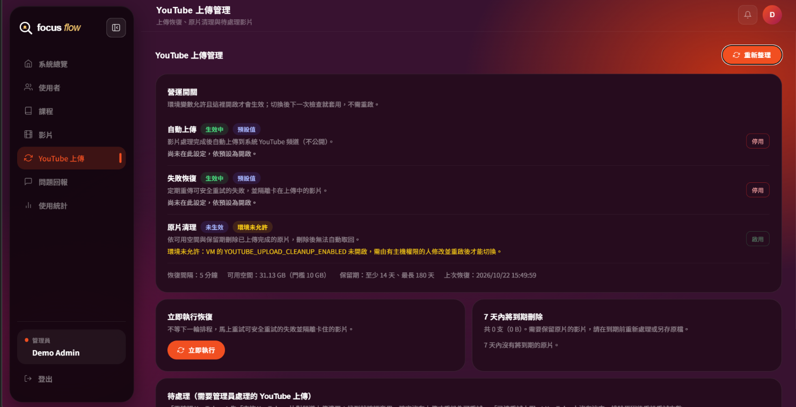
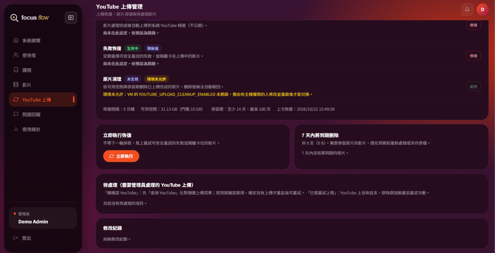

# YouTube 恢復與清理上線紀錄（2026-10）

這份紀錄說明 2026-10 把 `dev` 合併到 `main`、部署 YouTube 上傳恢復與原片清理的過程與證據。部署後要知道當時改了哪些設定、檢查過什麼時查閱；功能目前狀態一律看[目前狀態](../../current-status.md)。

## 結論

| 項目 | 內容 |
|---|---|
| 上線時間 | 2026-10-22 15:44（台灣時間）push `main`，15:45 部署完成 |
| 部署版本 | `main` = `88e3454 Merge branch 'dev'`（合併 `origin/dev` 的 147 筆 commit，內容與 `dev` 相同） |
| 部署方式 | 使用者自行 push `main` → GitHub Actions self-hosted runner 依 [deploy.yml](../../../.github/workflows/deploy.yml) 自動部署 |
| Actions 結果 | ✅ [Deploy to VM #39742613012](https://github.com/11246084/focusflow/actions/runs/39742613012)：拉程式、裝依賴、建前端、SELinux、重啟、QA 就緒與 nginx 檢查全部成功 |
| 上線時的開關狀態 | 上傳開、恢復開；清理環境變數不允許（`env_disabled`），2026-11-09 要開清理時再改 |

## 上線內容

| 功能 | 說明 | 上線後是否生效 |
|---|---|---|
| YouTube 上傳恢復與原片清理 | 兩層開關（環境變數總開關＋管理員執行期開關）、恢復排程、依空間與保留期的清理排程、管理員「YouTube 上傳管理」頁、補回原片、短片成品納入、已達重試上限列入待處理清單；設計見[設計決策](../../04_Features/YouTube_Lifecycle/decisions.md) | 恢復生效；清理要等管理員啟用 |
| 教育開放資料延伸推薦（組員 11246084） | 依關鍵字推薦愛學網影片 | 否，`OPEN_DATA_EXTENSION_ENABLED` 未開，API 回 404，前端自動略過 |
| `short_render/` | 短影片渲染工具 | 否，部署流程不使用 |
| 文件整理 | docs 新結構、AGENTS／CLAUDE 規則調整 | 不影響執行 |

## 環境變數設定

VM 的 `backend/.env` 不隨部署同步，下列變數由使用者在 VM 手動修改；deploy.yml 只傳入 QA 相關變數。後端只在啟動時讀 `.env`，所以在 push 前一刻修改，部署流程的 `pm2 restart` 就會套用。

| 變數 | 改前 | 改後 | 決定與理由 |
|---|---|---|---|
| `YOUTUBE_UPLOAD_RECOVERY_ENABLED` | `false` | `true` | 依[設計決策](../../04_Features/YouTube_Lifecycle/decisions.md) #33 上線時開啟。資料庫還沒有設定時跟隨環境變數，開機就跑一輪，會把可安全重試的失敗上傳實際送到 YouTube |
| `YOUTUBE_UPLOAD_CLEANUP_ENABLED` | `false` | `false`（不變） | 使用者決定（2026-10-22）：先不允許，2026-11-09 要開清理時才改成 `true` 並重啟後端，再由管理員看過預告清單後啟用。清理刪檔無法復原，上線初期保留 VM 這一道關卡；管理員頁的清理開關會顯示「環境變數不允許」，無法切換 |
| `YOUTUBE_UPLOAD_ENABLED` | `true` | `true`（不變） | 上傳總開關，維持現值 |
| 其他既有 YouTube 設定 | `PRIVACY=unlisted`、`PRIVATIZE_ON_DELETE=true`、`MAX_ATTEMPTS=3`、`RETRY_BASE_MS=60000`、`RECOVERY_BATCH_SIZE=5`、`STUCK_AFTER_MS=900000` | 不變 | 2026-10-22 VM 唯讀查得，與 `.env.example` 預設相同 |
| 排程間隔、保留期、空間門檻（5 個） | 未設定 | 未設定，用預設 300000／3600000／180／10／14 | 程式預設即設計值，見[功能開關](../../../backend/docs/feature-flags.md) |
| `OPEN_DATA_EXTENSION_ENABLED` | 未設定 | 未設定（等於 `false`） | 開啟前要先匯入資料，屬 Atlas 寫入，另行討論 |

2026-10-22 15:42 以 `sed -i.bak-20261022` 修改，原檔備份為 `backend/.env.bak-20261022`（已被 `.gitignore` 排除）；改後擁有者 `focusflow`、權限 `-rw-------`、SELinux 標籤 `usr_t` 與改前相同。

例：本次 `YOUTUBE_UPLOAD_CLEANUP_ENABLED=false` → 清理排程不啟動，`/health` 的 `switches.cleanup.reason` 為 `env_disabled`。2026-11-09 改成 `true` 並重啟 → 資料庫還沒有清理設定，`reason` 變成 `default_off`，仍不刪檔 → 管理員看過預告清單、確認為 0 支後啟用。

## 部署前檢查

| 項目 | 結果 | 檢查方式 |
|---|---|---|
| VM 工作目錄與版本 | ✅ 2026-10-22：HEAD 為 `c31b817`（目前的 `main`）；只有 `backend/private-data/avatars/` 下 1 個已追蹤頭貼被刪、2 個未追蹤頭貼。本次合併沒有改到這個資料夾，不擋 `git pull` | 目錄擁有者是 `focusflow`，以 `case` 登入時用 `git -c safe.directory=/opt/focusflow -C /opt/focusflow status --short` 唯讀查看 |
| YouTube 憑證含 `youtube.force-ssl` | ✅ 2026-10-22：`credentialCheck.status` 為 `ok`，`grantedScopes` 為 `youtube.force-ssl`，`privatizeScopeSatisfied` 為 `true`，`readiness` 為 `ready`；不需重新授權 | VM 內 `curl localhost:4000/health`，看 `runtime.youtubeUpload.credentialCheck.grantedScopes`；理由見[部署前檢查](部署與連線排錯.md#部署前檢查youtube-憑證權限) |
| 開機後恢復會處理的上傳 | ✅ 2026-10-22：`videos`、`shortassets` 都沒有 `failed` 或 `uploading` 的上傳，開啟恢復後第一輪不會送出任何影片，待處理清單也是空的 | 唯讀統計 `videos`、`shortassets` 中 `failed`／`uploading` 的筆數 |
| 原片所在磁碟可用空間 | ✅ 2026-10-22：容量 48G、已用 18G、可用 30G（37%），高於清理門檻 10G | `df -h /opt/focusflow/backend/uploads` |
| Atlas 新建 collection | 2026-10-22 唯讀確認兩者都不存在；使用者於 2026-10-22 同意部署重啟時由 Mongoose 自動建立兩個空集合與唯一索引 | 重啟時 Mongoose 自動建立 `runtimesettings`（`key` 唯一索引）與 `open_edu_videos`（`sourceNo` 唯一索引） |

## 合併與本機驗證（2026-10-22）

| 項目 | 結果 |
|---|---|
| 合併方式 | 獨立 worktree checkout `main`，`git merge --no-ff dev`；主工作區的未提交檔案未受影響 |
| 身分檢查 | 合併 commit 的作者與 committer 都是 Weihao，訊息無 AI 署名；待上線 commit 另含組員 11246084 的 2 筆與 GitHub 的 2 筆 PR merge |
| Backend | `npm.cmd test` 1123／1123 通過；`npm.cmd run docs:lint` 通過 |
| Frontend | `npm.cmd test` 107／107 通過；`lint`、`build` 通過（只有 chunk 大小警告） |
| 未執行 | 瀏覽器實測、YouTube 實際呼叫、Atlas 連線（本機 SRV 查詢被拒） |

## 上線後的狀態

| 項目 | 結果 | 檢查方式 |
|---|---|---|
| 兩層開關實際生效值 | ✅ 2026-10-22 部署後：`upload`、`recovery` 為 `envAllowed: true`、`runtimeEnabled: null`、`effective: true`；`cleanup` 為 `effective: false`、`reason: env_disabled`；`switchesError` 為 `null`（`runtimesettings` 可讀） | `/health` 的 `runtime.youtubeUpload.switches` |
| 恢復與清理排程 | ✅ 恢復排程 `timerActive: true`、間隔 300000 ms，開機那一輪 15:44:59 成功、無錯誤；清理排程 `timerActive: false`（環境變數不允許，未啟動）；可用空間約 31 GiB，`belowThreshold: false` | `runtime.youtubeUpload.schedulers.recovery`、`.cleanup` |
| 憑證權限 | ✅ 重啟後 `credentialCheck` 為 `ok`、`grantedScopes` 為 `youtube.force-ssl`、`readiness` 為 `ready` | `credentialCheck.status` 為 `ok`、`privatizeScopeSatisfied` 為 `true` |
| 管理員「YouTube 上傳管理」頁 | ✅ 2026-10-22 15:51：自動上傳、失敗恢復顯示「生效中／預設值」；原片清理顯示「未生效／環境未允許」，按鈕不能切換；上次恢復 15:49:59（第二輪排程已執行）；7 天內到期 0 支、待處理 0 項、修改紀錄空白 | 管理員登入後開啟，見下方截圖 |
| 測試課程上傳影片 | 延後：使用者決定（2026-10-22）不為驗收另傳測試片，以團隊下次實際上傳課程影片作為驗收 | 上傳後確認影片顯示已上傳 YouTube、連結可播放 |

## 不影響上線、但仍未完成的項目

- **正式站上傳 YouTube 的驗收**：延後到團隊下次實際上傳課程影片；部署後的憑證檢查已確認權限與換 token 正常，但尚未有一支經新版程式實際上傳成功。
- **短影片上架流程**：正式站 `SHORT_SCRIPT_AUTOMATION_ENABLED` 未開，短片的上傳、恢復與清理要等開啟短影片腳本功能時再完整驗收。
- **正式啟用清理**：依[設計決策](../../04_Features/YouTube_Lifecycle/decisions.md) #33，2026-11-09～11-13 先在 VM 把 `YOUTUBE_UPLOAD_CLEANUP_ENABLED` 改成 `true` 並重啟後端，再由管理員在介面啟用，啟用前預告須為 0 支。
- **獨立 code review**：原訂 2026-10-26～11-06，本次在 review 前上線。
- **教育開放資料延伸推薦**：未開啟，需先匯入資料。
- 2026-11-16～11-27 佈展期間凍結部署，只修緊急問題。

## 上線後觀察工具

- 服務狀態：VM 內 `curl localhost:4000/health` 的 `runtime.youtubeUpload`，或管理員總覽的「系統服務」
- 待處理上傳、開關與刪除預告：管理員「YouTube 上傳管理」頁
