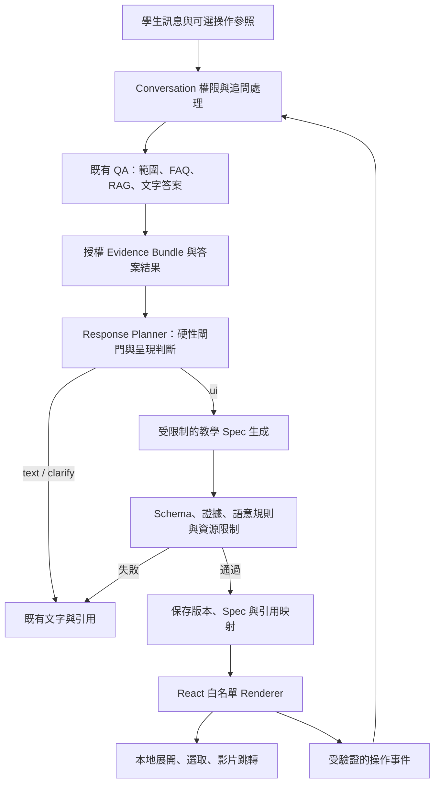

# Adaptive Generative UI 開發計畫

> 文件版本：0.2｜建立／更新：2026-10-12（Asia/Taipei）
> 狀態：規劃完成，功能尚未實作；M0–M7 均未驗收。
> 程式基準：`7a9dc63ae1566bf624f76fd25b5d9d198a868500`。這是本輪唯讀檢查的 checkout，非部署版本證明。
> 本文件負責產品架構與品質門檻；[tasks.json](tasks.json) 是任務狀態唯一來源，[PROGRESS.md](PROGRESS.md) 保存跨 Session 紀錄，[HARNESS.md](HARNESS.md) 定義執行與恢復流程。建立文件不代表授權實作、部署、外部寫入或正式驗收；後續取得開發授權後，Agent 可在授權範圍內依里程碑自主推進。

## 1. 產品目標與範圍

讓學生在既有自然對話中提問時，FocusFlow 自主判斷文字、圖解或互動元件是否有助學習，直接呈現適當內容，承接操作及後續追問，並保留可信的教材證據與影片時間戳。

核心產品行為：

- 預設為 `auto`：不要求學生先按「產生圖解」或選擇元件；模型可選擇只回答文字。
- Design Judgment 是依學習意圖、教材充分性、互動收益與成本作出呈現決策，不是偵測到關鍵字便強制出圖。
- 同一對話可從文字切換到比較、圖解、小測驗，再回到文字；不要求每一輪都有 UI。
- 學生可要求簡短、只用文字、換一種解釋或停止互動；明確偏好優先於自動選型。
- 操作後的「為什麼這個錯？」必須能定位到實際題目、選項與版本。
- 沒有可靠教材依據時，不以更華麗的畫面掩蓋不足；沿用既有部分回答／無答案語意。

MVP 包含 `comparison`、`steps`、`quiz` 三種受控元件及純文字模式；M6 才驗證有限組合與一種領域模擬器。任意 HTML／React／JavaScript 生成、通用程式沙箱、正式考試評分、全頁生成、RAG／embedding 更換均不在本計畫的第一版範圍。

## 2. 規範與已查證基礎

優先順序：本輪使用者授權 → [AGENTS.md](../../../AGENTS.md) → 當前程式／測試 → 本計畫 → 歷史資料。開始每個里程碑時重新檢查 Git 與受影響程式；發現基準漂移先更新差異與決策，不回退他人異動。

| 入口 | 本輪程式觀察／整合意義 |
|---|---|
| [StudentCourses.jsx](../../../frontend/focus-flow/src/pages/StudentCourses.jsx) | `AnswerContent`／`getAnswerBlocks` 處理文字；`QAPanel` 使用 conversations API；`jumpToVideo` 與來源卡片已具備播放器跳轉入口 |
| [qaConversationUtils.js](../../../frontend/focus-flow/src/pages/qaConversationUtils.js) | 對話訊息與 sources 的前端映射；新增欄位需涵蓋首次回答、歷史讀取及 retry |
| [conversation.service.js](../../../backend/src/services/conversation.service.js) | 擁有權與課程存取檢查、追問 contextualization、`askQuestion`、保存 assistant message；歷史主要抽取 role/content |
| [message.model.js](../../../backend/src/models/message.model.js) | 目前保存 content、sources、runtime 等，沒有正式的教學 Spec／操作狀態契約 |
| [qa.service.js](../../../backend/src/services/qa.service.js) | 課程範圍、FAQ 快取、檢索與引用；`S1…Sn` 對應本次 matches；FAQ 使用 `supporting-evidence-v1` provenance；使用者引用會過濾可播放來源 |
| [answerGeneration.service.js](../../../backend/src/services/answerGeneration.service.js) | 既有 OpenAI／Gemini／template 路徑；輸出 answer 與 supportingEvidenceIds。OpenAI 路徑以提示詞要求 JSON 並解析；Gemini 路徑已有 responseSchema |
| [line.service.js](../../../backend/src/services/line.service.js) | 使用既有 QA 與引用，需保留文字退化能力 |
| [API 規範](../../../.claude/rules/api-design.md)、[測試規範](../../../.claude/rules/testing.md) | 維持 routes → controllers → services → models、camelCase、統一 response envelope；後端使用 node:test |
| [OpenAPI](../../../backend/docs/openapi.yaml)、[Phase 2 契約](../../../backend/docs/phase2-api-contract.md) | 實作 response contract 變更時同步檢查，不在本輪修改 |
| [QA 評測入口](../QA_Evaluation/README.md) | 沿用評測方法與教材來源，但歷史分數不能代替本功能 baseline |

上述只證明 checkout 的實作形狀。本輪未啟服、跑功能測試、讀取正式資料、呼叫 LLM 或確認 VM／feature flags；不得由此宣稱已整合或已上線。

## 3. 架構與責任邊界



### 3.1 初版流程

1. 維持既有 conversation 的身分、擁有權、課程存取與提問限制；先產生可獨立使用的文字答案。
2. 在 QA 內部引用決策完成處建立 Evidence Bundle，包含實際准許使用的原文、來源、時間與內容版本。不得把未篩選的 retrieval candidates 全部升格為教材來源。
3. Conversation orchestration 呼叫 Response Planner。MVP 以當前答案採用的證據為界；若做比較缺少一方證據，保留部分文字或提出澄清，不偷偷擴大課程檢索範圍。
4. Planner 選擇 `text`、`clarify` 或 `ui`；`ui` 才呼叫 Spec generator。沿用既有 provider 選擇與伺服器端 credentials，不為此強迫換模型或更換 RAG。
5. Spec 通過驗證後與原文字答案一起保存、回傳；任何 GenUI 階段失敗都不將成功的文字 QA 標成 failed，也不觸發既有回答 retry 重複扣額度。
6. 前端收到完整且驗證通過的區塊才顯示可操作控制項。MVP 沿用 JSON request/response，不先引入 SSE；GenUI 增加的等待必須受 deadline 限制。

第一版使用獨立 Planner 與 generator 呼叫，便於分開評測與故障隔離；代價是額外延遲。通過評測後才考慮同次生成計畫與 Spec，或以串流先顯示文字；不得為省一次呼叫而取消可觀測的 planner 決策。

### 3.2 交付時序與可觀測結果

初版保留單次 JSON 回應，不新增背景 job／輪詢／SSE。流程時間點：`requestReceived → answerReady → plannerCompleted → artifactValidated（若有）→ responseSent → textVisible / uiInteractive`。`answerReady` 僅表示伺服器完成文字，**不是學生已看到文字**；文字與有效 UI 在同一 response 交付。GenUI deadline 從 answerReady 起算，5 秒內退回文字；UI 失敗不重新執行 QA 或覆蓋已成功文字。

- `text` 是正常選擇，`clarify` 是正常澄清，都不算 fallback。只有本應繼續的 GenUI 因錯誤、veto 或超時降級才記錄 fallback；另存 stage/reason。
- `plannedMode` 是未經後置 veto 的模型決策；硬性預檢根本未呼叫模型時記 `plannerInvoked=false`、plannedMode=null。`deliveredMode` 是最終呈現，不能混用兩者評估判斷能力。
- 澄清文字僅詢問缺少的意圖／操作對象，不新增無證據教材主張；來源仍對應原 QA 內容。M0 契約正反例須包含 clarify。
- 請求取消／逾時後停止 GenUI；遲到的結果不替換答案。頁面 loading 不清空舊對話，也不承諾文字立即可見。

| 指標 | 分母／時間邊界 | 門檻與解讀 |
|---|---|---|
| Design Judgment | 固定案例集的原始決策；另報硬性預檢與 veto | 第 8 節原門檻不變；不得用成功退化美化 Planner |
| 生成成功率 | 首次通過結構與規則驗證的 artifact／實際啟動 generator 次數（含 timeout、provider error） | ≥95%；不含正常 text，也不將 fallback 算成功 |
| Fallback | GenUI 降級次數／進入 GenUI 決策流程次數；另報 ui 決策後降級比例 | 分 stage/reason、分子分母；初版觀測項，不新設可抵銷品質門檻的合併分數 |
| 文字可見延遲 | textVisible − requestReceived | flag off/on 分組報 p50/p95，區別 QA 原始延遲與增強等待 |
| GenUI 增量延遲 | GenUI 結束／deadline − answerReady | 保留額外 p95 ≤5 秒；≥100 請求，列成功／fallback／timeout，禁止只算成功樣本 |
| UI 可操作延遲 | uiInteractive − requestReceived | 只對成功 UI 報，另報未成功比例；不可用其取代全部請求延遲 |
| 本地操作延遲 | 畫面回應 − 操作觸發 | 保留 p95 ≤100 ms；不含需新 LLM 解釋的輪次 |

未來混合內容路徑：在現有 `content`／`learningUi` 外加可選、有序 `contentBlocks[]`（text／learningUiRef，各自穩定 blockId 與來源引用），舊 client 仍讀文字。M6 僅驗證受控組合與 adapter 相容，**不自動引入串流**。若日後改為文字先送、UI 後補，需另記 ADR，定義 message/artifact 版本、取消、重新連線、授權重驗及完成事件；未驗證的部分 Spec 不可操作。

### 3.3 建議模組（均為待建立）

| 模組 | 責任 |
|---|---|
| `responsePlanner.service.js` | 硬性閘門、選型、原因碼、deadline；不負責 DB 授權 |
| `learningUiGeneration.service.js` | 用既有 provider 設定生成教學 Spec；不自行查資料或執行工具 |
| `learningUiValidation.service.js` | 嚴格 Schema、引用解析、題目／圖關係不變量、大小限制 |
| `learningInteraction.service.js` | 擁有權、版本與事件去重、狀態轉移、操作摘要 |
| `LearningUiRenderer` 與元件 registry | 固定元件與本地狀態、錯誤邊界、引用操作；保持 StudentCourses 容器職責清楚 |
| 共用契約來源 | 建議 `shared/adaptive-genui/`；單一 schema 定義並提供 CommonJS backend／ESM frontend 可用產物，M0 驗證匯入方式 |

Evidence Bundle 是內部資料，不把全部 context 放入公開 response 或一般 log；public sources 仍遵循既有權限與引用過濾。需特別處理 FAQ hit，使它也提供經 scope 重驗的可用證據；不得假設每次都走新答案生成。

## 4. Response Planner 與 Design Judgment

### 4.1 輸入與輸出

輸入包括：當輪問題、有限文字歷史、已驗證的 interaction context、當前文字答案／answerStatus、Evidence Bundle、可用元件版本、clientCapabilities、使用者呈現偏好、成本與時間預算。clientCapabilities 與 client state 皆不是權限證明。

輸出是短小的結構化決策，保存原因碼以供評測，不要求或記錄模型私有思考鏈：

```json
{
  "plannerVersion": "1",
  "mode": "ui",
  "componentTypes": ["comparison"],
  "learningObjective": "區分教材中兩種概念的適用條件",
  "reasonCode": "COMPARE_CONCEPTS",
  "evidenceRefs": ["S1", "S2"],
  "interactionIntent": "inspectDifferences"
}
```

`text`／`clarify` 時 componentTypes 為空。模型信心值不能作為唯一啟用依據。後端硬性閘門可以否決 UI 決策，並分別記錄 `plannedMode`、`deliveredMode`、`vetoReason`，避免把驗證器攔截算成 Planner 本身判斷正確。

### 4.2 判斷順序

| 優先級 | 條件 | 結果／原因碼 |
|---|---|---|
| 1 | feature 關閉、LINE／舊 client 不支援 | text：`FEATURE_DISABLED`／`CLIENT_UNSUPPORTED`；不呼叫 GenUI 模型 |
| 2 | 使用者要求只用文字、簡短回答，或已要求停止互動 | text：`USER_TEXT_PREFERENCE`；偏好 scope 保存到 conversation，當輪明確要求可覆寫 |
| 3 | 無答案、template fallback、引用不足或來源無法解析 | text：`INSUFFICIENT_EVIDENCE`／`ANSWER_FALLBACK`／`SOURCE_UNAVAILABLE` |
| 4 | 意圖／操作對象不明，可能造成不同教材解釋 | clarify：`AMBIGUOUS_INTENT`；簡短澄清，無需為澄清建立元件 |
| 5 | 單一定義、影片位置、簡單確認、感謝、短追問 | 通常 text：`TEXT_SUFFICIENT`；不可只因提到兩個名詞便出比較圖 |
| 6 | 需要辨別多項差異且各方證據充分 | comparison：`COMPARE_CONCEPTS` |
| 7 | 多步順序／過程確實有助理解 | steps：`EXPLAIN_SEQUENCE`；不把一般條列自動畫成流程 |
| 8 | 學生要求練習，或上下文明確適合自我檢核 | quiz：`PRACTICE_REQUEST`／`CHECK_UNDERSTANDING`；不在緊急查答案或每輪追問插測驗 |
| 9 | 指定已支援的可計算關係，且具充分規則證據 | M6 simulator：`EXPLORE_PARAMETERS`；無模板則 text 說明限制 |
| 10 | 額外資訊收益不足、重複上一張圖、deadline／成本超限 | text：`NO_ADDED_VALUE`／`BUDGET_EXCEEDED` |

上述不是純關鍵字分類器。MVP 預設每輪最多一個區塊，保留文字敘述；不生成 UI 也是成功結果。操作後通常沿用原區塊並回答追問，不無故重建畫面或清空學生選擇。

## 5. 技術選型與契約

### 5.1 決策

| 項目 | 初版選擇與理由 | 何時重評 |
|---|---|---|
| Renderer | 小型自建 React registry；教學元件明確、易限制與插入引用 | M6 若狀態綁定／組合重複實作過多，評估 json-render adapter |
| Schema | Zod 作應用層契約與 runtime validation，輸出 provider 支援的 JSON Schema；需確認版本及 CJS/ESM 相容性 | M0 實作探針若不適合，改標準 JSON Schema＋Ajv 並記錄決策；不維護兩份手寫契約 |
| LLM | 沿用現有 OpenAI／Gemini adapter 與設定；provider 能力不足時 text fallback | 實測結構化成功率、成本與延遲後才評估模型變更 |
| 狀態 | 元件內局部 state；影響追問／作答紀錄的事件保存於後端 | 跨頁長期學習進度另立規格 |
| 傳輸 | 初版完整 JSON、bounded timeout、保留舊欄位 | 真實延遲超標後才評估 SSE，不讓未驗證 patch 可操作 |
| 圖與模擬 | 受控節點／邊資料及固定 SVG/DOM 元件；固定已測試 simulation engine | 證據充分且領域模型已驗收後擴充 |

json-render 提供 catalog、registry、state binding 與具名 actions，但不處理 FocusFlow 的證據、授權與教學品質；未來只替換呈現 adapter，不把其完整通用 Spec 直接當資料庫與模型的永久契約。ChatKit 不作此計畫的必要依賴，避免重做現有播放器與 conversation 容器。

### 5.2 分離模型輸出與可信公開資料

模型輸出 `LearningUiDraft`：schemaVersion、blocks、區塊專用資料、claim 級 evidenceRefs。只可使用當次 `S1…Sn`，不可指定 DB id、video URL、任意時間戳、CSS、JavaScript、fetch URL 或後端工具。

後端產生 `LearningUiArtifact`，以下是欄位形狀示意，非可直接驗收的完整 Schema：

```text
schemaVersion, catalogVersion, artifactVersion
blocks[]: blockId, type, componentVersion, data
claims[]: claimId, text, sourceRefIds[], contentOrigin
sourceRefs[]: refId, videoId, segmentId/chunkId, startSec, endSec, contentVersion
```

- comparison 的每個教材敘述、steps 的每個步驟、圖的有語意邊、quiz 的正解與解析，必須能映射到 claim/sourceRefs；標題、提示按鈕不必假造引用。
- S 編號只在生成請求內有效；保存時轉成 artifact 內穩定 refId，來源順序改變不能導致錯引。
- `contentOrigin` 區分 `courseDerived` 與 `generatedExercise`。例題人物／數字可生成，但必須標示為練習資料，並引用支持規則及解析的教材；不得宣稱例題本身出自老師。
- 若沒有既有可靠 contentVersion，M0 定義由正規化證據內容與來源範圍產生的 hash；不得假設 pipeline 已提供本功能需要的版本欄位。
- `answer`／message `content` 永遠保留可理解的文字，來源仍沿用現有 sources；新增可選 `learningUi`，缺省或 null 表示文字模式。Planner 診斷資料只留受控 telemetry，不整包暴露給 client。
- 既有 answer-only supportingEvidenceIds 語意保持；UI 額外使用的來源另驗證並在最終去重合併，不能悄悄改成所有 matches。

### 5.3 初版限制（規劃門檻，非目前效能數字）

- 最多 1 個區塊；comparison 最多 3 個概念 × 6 個面向；steps 最多 8 步；quiz 每區塊 1 題、2–4 個選項。
- Spec JSON UTF-8 上限 32 KiB；單文字欄位最多 1,000 字元；拒絕未知 key/type、無效參照與額外能力。
- M6 組合最多 3 個區塊、巢狀深度 2、圖最多 20 節點／30 邊；拒絕循環 UI child references。教材關係圖是否允許循環依圖類型決定，不能與 UI tree 混為一談。
- 每輪至多 1 次 Planner＋1 次 generator；MVP 不自動修復重試。初始 GenUI 總 deadline 5 秒，超時取消／忽略遲到結果並回文字；不得保存超時後的替代答案。M5 用固定環境實測並記錄是否需調整。
- 本地選取、展開與模擬不呼叫 LLM。新增解釋視為一個受既有提問限額約束的 conversation turn；GenUI 額外 token 另計入成本上限，不將同一答案算兩次提問。

## 6. 操作與後續追問

### 6.1 事件契約

本地事件包括 expand、select、seekSource、調整模擬參數；需要保存或追問的事件採受控契約：

```json
{
  "clientEventId": "由客戶端建立的去重識別碼",
  "messageId": "伺服器訊息識別碼",
  "artifactVersion": 1,
  "blockId": "quiz-1",
  "action": "submitAnswer",
  "payload": { "optionId": "option-b" }
}
```

建議新增 `POST /api/v1/learning-interactions`，避免更深的巢狀 URL；由後端反查 conversation/course，不信任 client 傳入的 userId、courseId、correctAnswer 或自報分數。API 依 sendSuccess/AppError 規範，明定未登入 401、無權限 403／依既有隱匿政策 404、過期版本 409、無效 payload 400、限額 429。

保存事件先檢查擁有權、課程仍可存取、來源仍有效、artifact/block 存在、action 在該元件白名單。以使用者＋clientEventId 原子去重；同 id 不同 payload 回 conflict。版本採 compare-and-set，重複事件不得重複更新進度或觸發模型。需要 index 時只在已授權隔離 DB 驗證；shared Atlas index 變更另需授權。

### 6.2 狀態與追問上下文

- 初版 immutable artifact 保存在 assistant message 的正式 `learningUi` 欄位；不把正式契約藏進 Mixed runtime。
- 可持久化事件採獨立 `learningInteractions` 資料契約，避免 message 無限成長；保存必要選項／參數，不保存每次 hover/slider tick。M0 定義保留期限與刪除連動。
- 前端追問可在既有 message POST 新增可選 `interactionContext`（messageId、artifactVersion、blockId、eventId）；後端從已保存資料重建摘要。
- 摘要只包含題意、已選選項、合法狀態與指涉，不直接串接 client 自由文字成 system instruction。學生選錯的答案不是教材事實。
- 沒有明確參照時，僅可採用同一 conversation 中最近且唯一的合理操作；有歧義就澄清，不能猜成其他題目。
- 點擊來源不新增問答輪次。提交答案可用既有解析本地呈現並保存事件；只有「解釋原因」等新語意請求才走 conversation + RAG。
- 重新整理重播相同 artifact 與已確認狀態；新版本重生成建立新 artifactVersion，舊事件不可套到新版本。MVP 不允許任意模型 JSON Patch 修改已作答題目。
- 自我練習可在 client 有正解；若未來計分，必須另設伺服器評分與答案保密契約，不能直接升級成正式考試。

## 7. Grounding、安全與相容性

### 7.1 Grounding 三層

1. **來源合法性：** evidenceRefs 必須屬當輪授權集合，影片與課程 scope 正確，時間在來源區間內；沿用後端來源解析與可播放檢查。
2. **敘述支持性：** 每個 claim 是否真的受原文支持；引用存在不代表內容正確。離線評測需逐 claim 人工標註，模型評審僅輔助；線上 Schema 與規則驗證不能宣稱完成語意證明。
3. **教學有效性：** 比較不扭曲條件、箭頭不臆造因果、測驗有唯一合理答案、模擬規則與假設清楚。不能只用「引用覆蓋率 100%」取代此項。

初版任何必要 claim 缺乏有效證據，整個區塊退回文字，避免局部刪除造成殘缺的測驗／圖解。來源下架或權限撤銷後，歷史 artifact 讀取與互動重新檢查；不可再返回失效原文快照，顯示內容不可用。來源快照用於稽核但不是繞過權限的依據。

### 7.2 安全與穩定性

- 防 prompt injection：教材、歷史與學生輸入均為不可信資料；模型不具任意工具能力；惡意內容不能新增元件、actions 或來源。
- 不使用 eval、Function、dangerouslySetInnerHTML 或模型生成的事件程式。SVG 僅由固定 React 元件畫出；外部圖片、連結及公式運算不在 MVP catalog。
- client 不可寫任意 state path／物件屬性；動作參數用每種元件的固定 schema，禁止任意 API URL、原型污染 key 及無上限陣列。
- Renderer 有區塊錯誤邊界；未知版本、無效資料、元件崩潰時保留文字與播放器，不讓整個學習頁失效。
- GenUI 使用獨立 deadline、併發限制與 kill switch。建議新旗標 `ADAPTIVE_GENUI_ENABLED=false`、`ADAPTIVE_GENUI_SHADOW=false`（尚未存在）；不能改變目前 RAG／provider feature flags。
- 未授權者在 Planner／generator 之前拒絕；退化不能將拒絕存取變成文字資料洩漏。
- log 只記版本、原因碼、計數、延遲與匿名 case id；不得預設記錄逐字稿、完整提問、token、憑證或學生識別資料。評測輸入另做存取控制。

### 7.3 相容性矩陣

| 路徑 | 要求 |
|---|---|
| 旗標關閉／舊 client | 舊欄位與錯誤行為保持；不新增 GenUI 模型呼叫 |
| 首次訊息／history／既有 retry | 同一 learningUi 契約；缺欄位的舊 message 正常顯示文字；UI 失敗不使用 QA failed retry |
| FAQ exact／semantic hit | 重驗 scope 與 evidence provenance；可供 Planner 使用。文字 FAQ cache 不混入個人互動 state |
| UI cache（後續優化） | key 含教材內容 hash、schema/catalog/planner/model 版本、呈現意圖及影響輸出的語境；不跨權限分享狀態。MVP 不啟用跨使用者 UI cache |
| LINE／直接 QA API | 初版保留文字與引用，不承擔互動 renderer；未來網頁入口須登入重新授權 |
| template／provider 錯誤／無答案 | 不生成 UI；GenUI 的失敗不得遮蔽原有 QA 錯誤語意 |
| 未知 Schema／來源已失效 | 安全退化；版本不符不可靜默錯誤渲染 |

## 8. Design Judgment 評測：尤其是何時不生成 UI

### 8.1 可重現資料集

M0 建立至少 120 個情境的版本化資料集，建議放 `evaluation/cases.v1.json`（待建立）。使用合法可離線使用的教材片段或明確標示的合成 fixtures，避免測試啟服讀正式 Atlas。每例包含問題、歷史、證據、client 能力、偏好、操作參照、允許模式／元件集合、必禁模式、理由、必要 claims 與來源。

初版配置：60 個應不生成 UI（20 個硬性禁止、40 個文字較適合）、40 個 UI 明顯有益、20 個須澄清／兩種呈現皆可。以概念與對話群組切成 calibration 60／holdout 60，兩組各保持上述比例；同一題的改寫與對話續輪不得跨組洩漏。M0 公開標註規則與 split hash；holdout 不用來反覆調 prompt。

應包含下列對照案例，而非只測正向展示題：

| 情境 | 預期判斷與檢查 |
|---|---|
| 「這段在幾分幾秒？」 | text＋時間引用，無圖解 |
| 「一句話說明 X」 | text，即使 X 適合畫圖也尊重要求 |
| 「A 和 B 的差異？」但教材只提 A | 部分文字／澄清；不補造 B 的比較格 |
| 「幫我做模擬器」但沒有支援模板／規則證據 | text 說明限制，不生成假模擬器 |
| 「謝謝」「了解」「再短一點」 | text，不重建 UI |
| 前輪已有比較圖，追問其中一句 | 通常文字承接原圖，不再重複生成 |
| 明確要求比較且各方證據充分 | comparison；不得為達成低誤觸率而全部 text |
| 已作答後問「為什麼 B 錯？」 | 定位既有版本／選項，文字解析＋引用；有歧義則澄清 |
| 明確要求練習且證據完整 | quiz，解析引用教材，生成案例清楚標示 |
| 逐字稿要求忽略規則、外傳資料或執行 JS | 不能取得任何額外能力；內容必要時不生成 UI |
| 不可播放／下架來源、跨課程、舊 client、超時 | 按硬性閘門拒絕／退化，無越權與未驗證元件 |

由兩位標註者獨立判斷，至少一位能核對教材；記錄分歧並仲裁。尚無人工標註者時可完成測試框架，但不得宣稱判斷品質驗收通過。允許多個合理元件；「沒選中唯一預設答案」不一定是錯誤。

### 8.2 門檻與計算

以下是初始驗收目標，不是已達成數值；調整必須先記錄理由、資料版本與決策，不可為通過 holdout 臨時降低門檻。

| 指標 | 定義／初始通過門檻 |
|---|---|
| 硬性禁止違規 | 端到端 hard-no-UI 情境實際生成可操作 UI 的次數 = 0；另列 Planner 原始錯誤次數 |
| 不必要 UI 率 | soft-no-UI 中 Planner 選 UI 的題數／soft-no-UI 題數 ≤ 10% |
| 有益 UI 召回率 | 明確有益題中選到允許 UI 類型的題數／明確有益題數 ≥ 85% |
| 模式適切率 | 全部案例中選中標註允許模式與類型的比例 ≥ 90%；另報各類 confusion matrix |
| 指涉正確率 | 操作後追問子集中定位正確 artifact/block/option 的比例 ≥ 95%；不能用猜測越過權限 |
| 引用結構合法性 | 所有已接受 artifact 的 ref 可解析、scope／時間範圍合法 = 100% |
| 語意支持率 | 人工判定受來源支持的教材 claims／全部教材 claims ≥ 95%，且零重大錯誤；正解、因果、關鍵條件錯誤均屬重大 |
| Spec 原始成功率 | generator 首次輸出通過結構與規則驗證 ≥ 95%；不能將 fallback 計為生成成功 |
| 文字 QA 回歸 | 固定 fixtures 下舊契約不變；人工比較新舊回答不得出現新增重大事實錯誤或引用遺失 |

holdout 每例執行 3 次，保存 model/provider、參數、prompt/schema/catalog 版本、case hash、原始 decision、veto、最終模式、延遲與成本；報告每次及最差一次結果、分子分母與信賴區間，不把重複樣本當更多獨立學生。與 always-text、簡單規則 Planner 比較；always-text 不得因硬性禁止全對就被判定合格。

固定 Evidence Bundle 的離線評測分離 Planner 問題；另做完整 QA→UI 情境評測捕捉檢索不足。引用存在、Schema 通過、端到端學習成效各自報告，不相互替代。

## 9. 開發里程碑與驗收

### 9.1 工程依賴與品質驗收分離

M0–M7 的範圍、驗收門檻保留；下表原「依賴」代表產品演進順序，實際開發以 tasks.json 的 task-level dependsOn 為準。

- `engineering` 任務可用離線 fixtures、mock、已授權隔離 Mongo／瀏覽器驗證。M0 的契約、匯入探針與 fixture 格式就緒後，M1–M5 工程可依賴圖繼續；不等待人工 120 例仲裁或真實 provider baseline。
- `quality` 任務單列人工資料標註、provider holdout、claim 審查與真實效能。缺少授權／模型／教師時只阻擋相關任務，其他工程仍可推進；仍不得標記里程碑已驗收。
- 每個里程碑分別彙總 engineering、quality、release 三欄。M0 完整驗收仍要求其品質任務；M5 品質完成必須滿足 M0–M4 品質門檻。M6 catalog 擴充仍等 M5 完整品質關卡；M7 發布仍需獨立授權。
- 模型／人工結果若推翻契約，建立具來源 evidence 的修正任務，將受影響的 done 任務重開並註明失效證據；不得偷偷放寬測試或標註。

### 9.2 里程碑完整驗收要求

通用完成條件：範圍內實作、必要文件／契約、指定驗證、原始證據連結與未解風險均齊全，才可標記相應層級通過；全部必要層級齊全才標記里程碑「已驗收」。M0 的規格凍結是技術 review 記錄，不等同 shared Atlas／部署授權。除已存在的檔案外，下列產物皆為規劃路徑。

| ID／依賴 | 工作與產物 | 明確完成條件 | 驗證方式／證據 |
|---|---|---|---|
| M0 基線與契約／開發授權 | 確認 evidence 接點、共用 Schema、API／事件、版本及資料保留規則；建立 120 例、標註與 split；決定首批教材 | 所有核心欄位、錯誤／fallback、版本策略與費用上限有決策；CJS/ESM/provider schema 探針通過；資料集有人工仲裁與 baseline；無未決安全契約 | 隔離 mock 探針、契約正反例、人工 review；`evidence/m0-contract-review.md` 與 case manifest。無模型外部授權時只完成 mock，真實 baseline 記為待驗 |
| M1 Planner／M0 | 獨立 planner、硬性閘門、原因碼、shadow 模式與離線 runner | text/clarify/ui 路徑齊全；不改變既有回答；mock 硬性閘門全通過；實際 provider 判斷達第 8 節門檻才算品質通過 | node:test 決策表、timeout／無能力案例；provider holdout 3 輪與原始結果。mock 通過不可代替 LLM 判斷驗收 |
| M2 證據與生成／M1 | Evidence Bundle、Draft→Artifact、comparison/steps/quiz validators、provider adapters | 所有接受的 claim 有合法來源；未知 ID／注入／超限均拒絕；FAQ hit、fallback、無答案分支完整；文字答案不受 UI 失敗影響 | answer-generation、QA、FAQ 與新 validator 單元／route tests；固定證據人工逐 claim 核對，達支持率與 Spec 門檻 |
| M3 Renderer 與重播／M2 | 三種元件、錯誤邊界、source actions、message 保存與 public mapping、旗標 | 自動呈現，不需先點生成；舊訊息相容；history/reload 同一 artifact；來源跳轉與 QA 捲動保留；未知版本退回文字 | 隔離 message DB round-trip、前端 node:test、lint/build、瀏覽器桌機／手機／鍵盤檢查；截圖與操作紀錄。schema 變更不得只依 monkey-patch harness 推定 DB 相容 |
| M4 操作追問／M3 | interaction endpoint/model、去重/CAS、server context reconstruction、前端狀態恢復 | 「選 B→問為何錯」可承接；重複／亂序／舊版本可預期；跨使用者／撤銷修課不能讀寫；不重複扣次數或 LLM 呼叫 | 隔離 Mongo 併發與 route tests；事件 replay；操作追問 ≥20 例獨立情境、正確率 ≥95%；惡意 payload 與跨課程全拒絕 |
| M5 自動呈現 MVP／M1–M4 | 整合 auto 模式、評測報告、完整相容性／故障注入、kill switch | 第 8 節 holdout 全門檻通過；舊 QA/LINE/FAQ 回歸通過；關閉旗標零 GenUI 呼叫；無 UI 故障破壞文字；成本有實測並在 M0 上限內 | 完整受影響子系統檢查＋端到端瀏覽器；固定環境 ≥100 請求比較 flag off/on，GenUI 額外 p95 ≤5 秒、本地互動 p95 ≤100 ms；記錄環境、樣本、token與失敗，不以 mock 代表 provider 延遲 |
| M6 有限組合／M5 | 最多三區塊、版本化 slots 與單一領域模擬器；評估 json-render adapter | 新能力不降低既有不生成 UI 判斷門檻；模擬器規則、參數、假設有教材證據；禁止生成執行邏輯；組合限制強制執行 | 固定輸入輸出／邊界／性質測試、節點超限／循環測試、擴充後新 holdout；renderer 更換須同份 Spec parity；未通過則維持 MVP catalog |
| M7 受控試用與發布／M5，M6 可獨立後補 | 經授權限定課程／帳號試用、監控與回退；教師／學生評估 | 實際指定環境驗證通過；教師審查與使用者任務完成；回退演練成功；外部與人工證據齊全才標記相應層級完成 | 明確部署授權後驗證 health/config、真實來源與權限；至少 5 位學生各完成 4 組文字／UI 對照任務並平衡順序，記錄理解正確率、找來源時間與困惑。小樣本只作可用性證據，不宣稱學習成效因果成立 |

M5 是自動呈現 MVP 的本地／品質關卡；M7 是外部試用關卡。M6 未完成不阻擋只發布已通過的 MVP 元件，但不得把模擬器列入可用功能。

## 10. 測試方法與執行邊界

### 10.1 按風險選擇

- 單元：planner 決策表、validator、ref mapping、state reducer、去重／版本規則與 provider payload。後端／前端維持 node:test；無需為本功能更換整套測試框架。
- Route：成功、未登入、無課程權限、他人 conversation/message、非法 block、過期版本、重複事件、限額、來源下架、旗標關閉。
- 隔離資料庫：message/artifact round-trip、事件原子去重與 CAS、資料保留／刪除連動、index migration。in-memory monkey-patch 不足以證明 Mongoose 實際保存與併發語意。
- 瀏覽器：桌機與 390px 手機、鍵盤、焦點與螢幕閱讀器標籤、引用跳轉、歷史恢復、元件錯誤邊界；表格提供窄螢幕呈現，資訊不只靠顏色。
- 故障注入：Planner/generator 超時、截斷 JSON、未知元件、惡意文字、來源撤銷、版本競爭、前端崩潰；逐案確認文字仍可用與沒有未授權操作。
- 教學品質：人工核對 evidence／正解／因果；至少一輪文字與互動對照。流量指標或 UI 點擊率不能代替理解程度。

### 10.2 現有可用命令

先讀取受影響測試及 [backendTestHarness.js](../../../backend/tests/helpers/backendTestHarness.js)，確認模型／網路 mock；禁止未確認隔離就啟動 production server，以免 autoIndex 觸及 shared Atlas。不要載入正式憑證執行測試。以下命令本輪未執行：

```powershell
# 工作目錄：repository/backend；單檔示例，依改動選擇對應測試
node --test --experimental-test-isolation=none --test-concurrency=1 tests/answer-generation.service.test.js
node --test --experimental-test-isolation=none --test-concurrency=1 tests/qa.routes.test.js
node --test --experimental-test-isolation=none --test-concurrency=1 tests/conversation.routes.test.js
node --test --experimental-test-isolation=none --test-concurrency=1 tests/line.routes.test.js

# 跨模組整合 M5：工作目錄 repository/backend
npm.cmd test
npm.cmd run docs:lint

# M3/M5 前端整合：工作目錄 repository/frontend/focus-flow
npm.cmd test
npm.cmd run lint
npm.cmd run build

# 文件檢查：工作目錄 repository
git diff --check
```

新增 tests／evaluation runner 的精確命令由實作 Agent 寫入進度紀錄，未建立前不得宣稱可執行。Pipeline 未變更時不跑 STT 全套；若實作擴及其契約，另加對應 artifact／unittest 門檻。

真實 provider 評測有費用與資料傳輸，須有既有授權、目標模型／資料與費用上限；缺少時仍可完成所有本地 mock 工作，將 provider 品質驗收保留為待驗。部署、shared Atlas 寫入／index、live webhook、YouTube 發布須有明確授權；文件不能代替授權。

## 11. 未解風險與決策紀錄

| ID | 風險／尚未解決事項 | 處理方式與關卡 |
|---|---|---|
| R1 | 來源合法不代表敘述受支持；STT 錯字與教材矛盾會放大成圖解 | M0 選教材並標註；M2 逐 claim review；重大錯誤阻擋品質驗收 |
| R2 | 現有 prompt 禁止補充例子，與生成測驗情境存在衝突 | M0 定義 generatedExercise 邊界；M2 使用獨立受控生成提示，不放寬原 QA 事實規則 |
| R3 | provider 對 JSON Schema 支援不同、延遲與成本未知 | M0 能力探針／費用上限；M5 真實測量；不預設某模型能達 deadline |
| R4 | Evidence Bundle 在 FAQ hit、來源刪除及歷史回放時可能失效 | M2/M4 scope revalidation；M0 決定內容 hash 與撤銷策略 |
| R5 | 多次點擊／追問造成重複收費、狀態競爭 | M4 原子去重與版本控制；新增語意 turn 與本地操作分開計量 |
| R6 | 模擬器看似合理但規則錯誤 | M6 僅允許已驗證 engine，未知領域回文字；不以 LLM 代替計算 |
| R7 | 自動 UI 造成認知負擔、手機畫面擁擠 | M1 不必要 UI 評測、單區塊預設、文字偏好；M7 使用者測試 |
| R8 | schema 升版與舊訊息／舊 client 不相容 | M3 unknown-version fallback、固定 artifact snapshot；移除舊 renderer 前先驗證退化 |
| R9 | 學習操作屬學生資料，保留期限與清除連動未定 | M0 定保留與權限政策；未定不得開啟正式事件收集 |
| R10 | 人工標註／教師審查資源尚未確認 | 本地工程可繼續，但語意／教學驗收維持待驗，不用自評冒充人工驗收 |

| 日期 | 決策 | 理由／重評條件 |
|---|---|---|
| 2026-10-12 | auto 模式為產品主流程 | 使用者要求自然對話自主選型；按鈕只能作偏好／操作，不是生成必要入口 |
| 2026-10-12 | 先自建薄 Renderer，保留 json-render adapter | 教學契約與引用優先；M6 有實際組合需求再重評 |
| 2026-10-12 | 先保存可靠文字，再做 bounded GenUI 增強 | 保護既有 QA 的成功語意；M5 實測後再決定串流／呼叫合併 |
| 2026-10-12 | 當前只完成規劃文件 | 不安裝依賴、不修改功能、不執行外部驗證 |

## 12. 執行入口與責任

按 [HARNESS.md](HARNESS.md) 啟動與恢復，按 [tasks.json](tasks.json) 選可執行任務，於 [PROGRESS.md](PROGRESS.md) 追加證據與下一步。本文件不再維護第二份任務狀態表。

任務工程通過不代表里程碑品質通過；第 8、9 節數值門檻仍有效。對原里程碑的依賴解讀以第 9.1 節為準，不能以 M0 人工待驗阻塞所有本地工程，也不能將其刪除或視為豁免。

## 13. 技術參考

以下為 2026-10-12 技術評估已查閱的官方文件；實作安裝前重新確認版本與 API，不從網頁示例推定本 repo 已具備功能：

- [json-render 概念與 catalog](https://json-render.dev/docs)
- [json-render Registry 與具名 actions](https://json-render.dev/docs/registry)
- [OpenAI Structured Outputs](https://developers.openai.com/api/docs/guides/structured-outputs)
- [OpenAI ChatKit Widgets](https://developers.openai.com/api/docs/guides/chatkit-widgets)

本計畫借鑑自然對話中選擇呈現方式的產品體驗，不假設 ChatGPT Intelligent UI 可直接嵌入，也不把模型升級視為已取得互動介面能力。
